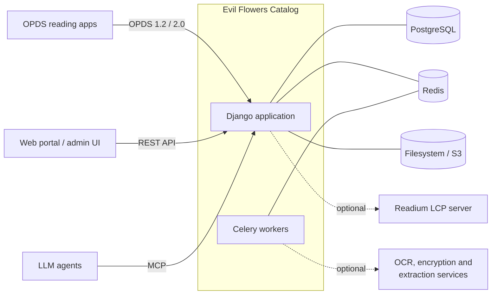

# Evil Flowers Catalog

<p align="center">
    
</p>

<p align="center">
    A self-hosted publication catalog and lending server, built on open standards.
</p>

<p align="center">
    <a href="https://specs.opds.io/opds-1.2">OPDS 1.2</a> ·
    <a href="https://drafts.opds.io/opds-2.0">OPDS 2.0</a> ·
    <a href="https://readium.org/lcp-specs/">Readium LCP</a> ·
    <a href="https://elvira.digital/EvilFlowersCatalog/">REST API</a> ·
    <a href="https://modelcontextprotocol.io/">MCP</a>
</p>

---

Evil Flowers Catalog is the server side of a digital library. It stores publications and their metadata, organises
them into catalogs and feeds, and makes them available to people and programs through standard protocols. Readers
can browse and borrow in any OPDS-capable app. Administrators and web frontends use the REST API. Copyrighted titles
can be lent with Readium LCP DRM, while open material is downloaded directly.

It is a backend. It does not ship an end-user web interface; see [Ecosystem](#ecosystem) for the frontends and
workers that are developed alongside it.

The catalog is general-purpose: a personal collection, a company knowledge base, a public or a research library
can all run on it. So far it has been used mostly by academic libraries, which explains features such as LDAP
sign-in, controlled lending and full-text search inside publications.

## Features

**Publishing and access**

- OPDS 1.2 (Atom) and OPDS 2.0 (JSON) feeds with navigation, search, facets and pagination. They work with
  e-readers and reading apps such as [Thorium Reader](https://thorium.edrlab.org/).
- Multiple catalogs on one instance, with per-catalog access levels (`read`, `write`, `manage`).
- Custom feeds and hierarchical categories for curating collections.
- Rich entry metadata: authors, languages, identifiers (ISBN, DOI), BibTeX import, covers and tables of contents.
- Several acquisitions per entry (formats, open access or restricted), with HTTP Range downloads.

**Lending**

- End-to-end [Readium LCP](https://readium.org/lcp-specs/) pipeline: encrypt, license, borrow, renew and return.
- Limited copies, a reservation queue and automatic license expiry.
- E-mail notifications for loans, reservations and reminders.

**Discovery**

- Full-text search in PostgreSQL with stemming, highlighting and "did you mean" suggestions.
- Optional hybrid ranking (BM25 + semantic embeddings) when an embedding service is configured.
- Search inside publications at the passage level, type-ahead suggestions and facet counts.
- Similar publications, ratings and reviews, reading history.

**Reading companions**

- Storage for annotations and highlights, used by the [EvilFlowersViewer](https://github.com/EvilFlowersCatalog/EvilFlowersViewer).
- Per-download PDF modifiers, for example personalised or sliced copies.
- An optional reading assistant that answers questions about the collection and cites pages. It runs on a
  self-hosted model, and LCP-protected titles are never passed to it.

**Integration**

- REST API with an auto-generated [OpenAPI specification](https://elvira.digital/EvilFlowersCatalog/) and
  [RFC 7807](https://datatracker.ietf.org/doc/html/rfc7807) error responses.
- A [Model Context Protocol](docs/catalog-wiki/Model-Context-Protocol.md) server, so LLM agents can search and,
  with permission, curate the catalog.
- Import from [Dataverse](https://dataverse.org/) through its publish workflow.
- Domain events through Celery or Kafka.

**Operations**

- Authentication with local accounts, LDAP, JWT (access and refresh tokens) and long-lived API keys.
- File storage on the local filesystem or any S3-compatible object store.
- Background work on Celery: OCR, LCP encryption, content extraction, scheduled sweeps and backups.
- OpenTelemetry traces, metrics and structured JSON logs, plus optional continuous profiling.

## How it fits together



Only PostgreSQL and Redis are required. Everything drawn with a dashed line is optional and enabled by
configuration.

A typical workflow:

1. An administrator creates a catalog and grants users access to it.
2. Publications are added through the REST API, the MCP server or a management command, and files are uploaded.
3. Entries are organised into feeds and categories.
4. Readers sign in from a web portal or add the OPDS URL (`/opds/v2/` or `/opds/v1.2/`) to their reading app,
   then browse, search, download or borrow.

## Getting started

### Requirements

- Python 3.12+ and [Poetry](https://python-poetry.org/)
- PostgreSQL 16+ with the `vector` ([pgvector](https://github.com/pgvector/pgvector)) and `pg_trgm` extensions.
  `pg_search` (BM25) and Apache AGE (library graph) are optional.
- Redis 7+

### Docker Compose (development)

The repository contains a [`compose.yml`](compose.yml) for local development. It starts PostgreSQL, Redis, the
Readium LCP server, the processing workers and a local Dataverse instance.

```bash
docker compose up -d --build
docker compose exec django python3 manage.py setup            # seed languages and currencies
docker compose exec django python3 manage.py createsuperuser
```

The API is then available at `http://localhost:8000`. Start the optional local Grafana/OpenTelemetry stack with
`docker compose --profile observability up -d otel-lgtm`.

> [!WARNING]
> `compose.yml` contains development-only secrets (`SECRET_KEY`, the JWK, tokens). Generate your own for any other
> environment.

A pre-built image is published to the GitHub Container Registry as
[`evilflowerscatalog`](https://github.com/EvilFlowersCatalog/EvilFlowersCatalog/pkgs/container/evilflowerscatalog).

### From source

```bash
poetry install                    # optional groups: --with s3,pdf,otel,kafka
cp .env.example .env              # then edit it, see below
python manage.py migrate
python manage.py setup
python manage.py createsuperuser
python manage.py runserver
```

In `.env`, at minimum, point `PG*` at your database, set `REDIS_HOST`, and set `SECURED_VIEW_JWK` to a private RSA
JWK used to sign tokens (for example from [mkjwk.org](https://mkjwk.org/)). Every variable is described in
[Settings & Enumerations](docs/catalog-wiki/Settings-&-Enumerations.md).

For background tasks, run a worker and the scheduler next to the web process:

```bash
celery -A evil_flowers_catalog worker -l info
celery -A evil_flowers_catalog beat -l info
```

### Optional components

| Component                       | What it enables                       | Guide                                                                      |
|---------------------------------|---------------------------------------|----------------------------------------------------------------------------|
| Readium LCP server + encryption | DRM-protected lending                 | [Readium LCP Deployment](docs/catalog-wiki/Readium-LCP-Deployment.md)      |
| S3-compatible storage           | Object storage instead of filesystem  | [Storage](docs/catalog-wiki/Storage.md)                                    |
| LDAP                            | Sign-in with institutional accounts   | [Security](docs/catalog-wiki/Security.md)                                  |
| Embedding service               | Semantic and hybrid search            | [Settings](docs/catalog-wiki/Settings-&-Enumerations.md)                   |
| Extraction services             | Passage search, figures, summaries    | [Asynchronous Tasks](docs/catalog-wiki/Asynchronous-Tasks.md)              |
| Self-hosted LLM                 | Reading assistant                     | [Settings](docs/catalog-wiki/Settings-&-Enumerations.md)                   |
| Dataverse                       | Dataset import on publish             | [Dataverse integration](#dataverse-integration)                            |

### Dataverse integration

The development stack includes a Dataverse instance at `http://localhost:8080` (user `dataverseAdmin`, password
`admin1`). When a dataset is published there, a pre-publish workflow calls the catalog. The catalog then imports the dataset as an entry with file acquisitions and lets Dataverse finish publishing.

1. Create an API token for the Dataverse admin, set it as `DATAVERSE_API_TOKEN` for the `django` service, then
   restart it with `docker compose up -d django`.
2. Register the workflow:
   ```bash
   conf/dataverse/scripts/hook.sh "$DATAVERSE_API_TOKEN" --url http://127.0.0.1:8080 \
       --trigger pre --file conf/dataverse/hooks/prepublish-sync.json
   ```
3. Publish a dataset from the Dataverse UI.

## Documentation

- **API reference**: the [OpenAPI specification](https://elvira.digital/EvilFlowersCatalog/), generated with
  `python manage.py openapi`.
- **Operator and contributor guides**: [`docs/catalog-wiki/`](docs/catalog-wiki/Home.md), mirrored on the
  [GitHub Wiki](https://github.com/EvilFlowersCatalog/EvilFlowersCatalog/wiki). Topics include
  [OPDS 2.0](docs/catalog-wiki/OPDS-2.md), [Readium LCP](docs/catalog-wiki/Readium-LCP-Integration.md),
  [Security](docs/catalog-wiki/Security.md), [Caching](docs/catalog-wiki/Caching.md),
  [Management commands](docs/catalog-wiki/Management-commands.md) and
  [Asynchronous tasks](docs/catalog-wiki/Asynchronous-Tasks.md).
- **Design decisions**: every feature starts as an implementation proposal (`IP-XXX`); see the
  [proposals index](docs/proposals/index.md).
- **Release notes**: [CHANGELOG.md](CHANGELOG.md).

The implementation follows these specifications:
[OPDS 1.2](https://specs.opds.io/opds-1.2),
[OPDS 2.0](https://drafts.opds.io/opds-2.0),
[Readium LCP](https://readium.org/lcp-specs/),
[Readium Web Publication Manifest](https://readium.org/webpub-manifest/),
[RFC 7807](https://datatracker.ietf.org/doc/html/rfc7807) (Problem Details),
[RFC 7617](https://datatracker.ietf.org/doc/html/rfc7617) (Basic auth),
[RFC 6750](https://datatracker.ietf.org/doc/html/rfc6750) (Bearer tokens) and
[RFC 7519](https://datatracker.ietf.org/doc/html/rfc7519) (JWT).

## Ecosystem

The catalog is the core of a set of related projects:

| Project                                                                                                  | Role                                               |
|----------------------------------------------------------------------------------------------------------|----------------------------------------------------|
| [elvira-portal](https://github.com/EvilFlowersCatalog/elvira-portal)                                     | Web frontend for readers and administrators        |
| [EvilFlowersViewer](https://github.com/EvilFlowersCatalog/EvilFlowersViewer)                             | In-browser PDF viewer with annotations             |
| [evilflowers-lcpencrypt-worker](https://github.com/EvilFlowersCatalog/evilflowers-lcpencrypt-worker)     | Readium LCP encryption worker                      |
| [evilflowers-ocr-worker](https://github.com/EvilFlowersCatalog/evilflowers-ocr-worker)                   | OCR for scanned PDFs                               |
| [evilflowers-analyzer-service](https://github.com/EvilFlowersCatalog/evilflowers-analyzer-service), [text](https://github.com/EvilFlowersCatalog/evilflowers-text-service), [image](https://github.com/EvilFlowersCatalog/evilflowers-image-service), [equation](https://github.com/EvilFlowersCatalog/evilflowers-equation-service) | Content extraction pipeline |
| [evilflowers-postgresql](https://github.com/EvilFlowersCatalog/evilflowers-postgresql)                   | PostgreSQL image with the required extensions      |
| [calibre-evilflowers](https://github.com/EvilFlowersCatalog/calibre-evilflowers)                         | Calibre plugin for syncing a library               |

## Project status

The server is in production use and under active development. OPDS 1.2, OPDS 2.0 and Readium LCP are
implemented end to end. The REST API still evolves between minor versions, so read the upgrade notes in the
[changelog](CHANGELOG.md) before updating. If you plan a deployment, we are happy to hear about it in
[Discussions](https://github.com/EvilFlowersCatalog/EvilFlowersCatalog/discussions).

## Contributing

Bug reports, questions and pull requests are welcome. Please read the [contributing guidelines](CONTRIBUTING.md)
and the [code of conduct](CODE_OF_CONDUCT.md). Larger changes start with a proposal in
[`docs/proposals/posts/`](docs/proposals/posts). Code is formatted with [Black](https://black.readthedocs.io/)
(line length 119).

## License

Released under the [MIT License](LICENSE).

## Acknowledgment

This open-source project is maintained by students and PhD candidates of the
[Faculty of Informatics and Information Technologies](https://www.fiit.stuba.sk/) at the Slovak University of
Technology. The software is used by the university in its educational and research activities. We appreciate the
faculty's support of our work and its contribution to the open-source community.


[BACKBONE, s.r.o.](https://www.backbone.sk/en/) actively supports the development of this project by providing
infrastructure, software licenses and staff.


