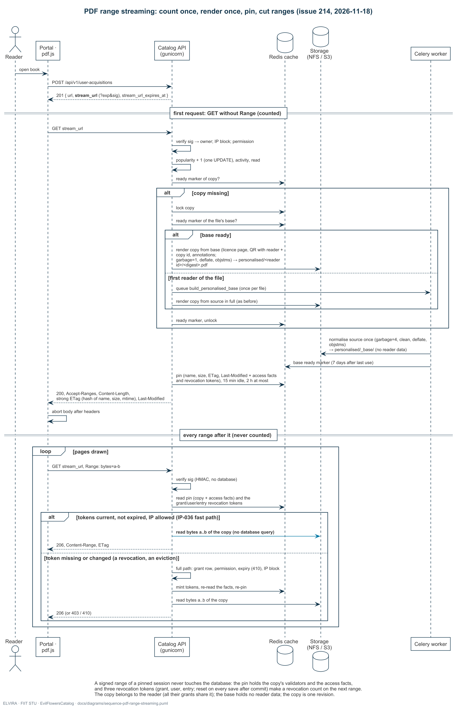

# Streaming publications to the viewer (#214)

The viewer (pdf.js `getDocument({url})`) reads a book in byte ranges: one plain
`GET` (headers only, then aborted), then `Range: bytes=…` requests of
`rangeChunkSize` (64 KiB by default) for the pages it draws. This page is the
server half of that contract. Rollout: knowledge#88.



## The contract

`GET|HEAD /data/v1/user-acquisitions/<id>` (and `/data/v1/acquisitions/<id>`, covers, thumbnails):

| Request | Answer |
|---|---|
| no `Range` | `200`, whole file, `Accept-Ranges: bytes`, `Content-Length` |
| `Range: bytes=a-b` (one range) | `206`, `Content-Range: bytes a-b/size`, only those bytes |
| range starting past the end | `416`, `Content-Range: bytes */size` |
| several ranges, other units, bad syntax | `200`, whole file (ignoring `Range` is always allowed) |
| `If-Range` equal to our strong `ETag` (or exactly our `Last-Modified`, file older than 1 s) | `206` as asked |
| any other `If-Range` (weak tag, other tag, other date) | `200`, whole file |
| `HEAD` | the same headers, no body |

Every answer carries a strong `ETag` (`"<hash of name, size, mtime in µs>-<size>"`)
and `Last-Modified`. For a personalised copy the name alone is not enough: it is a
digest of the copy's inputs, and a copy evicted and rendered again under the same
name has other bytes (`generated_at`). The modification time tells them apart, so
an `If-Range` never approves ranges of two renders.

No compression: pdf.js turns ranges off when it sees `Content-Encoding`. The
GZip middleware skips every response with `Accept-Ranges` (`apps/api/middleware/gzip.py`).

**CORS.** `Accept-Ranges`, `Content-Range`, `ETag` and `Content-Disposition` are
in `CORS_EXPOSE_HEADERS`: none is CORS-safelisted, and a cross-origin viewer
that cannot read them silently downloads the whole file.

### Counting

A client that sends only `Range: bytes=0-` downloads the whole file uncounted;
that is the price of the simple rule, and pdf.js never does it.

Only a `GET` without `Range` counts as an open: `popularity` + 1 (one
`UPDATE … SET popularity = popularity + 1`, no `entry.save()`), `ENTRY_DOWNLOADED`,
a read event, the `acquisition_served` metric. Every range (`bytes=0-…`
included) and every `HEAD` is part of an open already counted. One open in the
viewer counts once, whichever path serves the bytes.

### Signed URL (`stream_url`)

pdf.js sends the same `httpHeaders` with every range, and a bearer token can
expire mid-book; an `Authorization` header also costs a CORS preflight. The
user acquisition's JSON (`POST /api/v1/user-acquisitions`, `GET /api/v1/user-acquisitions/<id>`)
carries, for its owner only:

```json
"stream_url": "https://…/data/v1/user-acquisitions/<id>?exp=1763520000&sig=…",
"stream_url_expires_at": "2026-11-19T03:20:00Z"
```

- `sig` = HMAC-SHA256 (`SECRET_KEY`, salted) over the user acquisition id and `exp`.
  It names one user acquisition only.
- Reusable until `exp` (`EVILFLOWERS_FILES_SIGNED_URL_TTL`, default 6 h, rounded
  down to 5 minutes so the JSON stays revalidatable, never past the user
  acquisition's `expire_at`). Single-use links would break pdf.js.
- Like `access_token`, `sig` sits in the query string: keep query strings out of
  access logs and traces, or redact `sig` there.
- It stands in for the owner's credential (rate limited per user, not per IP).
  The owner must be active; the IP block and permission checks run on every request.
- A bad or expired signature: `403`. The viewer asks for a fresh `stream_url`.

The portal opens the book with `getDocument({url: stream_url})` and no headers.

## Time to the first byte

The first request waits for the personalised copy. Two things make it short:

1. **Shared base** (`EVILFLOWERS_PERSONALISED_SHARED_BASE=1`, the default). The
   expensive full rewrite (`garbage=4`, `clean`, deflate, object streams,
   encryption stripped) runs once per source file, **in a Celery worker**
   (`build_personalised_base`), and is stored under `personalised/_base/` (no
   reader data in it; same marker, lock and eviction as a copy, kept
   `EVILFLOWERS_PERSONALISED_BASE_IDLE_HOURS` = 168 h after its last use). A
   reader's copy is the base plus licence page, QR watermark and annotations,
   saved with `garbage=1, deflate, use_objstms`.

   The first reader of a file never waits for the base: building it costs about
   one full render plus a write, so that reader is rendered in full from the
   source, as before, and the build is queued (once per file, best effort: a
   broker outage only means the next reader is rendered in full too).

   MuPDF CPU, measured locally (PyMuPDF 1.28 / MuPDF 1.29, 6–10 MB books from the dev catalog):

   | pages | full render (first reader) | base (worker, once) | copy from base (later readers) |
   |---:|---:|---:|---:|
   | 233 | 1.13 s | 0.73 s | 0.31 s |
   | 365 | 0.83 s | 0.60 s | 0.36 s |
   | 642 | 2.32 s | 1.68 s | 0.73 s |
   | 273 | 1.24 s | 0.87 s | 0.37 s |
   | 198 | 0.42 s | 0.26 s | 0.20 s |

   The copy has the size of the full render. These are CPU times on a laptop;
   the NFS read and write on KU come on top and are not measured here (see the spans).
   The base costs about one source-size file of storage per recently read book.

2. **Spans.** `personalise.render` (MuPDF CPU) and `personalise.save` (the write to
   storage) inside the download span, labelled `evilflowers.personalise.kind`
   (`copy` or `base`) and the size written.

Rejected:

- **Incremental update** (`saveIncr` on a copy of the source): ~3× faster than the
  full render, but the copy then *starts with the clean source*: cutting the file
  at the original length gives the book without licence page or watermark, and
  pages a page range excludes stay in that prefix.
- **Linearisation**: MuPDF removed it (`save(linear=True)` raises); range-capable
  servers do better with normal PDFs.
- **Caching bytes in Redis or memcached**: every copy is personal, so a range is
  asked for once per reader; the hit rate would be close to zero. The kernel page
  cache already keeps hot files, bounded by the kernel.
- **nginx offload** (`X-Accel-Redirect` to a sidecar or the gateway nginx): every
  range still passes through Django for auth, IP block and licence, so nginx would
  take over only the transfer of a chunk, the short part under gevent; a sidecar
  per catalog pod is not worth the infrastructure. Decided against on 2026-11-18.

## Whose copy (IP-036)

`EVILFLOWERS_PERSONALISED_COPY_SCOPE` (`apps/files/copies.py`):

- `reader` (default): one copy per reader and variant, in `personalised/<user id>/`, shared by every grant of that
  reader with the same page range. The licence page and QR carry the reader (name, id) and a **copy id** (the
  copy's digest); the `ENTRY_DOWNLOADED` activity records grant and copy id. Re-opens never render again. A shared
  grant is watermarked with whoever signed in opens it; anonymous recipients get a per-request render as before.
- `grant`: one copy per grant, in `personalised/<grant id>/`, watermarked with the grant id (before IP-036).

**Pre-render** (`EVILFLOWERS_PERSONALISED_PRERENDER`, on): a new personal grant of a PDF (`POST
/api/v1/user-acquisitions`) queues `prerender_personalised_copy` after commit with a 15 s countdown. A GET that
follows at once takes the render lock itself and the task then finds the copy ready; a later GET finds it rendered.
`AcquisitionDownload` creates grants it redirects to at once, so it never queues one.

## Each range after the first

The first request of a session (no `Range`) resolves the copy and **pins** it:
name, size, ETag, Last-Modified in the cache for 15 minutes after the last use and
2 hours at most (`personalised.pin`). The owner's pin is keyed by grant and query
only; another reader of a shared grant has their own.

**Full path** (bearer tokens, IP-036 Q5): the user acquisition lookup, the
permission and IP checks, the pin and the bytes; not the authors query, the
source `stat`, the annotation query or the copy `stat`.

**Fast path** (signed `stream_url`, `EVILFLOWERS_FILES_RANGE_FAST_PATH`, on): the
owner's pin also holds the access facts (owner, entry, `expire_at`, IP-block flag)
and three **revocation tokens** (grant, user, entry; `apps/files/revocation.py`). A
signed range checks the HMAC, reads the pin and the tokens (four cache round trips:
the pin, two touches, the tokens),
checks expiry and the IP block in memory and serves the bytes: **no database query,
no rate limit, no authentication backend.** Anything it cannot vouch for goes to
the full path, which answers with the usual checks.

Revocation is immediate:

- every save or delete of a grant, user or entry drops its token after commit,
  so any pin made before stops matching on the next range (a cache error there is
  logged, never fails the save; the revocation is then late by at most the pin's
  2 h maximum age);
- a missing token (eviction, flush) means "unknown": full path, which mints a new
  one and re-pins. Eviction costs speed, never safety;
- tokens are read before the grant's facts are re-read when pinning, so a
  revocation that commits in between leaves a pin that is stale at once;
- `QuerySet.update()` sends no signal: code that changes grants, users'
  `is_active` or entries' `config` that way must call `revocation.revoke()`.

A pin is dropped with its copy's marker; a new open always re-resolves (an edited
annotation shows).

**Viewer side** (EvilFlowersViewer#151): `rangeChunkSize` is the largest lever
left. 64 KiB means ~100 requests for a 6.7 MB book; 512 KiB–1 MiB cuts that 8–16×.

## Sending the bytes

The range is read from storage and streamed by the gunicorn (gevent) worker.
Object storage (S3) asks the store for exactly the range (`open_range`).

The proxies in front of the catalog must pass ranges through untouched: no
`gzip` of `application/pdf`, no `proxy_cache` of `/data/v1/user-acquisitions`
(per user), and `proxy_buffering off` on that location at the edge
(knowledge#88).

## EPUB and Readium

Readium Web (readium.org/web) reads EPUB through a Readium Web Publication
Manifest and per-resource URLs from a streamer; it lists PDF as planned, not
supported. Nothing here changes for it: EPUB downloads get the same Range,
validators and counting.

## Verify

```sh
curl -sI -H 'Range: bytes=0-65535' "$STREAM_URL"                       # 206, Content-Range, Accept-Ranges, ETag
curl -sI -H 'Range: bytes=0-65535' -H "Origin: $PORTAL" "$STREAM_URL"  # Access-Control-Expose-Headers lists them
curl -sI -H 'Range: bytes=0-9' -H "If-Range: $ETAG" "$STREAM_URL"       # 206 while the copy is unchanged
```

- One open in the viewer (url mode) = popularity + 1.
- Trace of the first request: `personalise.render` (+ `personalise.save`); of a
  range: no `personalise.*` span.
