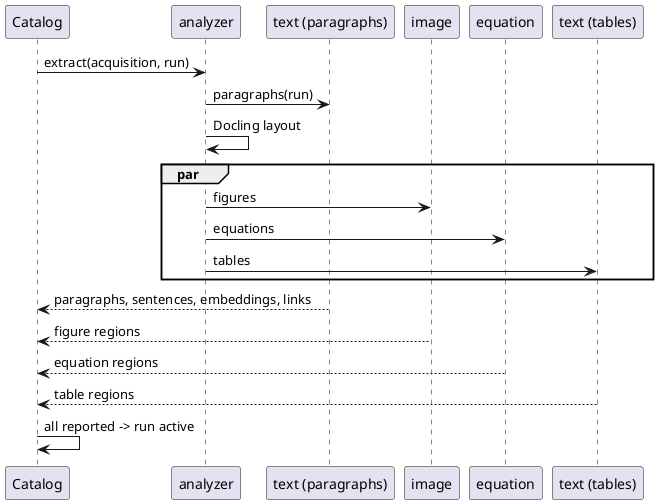

# IP-018: Intelligent Viewer

Every PDF uploaded to the catalog is analysed once, right after upload. Its figures, tables and
equations are found, cropped and described, and their exact position on the page is stored. The
reader's viewer can then show what the catalog knows about any of them, and the assistant can read
them. On top of that, the assistant can mark the sentences that answer a reader's question as an
**agent annotation**: an ordinary `Annotation` next to the reader's own, whose highlights also carry
their text, position and order, so they can be searched and stepped through.

<!-- more -->

## Status

**Status**: Draft
**Last Updated**: 2026-11-04
**Implementation**: In progress. Phase 6 (agent annotations, and the reader's own text highlights)
is built and running on dev; chats bound to a user acquisition (Phase 5) shipped with IP-015.
Phases 1–6b are built (2026-11-03) and run end to end on dev since 2026-11-04: the catalog on
`develop`, each service on its `main` with a published `:main` image, the services started on the
server with the `extraction` profile, and the portal showing regions in the viewer. Dev stays on
trial for a few days; then the dev backfill, then Phase 7. Phase 8 collects what the first days on
dev asked for: tables, contents tabs, captions, chat tools, recommendations.

This is a **parallel proposal**. It overlaps with [IP-012](ip-012-ai-powered-discovery.md),
[IP-013](ip-013-document-extraction-structure.md) and [IP-015](ip-015-assistant-fold-in.md), but it
does not wait for them and they do not wait for it. Where two proposals describe the same piece,
**whichever is implemented first owns it** and the other adapts to what shipped. See
[Relationship to other proposals](#relationship-to-other-proposals) for each overlap, including the
statements this proposal directly contradicts.

## Relationship to other proposals

### Parallel rule

- A shared piece (the extraction models, the service task contracts, the storage layout) is
  defined by whichever proposal implements it first.
- The later proposal updates its own text to build on what exists instead of re-specifying it, and
  logs that in its Changelog.
- Contradictions listed below are resolved in favour of this proposal **for the viewer use case
  only**. They do not change the goals of the other proposals.

### Overlaps and contradictions

| Proposal | What it says | What IP-018 says | Kind |
|---|---|---|---|
| IP-013 [Scope & non-goals](ip-013-document-extraction-structure.md#scope-non-goals) | "Explicit non-goal: read-time PDF highlight/anchoring … no per-passage highlight quads, no anchor resolver … and no new Viewer highlight render path." | Agent highlights are stored as positioned areas on the page and shown in the viewer. Quotes are resolved to page positions. | **Deprecated** (see below) |
| IP-013 [Review Q2](ip-013-document-extraction-structure.md#q2-read-time-anchoring-deferred-text-based-stored-bboxes-or-hybrid) | Answered "do NOT build monad-knowledge-style highlighting". | Builds exactly that, limited to agent highlight layers. | **Deprecated** (see below) |
| IP-013 [Scope & non-goals](ip-013-document-extraction-structure.md#scope-non-goals) | "Feature bounding boxes are kept only for cropping/display of figures/tables." | Feature positions are a first-class output: the viewer uses them to locate each figure, table and equation on the reader's page. | **Contradiction** (narrow) |
| IP-013 [Proposed Solution](ip-013-document-extraction-structure.md#proposed-solution) | `apps/extraction` runs on the IP-012 `discovery` worker image, folded into the catalog. | No extraction code is folded into the catalog. Extraction runs in the `evilflowers-*-service` repositories, each building its own image; the catalog compose only pulls pinned builds. | **Contradiction** (where the code lives) |
| IP-012 [Phase 1](ip-012-ai-powered-discovery.md#phase-1-event-driven-indexing-pipeline-replaces-61) | Retire `text-service` and `search-service`. | Both are **updated**, not retired: they stay in compose, are refactored in their own repositories and brought back to a running state. | **Contradiction** |
| IP-012 (chunk index) | Chunking and embeddings belong to IP-012's catalog-wide index (BGE-M3, pgvector, RRF). | Every paragraph of a PDF is embedded **during extraction** (Snowflake Arctic Embed by default, in pgvector), as one job running in parallel with figures, tables and equations, so the highlight agent can rank paragraphs by meaning. Catalog-wide search, recommendations and the fusion stay with IP-012, which may reuse these vectors. | **Contradiction** (narrow) |
| IP-013 [Data Model Changes](ip-013-document-extraction-structure.md#data-model-changes) | Separate `extraction_figure`, `extraction_table`, `extraction_equation` tables. | One `extraction_region` table with a `kind`. Whichever lands first decides. | Overlap (schema) |
| IP-013 [Phase 2](ip-013-document-extraction-structure.md#phase-2-feature-extraction-docling-figures-tables-math-images) and [Phase 3](ip-013-document-extraction-structure.md#phase-3-classification-captioning) | Docling feature extraction, then VLM captions and classification. | Same tools and steps, but triggered on upload for the viewer. Sections, passages and subject classification stay with IP-013. | Overlap (shared work) |
| IP-015 [D1](ip-015-assistant-fold-in.md#d1-tool-set-exactly-three-read-only) | The chat assistant has exactly three read-only tools. | No tool-count limit (Q5); reading is bounded by a page budget instead. Region tools for the viewer context, and an agent that **writes** an annotation through its own endpoint. | **Contradiction** (tool set) |
| IP-015 [D12](ip-015-assistant-fold-in.md#d12-relationship-to-ip-012) | The assistant has no retrieval work. | Unchanged. IP-018 tools read one publication the reader has open, which is not catalog-wide retrieval. | Compatible |

### Deprecated: IP-013's highlighting non-goal

IP-013 ruled out read-time highlighting by pointing at monad-knowledge's `highlights.py` as the
machinery to avoid. That module has changed in monad-knowledge since IP-013 was resolved, so the
reasoning behind the non-goal no longer holds. **The non-goal and the IP-013 Q2 answer are
deprecated** as far as highlighting is concerned; IP-018 owns highlighting. IP-013 itself is
amended in a separate change (see [Q3](#q3-should-ip-013-be-amended-now-or-after-this-proposal-is-accepted)).

What changed in monad-knowledge (read 2026-10-28 at `988d0efdd`, `monad_knowledge/reading/highlights.py`,
IP-171 and IP-175 there): the old module matched whole paragraphs to claims by token overlap and
leaned on stored Neo4j bounding boxes. Since 2026-10-16 it is a deterministic, model-free
resolver: the extractor stores the exact evidence sentence of every claim as an offset into its
paragraph text, and at highlight time PyMuPDF finds that sentence on the page (`exact`), or most
of it in six-word windows (`partial`), or reports it `missed`. Over 63 papers it located 12,647 of
13,408 sentences (7,488 exact, 5,159 partial) and missed 761 (5.7 %). That is the machinery IP-018
reuses for agent highlights; see [Quote resolution](#quote-resolution).

## Problem Statement

A reader in the viewer sees a figure, a table or a formula as pixels. The catalog has no idea
what is on the page or where. Asking the assistant about a figure means describing it in words.
Asking it to "teach me X from this book" gets a summary, not a path through the book itself.

### Current state (verified 2026-10-27)

- **Extraction prototypes exist but are disconnected.** Seven `EvilFlowersCatalog/evilflowers-*-service`
  repositories hold extraction work:
    - `evilflowers-image-service`: pdfplumber crops, PaliGemma captions, ViT/ResNet labels, Kafka
      consumer writing to Elasticsearch. It computes each image's bounding box and then **discards
      it**, keeping only the page number. The caption model is loaded again for every image.
    - `evilflowers-equation-service`: Nougat page-to-LaTeX plus a regex. Region detection is a
      `TODO`, and the extractor only processes one page (`pages[1:2]`, marked "Remove after testing").
    - `evilflowers-analyzer-service`: PyMuPDF metadata and table of contents, Kafka orchestrator.
    - `evilflowers-video-service`: Whisper transcription. Out of scope.
    - `evilflowers-text-service`: Celery worker on queue `evilflowers_text_worker`. Chunks text and
      posts it to `search-service`. It extracts tables with pdfplumber and then **drops them**.
    - `evilflowers-search-service`: FastAPI over Milvus Lite and Elasticsearch.
    - `evilflowers-text-service-tp2025`: a fork of the text service.
- **The catalog only talks to two of them.** `apps/dataverse/services/text_publish.py` enqueues
  `evilflowers_text_worker.process_pdf` on every PDF upload (`apps/api/services/entry.py`), and
  `apps/api/services/search_service_client.py` lets OPDS 2.0 search query `search-service`. Both
  are in the development `compose.yml` only, which pulls `ghcr.io/evilflowerscatalog/evilflowers-text-service:main`
  and `ghcr.io/evilflowerscatalog/evilflowers-search-service:main`. Both images are out of date, and
  the containers are not running. Text-service already receives `CATALOG_API_URL` and
  `CATALOG_SECRET_KEY`, so a service writing back to the catalog over HTTP is an existing pattern.
- **The assistant can already read a reader's copy.** `apps/assistant/pdf.py` (`ReaderDocument`)
  rebuilds the viewer's page numbering over the original file, and `apps/assistant/explain.py`
  uses it with the `read_pdf_page` and `search_pdf` tools.
- **Annotations are already layers, but their content is only drawings.** An `Annotation` has a
  `title` and belongs to a `UserAcquisition`. The viewer treats it as a named group of drawings
  (`saveGroupFunc` / `getGroupsFunc`). Each `AnnotationItem` holds one page of that group as an SVG
  string in `content`. The `annotations` filter already limits non-superusers to their own
  annotations. `UserAcquisitionDownload` with `?annotations=true` draws the SVG `rect`, `line` and
  `circle` elements into the downloaded PDF (`apps/core/modifiers/pdf/annotations.py`). The catalog
  cannot search highlights, list them by text or point to one. The viewer has two layers, freehand
  **drawing** and manual **highlight**; this proposal adds the agent as the **third**. Nothing in the
  schema records which layer an annotation is. Page bookmarks are a further annotation, recognised
  only by the magic title `__page_bookmarks__`.

### Production state (2026-10-27)

`docker ps` on the production host lists only these containers:

| Container | Role |
|---|---|
| `evilflowers` | Catalog: gunicorn, Celery worker (default queue), Celery beat, event handler (`conf/supervisor.conf`) |
| `readium` | Readium LCP license server |
| `letsencrypt` | TLS termination |
| Flower | Celery monitoring dashboard |

**None of the `evilflowers-*-service` containers run in production**: not `text-service`, not
`search-service`, and not image, equation, analyzer or video. The `ocr-worker` and
`lcpencrypt-worker` from the development compose are not running either.

Consequences:

- Every PDF upload still enqueues `evilflowers_text_worker.process_pdf`, and nothing consumes that
  queue. Tasks are expected to accumulate in Redis. This needs checking in Flower.
- No production feature depends on any of the service repositories, so refactoring them, changing
  their task contracts or dropping Kafka breaks nothing in production.
- PostgreSQL and Redis are not containers on this host. Where they run is not yet recorded here.

Production storage is confirmed as `FileSystemStorage`, mounted from
`/opt/elvira-devops/environments/production/storage` to `/var/local/evilflowers`.

## Proposed Solution

### Overview

1. **Extract on upload.** When a PDF acquisition is stored, the catalog queues an extraction task
   for the service containers. They find every figure, table and equation, record its page and
   position, crop it to an image, and describe it: a caption and category for figures, markdown for
   tables, LaTeX for equations. Results are written back to the catalog, which owns the schema.
   The extraction code lives in the `evilflowers-*-service` repositories, not in the catalog.
   In the same run, and in parallel with those jobs, every paragraph is stored with its sentences
   and positions and embedded, so passages can be found by meaning (see
   [Paragraph index](#paragraph-index)).
2. **Expose it per reader.** An API returns the regions on a given page **in the reader's own page
   numbering**, only for pages the reader may see, with an authorized route for each crop.
3. **Give the assistant the same view.** The explain agent and the chat assistant, when opened for
   a publication, can list and read regions alongside page text.
4. **Agent annotations.** The assistant can answer a request by marking the relevant sentences in
   the book. The result is a regular `Annotation` of kind `agent`, holding the prompt and a short
   summary. Each highlight is an `AnnotationItem` with its text, position and order, plus an SVG in
   `content` generated by the server, so everything that already displays or exports annotations
   handles agent annotations unchanged.
5. **Backfill.** A command runs the same extraction for every PDF already in the catalog.

### Scope

**In scope**

- Figure, table and equation extraction with positions, on upload and as a backfill.
- Captions and categories for figures; markdown for tables; LaTeX for equations.
- A paragraph index per acquisition, built during extraction: paragraph text, sentence offsets,
  positions, one embedding per paragraph, and the links between paragraphs (Phase 2b).
- Highlight finding by meaning over that index, at sentence level (Phase 6b).
- Region and crop APIs scoped to a user's acquisition.
- Assistant tools for regions; explain accepts a region.
- Agent annotations: new fields on `Annotation` and `AnnotationItem`, generation, API.
- Storage, versioning and clean-up of extraction output.
- Refactoring the service repositories (image, equation, analyzer, text, search) in place: drop
  Kafka for Celery on the existing broker, keep positions, fix the known defects, publish images
  from each repository's own CI.
- Updating `text-service` and `search-service`, which are in compose but down and out of date, and
  running the whole compose end to end.
- Compose changes only on the catalog side: service entries pulling pinned image builds, in the
  development compose and the production compose.

**Out of scope**

- Any user interface. Viewer behaviour is prototyped separately and not specified here.
- Sections, passages, page labels and subject classification
  ([IP-013](ip-013-document-extraction-structure.md) Phases 1 and 3).
- Catalog-wide search, recommendations and ranking fusion ([IP-012](ip-012-ai-powered-discovery.md)).
  Paragraph embeddings of one publication are in scope; searching across publications is not.
- EPUB and other formats. PDF only.
- Folding any extraction code into the catalog repository or the catalog image.
- `evilflowers-video-service`. `evilflowers-text-service-tp2025` is not deployed, but its
  paragraph indexer (`src/semantic/`) is the starting point for Phase 2b and is ported into
  `evilflowers-text-service`.
- Adding text and positions to existing reader annotations. They keep only their SVG.

### How it runs

**No extraction code is folded into the catalog.** Each piece of extraction stays in its own
`EvilFlowersCatalog/evilflowers-*-service` repository, is refactored there, and is published as an
image by that repository's CI to `ghcr.io/evilflowerscatalog/<repo>`. The catalog repository
changes only its compose files, which pull the correct, pinned build of each service.

| Repository | Role after the refactor |
|---|---|
| `evilflowers-analyzer-service` | Entry point for a document: opens the PDF, records page count and sizes, starts the paragraph job at once, runs layout detection once and hands regions to the other services by kind (see [Q11](#q11-where-does-layout-detection-run)) |
| `evilflowers-image-service` | Figures: crop, size/aspect/coverage gates, caption and category. Keeps the bounding box |
| `evilflowers-equation-service` | Equations: LaTeX for each detected region, sympy normalization, crop |
| `evilflowers-text-service` | Text as today, plus tables: markdown, caption, crop and position instead of dropping them. Plus the paragraph index: paragraphs, sentences, positions, embeddings and links (Phase 2b) |

**All extraction jobs of a run go in parallel.** The paragraph job needs only the PDF's text layer
(PyMuPDF blocks), not Docling's layout, so the analyzer dispatches it as soon as it opens the
document, next to the layout pass. Figures, tables and equations follow as layout finds them. Each
job reports to the catalog on its own; the run becomes active when all of them have reported. A
slow caption model does not hold back the paragraph index, and the reverse.


| `evilflowers-search-service` | Updated dependencies and image; stays the OPDS 2.0 search backend behind `SEARCH_SERVICE_URL` |

What the catalog keeps:

- The schema: `ExtractionRun`, `Region` and the annotation fields, in a small `apps/extraction`
  app with models, dispatch and ingestion only, no pipeline code.
- Dispatch: `app.send_task(...)` by task name and queue, exactly like
  `apps/dataverse/services/text_publish.py` does today.
- Ingestion: an internal endpoint the services post their results to, authenticated with a service
  credential (see [Q12](#q12-how-do-services-hand-results-back-to-the-catalog)).
- All reader-facing APIs, the assistant tools and agent annotations.

```yaml
# catalog compose (development and production): image references only
evilflowers-analyzer-service:
  image: ghcr.io/evilflowerscatalog/evilflowers-analyzer-service:<pinned tag>
  environment:
    REDIS_URL: redis://redis:6379/7
    STORAGE_PATH: /mnt/data
    CATALOG_API_URL: http://django:8000
    CATALOG_SERVICE_TOKEN: ${EXTRACTION_SERVICE_TOKEN}
  volumes:
    - <catalog storage>:/mnt/data
    - extraction-models:/models
# ...same shape for image-, equation-, text- and search-service
```

- Services talk to each other and to the catalog over Celery on the existing Redis broker. Kafka is
  removed from every service, because production does not run it.
- The catalog's own Celery worker does not listen on any service queue, so heavy work never runs
  next to gunicorn, and the catalog image gains no Docling or torch dependency.
- Services read the original PDF and write crops through the same storage mount as the catalog
  (`/var/local/evilflowers` in production). They run with the catalog's UID so the catalog can
  delete what they write.
- Model weights are kept in a volume, not in the images.
- Flower, already in production, shows every service queue and the backfill progress.
- The catalog records which service image tags produced a run (`provenance`), and
  `EVILFLOWERS_EXTRACTION_PIPELINE_VERSION` is bumped whenever the pinned tags change output.

## Implementation Plan

Work happens in the repository that owns it. Catalog phases change this repository; service phases
are done in each `evilflowers-*-service` repository, end with a published image, and touch the
catalog only through a compose image reference.

### Phase 1: Catalog schema, dispatch and ingestion (catalog repository)

- [x] Create `apps/extraction` with `ExtractionRun` and `Region` models and migrations
      (see [Data Model Changes](#data-model-changes)). No pipeline code. *Changed:* one migration
      (`extraction/0001_initial`) holds all extraction tables including the paragraph index, so it
      adds the `pgvector` dependency and enables the `vector` extension.
- [x] Storage layout `catalogs/<catalog>/<entry>/extraction/<acquisition_id>/v<N>/`, documented as
      the contract the services write to (`ExtractionRun.storage_dir`, sent to every task as
      `output_dir`).
- [x] Remove the acquisition's `extraction/` folder in `AcquisitionStorageService.delete`.
- [x] Dispatch in `apps/extraction/services.py`: `send_task("evilflowers_analyzer.extract")` to
      `EVILFLOWERS_EXTRACTION_QUEUE` with task id `uuid5(namespace, "extract:<acquisition_id>:v<pipeline_version>")`
      (`services.task_id`; a UUID because `JobProtocol` and the event listener require one, #108),
      sent once the transaction commits. Creates the `ExtractionRun` with `status = queued`; a failed
      run of the same version is reset and sent again. Off unless `EVILFLOWERS_EXTRACTION_ENABLED`.
- [x] Ingestion endpoints under `/extraction/v1/runs/{id}` (`start`, `regions`, `paragraphs`,
      `jobs/{job}`, and `GET` of the run), part of the OpenAPI spec, authenticated with a bearer API
      key of a user holding `extraction.ingest_extraction` (Q12). Results for a run that is not
      `running` answer 409.
- [x] The analyzer declares the run's jobs when it starts it (`ExtractionRun.jobs`); when the last
      job reports, the run becomes active in one transaction and the previous run is deleted with
      its files. A failed job fails the run and the previous active run stays.

### Phase 2: Service refactor (service repositories)

Common to every service:

- [x] Replace Kafka consumers and producers with Celery workers on named queues over Redis
      (`evilflowers_analyzer`, `evilflowers_image`, `evilflowers_equation`, `evilflowers_text_worker`,
      `evilflowers_text_embed`).
- [x] Read the original PDF and write crops through the shared storage mount, using the catalog's
      storage layout.
- [x] Report results to the catalog ingestion endpoint; never write to the catalog database.
      *Changed:* a small `src/catalog.py` HTTP client in each service (retries, batches of 100,
      409 stops the job) instead of `evilflowers-protocol-python`, whose generated client lacks the
      ingestion endpoints until the spec is synced; the endpoints are in the OpenAPI spec.
- [x] Load models once per worker process, not per item.
- [x] Failures on one page or one region are logged and skipped. A document never fails as a whole
      because of one bad region.
- [x] CI runs the unit tests and builds and publishes `:main`, `:sha-…` and semver-tagged images to
      `ghcr.io/evilflowerscatalog/<repo>`, recording `IMAGE_TAG` in the run's provenance.

Per service:

- [x] `evilflowers-analyzer-service`: open the PDF with PyMuPDF, record page count and page sizes,
      run the Docling layout pass in page batches, and fan regions out by kind (Q11). Captions
      printed next to figures and tables are passed along. *Changed:* no OCR: layout runs on page
      images and finds regions on scanned pages without it, and no extraction step uses OCR text.
- [x] `evilflowers-image-service`: keep the bounding box as page fractions with a top-left origin;
      crop to WebP; gates (under 80 px on a side, aspect ratio over 8, over 90% of the page);
      captions and categories by a multimodal model behind an Ollama endpoint, off by default
      (`CAPTIONS_ENABLED`, `CAPTION_MODEL`; the model is still open, Q8). PaliGemma and the ViT/ResNet
      labellers are removed.
- [x] `evilflowers-equation-service`: region detection comes from the analyzer (Q11) for every page
      (the `pages[1:2]` limit is gone with the Nougat code); LaTeX per region with LaTeX-OCR on ONNX
      Runtime (`LATEX_BACKEND=onnx`, or `ollama`), sympy normalization where it parses (kept in the
      region's `provenance.sympy`; `latex` holds the model's LaTeX), crop.
- [x] `evilflowers-text-service`: tables found by the analyzer are read with pdfplumber into markdown,
      cropped and reported with caption and position (`evilflowers_text_worker.tables`); text
      processing against `search-service` is unchanged and no longer extracts tables it drops.

### Phase 2b: Paragraph index (text-service and catalog)

Runs as its own job of the extraction run, in parallel with figures, tables and equations (see
[How it runs](#how-it-runs)).

- [x] Analyzer dispatches the paragraph job when it opens the document, before the layout pass.
- [x] `evilflowers-text-service`: split each page into paragraphs from PyMuPDF text blocks, keeping
      each paragraph's page and bounding box. Port the filters from
      `evilflowers-text-service-tp2025` `src/semantic/indexer.py` (`_is_valid_paragraph`: minimum
      length, table-of-contents boilerplate). Running heads and footers repeated across pages are
      dropped.
- [x] Split each paragraph into sentences and store character offsets into the paragraph text,
      plus each sentence's quads on the page, so a sentence can be highlighted without resolving a
      quote. *Changed:* quads come from the words the paragraph is built from (one box per line the
      sentence covers), not from `search_for`, so a repeated sentence is never placed on the wrong
      line.
- [x] Embed every paragraph with `EMBEDDING_MODEL` (default Snowflake Arctic Embed v2.0; BGE-M3,
      `stsb-xlm-r-multilingual` or another sentence-transformers model selectable, Q16), loaded
      once per worker, batched. The paragraph is embedded with its section title prefixed, as
      monad-knowledge's chunker does. The model name goes into the run's `provenance`.
- [ ] Confirm the Arctic Embed v2.0 size (`-m` or `-l`) and its dimension on a sample of Slovak
      and English requests; the pgvector column takes that dimension. *For now:* `-m` (768
      dimensions, the same as stsb-xlm-r-multilingual), `EMBEDDING_DIMENSIONS` in
      `apps/extraction/models.py`.
- [x] Build the paragraph links (see [Paragraph index](#paragraph-index)): `next` within the reading
      order, `section` from the PDF outline, and `similar` to the k nearest paragraphs of the same
      publication (`SIMILAR_LINKS_K`, above `SIMILAR_MIN_SCORE`).
- [x] Report paragraphs, sentences, embeddings and links to the catalog ingestion endpoint (Q12),
      in batches with the links in the last one. text-service keeps no vector store of its own;
      tp2025's Milvus writer is not ported (Q15).
- [x] Catalog: enable the pgvector `vector` extension; `extraction_paragraph` (with the
      `embedding` column and an HNSW cosine index), `extraction_sentence` and
      `extraction_paragraph_link` tables in the IP-018 migration; paragraphs of the inactive run are
      deleted with it.

### Phase 3: Text and search services back up

- [x] `evilflowers-text-service`: update dependencies and base image, fix whatever keeps the
      container down, publish a new build. The ToC layout model (`*.pt`, never in the image) is
      fetched on demand instead of crashing; models live in `/models`.
- [x] `evilflowers-search-service`: update dependencies and base image, fix whatever keeps the
      container down, publish a new build. The image started `src.api:app`, which does not exist,
      and `Config` crashed without Milvus variables; it now runs `main:app` on Milvus Lite and
      starts without Elasticsearch. `search_service_client.py` is unchanged.
- [x] Catalog `compose.yml` (development): keep `:main` for every service (Q13) and add the
      analyzer, image, equation and text-embed services; PostgreSQL is `pgvector/pgvector:pg16`.
      The server's development and production composes (`elvira-devops`) carry the same services
      under the `extraction` profile, `:main` in development and `EXTRACTION_RELEASE` in production.
- [ ] Run the full development compose end to end: upload a PDF, see the text task consumed, the
      extraction run reach `done`, regions and crops present, and OPDS 2.0 search answering.
      *2026-11-04, dev:* everything but search. Runs reach `done` with every job reported, e.g. a
      385-page book (Docling about 1 minute per 16 pages on 4 CPU threads, so about 25 minutes):
      42 regions, 2411 paragraphs, crops served to the viewer. pgvector 0.8.7 was already on the
      shared PostgreSQL 18, so no image change was needed. search-service runs, but dev has no
      Elasticsearch, so keyword search fails; the semantic path does not use it. Fixed on the way:
      equation-service CI (sympy 1.14 leaves `parse_latex` unevaluated), text-service on PDFs
      without a text layer (an empty paragraph batch was rejected and the job never reported),
      Arctic Embed under transformers 5 (non-persistent buffers left uninitialized: pinned
      `transformers<5`), garbled markdown for rotated tables (dropped, the crop is kept), and
      text-embed's IP clashing with dataverse on dev (now `172.28.20.12`). Still open: Docling
      counts tables of contents and indexes as tables, and on a landscape page it boxed only part
      of the table.

### Phase 3b: Triggers and backfill (catalog repository)

- [x] Queue extraction wherever a PDF acquisition file is stored: `attach_acquisition` (API upload
      and MCP upload links) and `EntryService.populate`. *Changed:* Dataverse sync stores external
      URLs, not files the services can read, so it queues nothing.
- [x] Re-queue when an acquisition's file is replaced. *Changed:* an acquisition's file cannot be
      replaced (`PUT /acquisitions/{id}` changes metadata only); `queue(force=True)` and
      `backfill_extraction --force` re-extract when that changes.
- [x] `manage.py backfill_extraction` with `--missing` (no active run), `--outdated` (older pipeline
      version), `--acquisition <id>`, `--force`, `--limit`, `--dry-run` and a rate limit (`--rate`
      per minute). Runs left `queued` or `running` are sent again.

### Phase 4: Reader API

- [x] Page mapping between original pages and reader pages, shared with
      `apps/assistant/pdf.py` instead of duplicated (`reader_source_pages`).
- [x] `GET /api/v1/user-acquisitions/<id>/regions?page=N` and `GET .../regions/<region_id>`.
- [x] `GET /data/v1/user-acquisitions/<id>/regions/<region_id>.webp` for the crop.
- [x] Access checks identical to `UserAcquisitionDownload`: `check_user_acquisition_read` and the
      IP block. Regions on pages outside the acquisition's range are never returned.
- [x] Extraction status per acquisition (`GET /api/v1/user-acquisitions/<id>/extraction`), so a
      client can tell "nothing found" from "not processed yet".
- [x] Portal: the viewer's `regionPackage` loads a page's regions from the API, with the crop URL
      carrying the access token for the `` (`elvira-portal` `dev`, 2026-11-04). The viewer's
      region card shows a table as its crop, without scrolling, and the markdown only without one
      (EvilFlowersViewer `develop`, unreleased with the full-text search fix as 0.7.4).

### Phase 5: Assistant access

- [x] Tools `list_page_regions(page)` and `get_region(region_id)` for the explain agent, the
      highlight agent and chats opened on a user acquisition; reading regions costs no page budget.
      *Changed:* the crop is not sent to the model; `get_region` returns caption, markdown or LaTeX.
- [x] `POST /assistant/v1/explain` accepts `region_id` as an alternative to selected text.
- [x] Chats can be bound to a user acquisition, giving them `read_pdf_page`, `search_pdf` and the
      region tools for that publication only.

### Phase 6: Agent annotations

- [x] Migration adding `kind`, `status`, `prompt`, `summary` and `unresolved_count` to
      `Annotation` (`core/0044_annotation_layers`; `model` left out until a second model exists). `kind` names the layer the annotation belongs to, matching the layers the
      viewer already has: `drawing` (freehand), `highlight` (manual text highlights) and `agent`
      (new). Existing rows get `drawing`. Rows titled `__page_bookmarks__`, which the portal uses as
      the page-bookmark container (`elvira-portal` `src/pages/common/Viewer.tsx`), get `bookmarks`.
- [x] Migration adding nullable `seq`, `match`, `quads`, `text` and `note` to `AnnotationItem`. Agent items
      always fill them. Manual `highlight` items may fill `text` and `quads` from the text selection,
      which makes them searchable the same way.
- [x] Highlight agent (`apps/assistant/highlight.py`): finds passages by agentic search (see
      [Finding passages](#finding-passages)), returns exact quotes in reading order, each with the
      reader page it read it on, a one-sentence summary and a short note per quote. It runs hidden:
      no chat is created and nothing of its conversation is stored.
- [x] Quote gate: a quote is kept only if it occurs in the text `read_pdf_page` returned for its
      page, tolerant of whitespace and hyphenated line breaks only; a quote on another page the agent
      read is kept with that page (monad-knowledge `locate_evidence`). A quote the model
      paraphrased is dropped here, before the PDF is searched, and counted in `unresolved_count`.
- [x] Quote resolution on the original file (`apps/assistant/quotes.py`), as described in [Quote resolution](#quote-resolution):
      `exact`, then `partial` six-word windows, else `missed`. Map the page to the reader's
      numbering, store the areas as page fractions and the method in `match`. Missed quotes are
      dropped and counted in `unresolved_count`. No model call.
- [x] Port monad-knowledge's resolver tests (`tests/reading/test_span_highlights.py`: exact,
      one changed word is partial, absent is missed) against a small generated PDF, plus the page
      mapping and the gate (`apps/assistant/tests/test_quotes.py`).
- [x] Generate `content` for each agent item: an SVG of `rect` elements, one per quad, in PDF
      points with a `viewBox` (Q7), so the existing PDF export draws it.
- [ ] One migration for all IP-018 schema: `extraction_run`, `extraction_region` (Q2), the
      annotation and item columns (Q9), and a data step converting existing reader SVG from screen
      pixels to PDF points (Q7). The viewer converts on save from then on. *Changed:* the annotation
      columns shipped first in their own migration (`core/0044`), so agent highlights did not wait for
      extraction; the region tables and the SVG conversion follow in theirs.
- [x] Highlight requests run as a Celery task (`apps/assistant/tasks.py`); the annotation starts
      `pending` (Q4). One left `pending` past `CELERY_TASK_TIME_LIMIT` is reported `failed`.
- [x] Endpoints: `POST /assistant/v1/highlights` requests an agent annotation from a prompt (202,
      `pending`); `GET /assistant/v1/highlights?user_acquisition_id=` lists them and
      `GET /assistant/v1/highlights/{id}` polls one, each with its highlights nested. Renaming and
      deleting use the existing `annotations` and `annotation-items` endpoints, which return `kind`
      and `status` and filter by `kind`.
- [x] Agent annotations: the reader may rename the title and delete one highlight or the whole
      annotation; creating or updating items of an agent annotation is rejected (Q10). The
      `annotations` endpoint cannot create one of kind `agent`.
- [x] Ownership is unchanged: `AnnotationFilter` already limits users to their own annotations.
- [x] Reader text highlights (kind `highlight`): annotation items accept and return `text` and
      `quads` (validated page fractions). With the viewer's `readerHighlightPackage` (viewer 0.7.3),
      "Zvýrazniť" stores the selection as an item of one `highlight` annotation per copy instead of
      painting it on the drawing layer, and the viewer lists them as "My highlights" beside the agent
      annotations, with the same jump, step and delete. Older drawing-layer highlights stay drawings.
- [x] Viewer fixes found while testing (0.7.2): text-layer spans were stretched over the whole page
      and missing pdf.js 6's `--total-scale-factor`, so selection landed on the wrong lines; `dark:`
      utilities followed a dark host page instead of the viewer's own theme. The portal now appends
      the viewer stylesheet last so its own same-named utilities cannot override the viewer's.
- [x] Portal: the viewer's `agentAnnotationPackage` is wired to these endpoints, polling while
      `pending`; agent annotations are kept out of the drawing layer's groups.

### Phase 6b: Semantic highlight finding

- [x] Tool `search_paragraphs(query)` for the highlight agent, explain and bound chats: embeds the
      query with the model recorded on the active run, ranks this acquisition's paragraphs by
      cosine similarity in pgvector, and returns every paragraph
      above `EVILFLOWERS_ASSISTANT_PARAGRAPH_MIN_SCORE`, capped at
      `EVILFLOWERS_ASSISTANT_PARAGRAPH_CANDIDATES`, with reader page and sentence ids. Pages outside
      the acquisition's range are never returned.
- [x] Highlight requests rank the paragraphs directly (`apps/assistant/semantic.py`,
      `apps/extraction/reader.py`), without a tool call: the request is embedded by text-service on
      `EVILFLOWERS_EXTRACTION_EMBED_QUEUE` with the model recorded on the run, and every paragraph
      above `EVILFLOWERS_ASSISTANT_PARAGRAPH_MIN_SCORE` (0.3), capped at
      `EVILFLOWERS_ASSISTANT_PARAGRAPH_CANDIDATES` (40), on pages of the acquisition's range is a
      candidate. The `search_paragraphs` tool above, for explain and chats, is not built yet.
- [x] Expansion over the links: each candidate brings its `next` neighbour and its `similar`
      paragraphs above the same threshold, one hop, so a passage that continues on the next
      paragraph or repeats the point elsewhere is not missed.
- [x] Sentence selection (Q17): all candidates go to the model at once, as numbered sentences with
      their paragraph's score. It keeps the sentences that answer the request, with a note each,
      and discards the rest, possibly all of them. The score only orders and filters candidates;
      it never makes a highlight by itself. Candidates beyond the model's context are sent in
      batches in score order and the kept sentences merged. No quote is copied, so nothing can be
      paraphrased: each highlight is a stored sentence with stored quads, `match = exact`.
- [x] `MAX_QUOTES` becomes a cap on sentences per annotation (the best-scored are kept), not the
      agent's stopping point; the number of highlights follows from the threshold.
- [x] Fallback: a publication without a paragraph index, or a request text-service cannot embed in
      `EVILFLOWERS_EXTRACTION_EMBED_TIMEOUT`, uses the agentic search of Phase 6 unchanged.
- [x] Report per annotation: candidate paragraphs, sentences shown and sentences kept, in the task's
      log line.

### Phase 8: Reader round on dev (2026-11-04)

What the first days on dev asked for. Each item lands as its own commit in the repository named.

**Tables** (EvilFlowersViewer)

- [x] The region card shows a table as a **grid of cells** (rows and columns from the extracted
      markdown), not as its crop. The crop is the fallback: a table without markdown, or markdown
      that does not parse into rows. A toggle switches between grid and crop.
- [x] **Copy as CSV** (and copy as Markdown) on every table card; the CSV is built from the same
      parsed rows, quoted per RFC 4180.
- [x] Table cards are large: up to 640px wide and 70% of the viewer's height, scrolling inside
      the grid only. Figure and equation cards keep the small size.

**Rendering** (EvilFlowersViewer)

- [x] Text drawn twice over tables on some PDFs (cell text shifted over the paragraph above),
      while the analyzer's crop of the same page is correct. Reproduce on the reported book, compare
      the canvas against pdf.js's reference rendering, and fix the viewer's render path.
      *Closed without a change (2026-11-05):* a freshly downloaded copy of the same PDF renders
      correctly, so the reported file was most likely corrupted. Reopen if it shows up again.

**Contents** (EvilFlowersViewer)

- [x] The "Obsah" sidebar gets two tabs: **Chapters** (the outline, as today) and **Figures**
      (every figure, table and equation of the copy, from `GET .../regions` without `page`, with
      kind, caption and reader page). A click jumps to the page and opens the region's card. The
      tab says when nothing was found or the copy is not processed yet.

**Captions** (services and catalog)

- [x] Answer to "is the image matched with its printed caption": *partly*. The analyzer takes
      Docling's `caption_text` for a figure or table (the "Figure 2.1: ..." under or above it) and
      stores it as `caption`, but when image-service captions are on, the model's description
      **replaces** it and the printed text survives only in `provenance.printed_caption`.
- [x] Store both: new `Region.printed_caption` (the document's own caption, verbatim) and
      `Region.description` (the model's). `caption` stays as the field clients read and becomes
      `printed_caption or description`. Ingestion takes `printed_caption` from the analyzer's
      caption; image-service sends its description separately. A migration copies
      `provenance.printed_caption` into the new column for existing runs.
- [x] Viewer and portal always show the printed caption when there is one, the description
      under it, smaller.

**Highlights** (catalog)

- [x] Semantic first, then the model (Phase 6b): cosine over the paragraph index picks the
      candidates, the model keeps the sentences that answer the request, agentic search over
      `read_pdf_page` is the fallback without an index or embeddings.
- [ ] Verify on dev that highlight requests on an extracted book take the semantic path (the
      task's log line reports candidates, shown, kept); a run without paragraphs falls back.

**Chat** (catalog, EvilFlowersViewer, elvira-portal)

- [x] `search_paragraphs(query)` for chats bound to a copy and for explain (the open item of
      Phase 6b), falling back to `search_pdf` when the copy has no index.
- [x] `search_pdf` takes `regex: true`: the query is a regular expression (case-insensitive),
      every page with a match is returned in reading order with its match count and a snippet.
      Patterns over 200 characters and nested quantifiers such as `(a+)+` are refused, so a
      model-written pattern cannot hold a worker. Explain, the highlight agent and bound chats are
      all told about both searches: `search_paragraphs` by meaning, `search_pdf` by words or pattern.
- [x] `list_regions(kind?)`: every figure, table and equation of the copy with id, kind, reader
      page and caption, so the chat sees all figures and can cite them by id
      (`[[region:<id>]]`, which the viewer already resolves to a card).
- [x] `create_highlights(prompt)`: a chat bound to a copy can ask for an agent annotation. The
      tool queues the same Celery task as `POST /assistant/v1/highlights` and returns the
      annotation id at once; the turn yields an `annotation` SSE frame with it.
- [x] Viewer chat: on an `annotation` frame the AI highlights layer reloads and the new annotation
      shows as a card in the chat (title, status, count) that opens it in the AI highlights
      sidebar, like one made there.
- [x] Portal chat (`AiAssistant`): the same frame renders the card with "open in viewer", which
      opens the copy on the annotation's first page.

**Recommendations** (catalog, elvira-portal, EvilFlowersViewer)

- [x] A publication vector per active run: the normalised mean of its paragraph embeddings,
      stored on `ExtractionRun.embedding` (pgvector, HNSW), computed when the run becomes active.
- [x] `GET /api/v1/entries/<id>/similar`: the nearest publications by that vector among entries
      the user may see, one per entry, never the entry itself, with their score.
- [x] `POST /assistant/v1/similar` with `{user_acquisition_id, text}`: the selection embedded and
      ranked against every publication's paragraphs, grouped per entry, the copy itself excluded.
      This backs the viewer's "Podobné" (`suggestionsFunction`, kind `similar`).
- [x] Portal entry detail: the "Súvisiace" tab lists `similar` (today it shows the entry itself
      four times, a placeholder).
- [x] Portal entry detail: a **Figures** tab next to it, every figure of the entry's processed
      PDF with its crop, printed caption and description (Q18 for access).

### Phase 7: Production

- [x] Add the analyzer, image, equation, text and search services to the production compose
      (`elvira-devops`), each pulling its pinned build and mounting production storage.
- [ ] Run the backfill, watching the queues in Flower. First on dev (357 local PDFs), after a few
      days of trial there. At about 4 seconds a page on CPU, raising the analyzer's
      `LAYOUT_THREADS` is worth checking first.
      *On hold (2026-11-05):* not before extraction and embeddings are checked further on dev for
      mistakes, so weeks of processing are not spent on a pipeline that has to run again.

### Prerequisites

- A PostgreSQL migration window for the new tables.
- A host for the service containers that can mount production storage.
- Push access to the `evilflowers-*-service` repositories and their `ghcr.io` packages.

## Technical Details

### Technology Stack

- **Docling** for layout, figures, tables and formulas in one pass (as chosen in
  [IP-013 Q1](ip-013-document-extraction-structure.md#q1-born-digital-feature-extractor-docling-unified-or-a-la-carte)).
- **PyMuPDF** for page geometry, cropping, quote resolution and paragraph blocks.
- **Snowflake Arctic Embed v2.0** (default, configurable) for paragraph and request embeddings,
  stored in **pgvector** in the catalog's PostgreSQL.
- **sympy** for LaTeX normalization.
- A local **vision-language model** for figure captions and categories. The same choice as
  IP-013 Phase 3 if that lands first.
- **Celery** on one named queue per service, broker as today. Kafka is removed from the services.
- **GitHub Actions + ghcr.io** in each service repository for image builds.
- The existing **Ollama** endpoint (`EVILFLOWERS_ASSISTANT_OLLAMA_*`) for the highlight agent.

### Coordinates

- Positions are stored against the **original file**: 1-based original page number, plus
  `x0, y0, x1, y1` as fractions of the page width and height, origin top-left.
- Fractions survive any zoom level. A top-left origin avoids the y-axis flip that
  `evilflowers-image-service` had to do by hand.
- The reader's copy differs from the original. `UserAcquisitionDownload` cuts it to
  `user_acquisition.range` and inserts the license page as page 2. The API converts every page
  number to the reader's numbering before returning it, using the same logic as
  `apps/assistant/pdf.py`.

### Storage

```
/var/local/evilflowers/catalogs/<catalog.url_name>/<entry.id>/
├── cover.jpg
├── thumbnail.jpg
├── <uuid>.pdf                     Acquisition.content
├── encrypted/                     Readium LCP
└── extraction/
    └── <acquisition.id>/
        └── v<N>/
            ├── p012-fig03.webp
            ├── p040-tab01.webp
            └── p041-eq02.webp
```

- Keyed by acquisition id, because all acquisitions of an entry share the entry folder.
- Only crops are files, written by the services. Positions, captions, markdown and LaTeX are posted
  to the catalog and live in PostgreSQL.
- A new version is written completely before it becomes active, so readers never see a partial run.
- Crops are never served as public media. They are parts of restricted publications.

### Data Model Changes

```sql
CREATE TABLE extraction_run (
    id               uuid PRIMARY KEY,
    acquisition_id   uuid REFERENCES acquisitions(id) ON DELETE CASCADE,
    pipeline_version int  NOT NULL,
    status           text NOT NULL,            -- queued | running | done | failed
    is_active        boolean DEFAULT false,    -- one active run per acquisition
    page_count       int,
    page_sizes       jsonb,                    -- [[width, height], ...] in PDF points
    error            text,
    started_at       timestamptz,
    finished_at      timestamptz,
    created_at       timestamptz DEFAULT now(),
    UNIQUE (acquisition_id, pipeline_version)
);

CREATE TABLE extraction_region (
    id          uuid PRIMARY KEY,
    run_id      uuid REFERENCES extraction_run(id) ON DELETE CASCADE,
    kind        text NOT NULL,                 -- figure | table | equation
    page        int  NOT NULL,                 -- original file, 1-based
    seq         int  NOT NULL,                 -- order on the page
    bbox        jsonb NOT NULL,                -- {x0, y0, x1, y1} as page fractions, top-left origin
    image_path  text,                          -- storage name of the crop
    caption     text,                          -- figure caption, or caption found near a table
    category    text,                          -- chart | photo | diagram | map | ...
    markdown    text,                          -- tables
    latex       text,                          -- equations
    provenance  jsonb                          -- model names, versions, generated_at
);

CREATE TABLE extraction_paragraph (
    id          uuid PRIMARY KEY,
    run_id      uuid REFERENCES extraction_run(id) ON DELETE CASCADE,
    page        int  NOT NULL,                 -- original file, 1-based
    seq         int  NOT NULL,                 -- reading order in the document
    section     text,                          -- outline heading the paragraph falls under
    bbox        jsonb NOT NULL,                -- page fractions, top-left origin
    text        text NOT NULL,
    embedding   vector(<dim>)                  -- pgvector (Q15); dimension of the Arctic Embed size chosen in Phase 2b (Q16)
);
CREATE INDEX ON extraction_paragraph USING hnsw (embedding vector_cosine_ops);

CREATE TABLE extraction_sentence (
    id            uuid PRIMARY KEY,
    paragraph_id  uuid REFERENCES extraction_paragraph(id) ON DELETE CASCADE,
    seq           int  NOT NULL,               -- order in the paragraph
    start         int  NOT NULL,               -- character offsets into paragraph.text
    "end"         int  NOT NULL,
    page          int  NOT NULL,               -- a sentence may continue on the next page
    quads         jsonb NOT NULL               -- [{x0, y0, x1, y1}, ...] page fractions
);

CREATE TABLE extraction_paragraph_link (
    source_id   uuid REFERENCES extraction_paragraph(id) ON DELETE CASCADE,
    target_id   uuid REFERENCES extraction_paragraph(id) ON DELETE CASCADE,
    kind        text NOT NULL,                 -- next | similar
    score       real,                          -- cosine similarity for similar
    PRIMARY KEY (source_id, target_id, kind)
);

  -- Agent annotations reuse the existing tables (apps/core/models/annotation.py, annotation_item.py)
  ALTER TABLE annotations
      ADD COLUMN kind             text NOT NULL DEFAULT 'drawing', -- drawing | highlight | agent | bookmarks
      ADD COLUMN status           text,                          -- agent only: pending | done | failed
      ADD COLUMN prompt           text,                          -- agent only
      ADD COLUMN summary          text,                          -- agent only
      ADD COLUMN model            text,                          -- agent only
      ADD COLUMN unresolved_count int;                           -- agent only: quotes not found

  ALTER TABLE annotation_items
      ADD COLUMN seq   int,                                      -- agent only: reading order in the annotation
      ADD COLUMN match text,                                     -- agent only: exact | partial (see Quote resolution)
      ADD COLUMN quads jsonb,                                    -- agent only: [{x0, y0, x1, y1}, ...] page fractions
    ADD COLUMN text  text,                                     -- agent only: the highlighted sentence
    ADD COLUMN note  text;                                     -- agent only
-- page:    unchanged meaning, the reader's page number, as the viewer already stores it
-- content: still SVG; for agent items generated by the server from quads
```

### Finding passages

The highlight agent finds passages by **agentic search** over the reader's copy, with the tools
the explain agent already has. It turns the request into several `search_pdf` queries (the reader's
words, synonyms, the book's own terms once seen, guided by the outline), reads the pages that come
up with `read_pdf_page` within `EVILFLOWERS_ASSISTANT_MAX_PAGES_READ`, and quotes from what it read.
Nothing has to be indexed first, so it works on every readable PDF today. The model supplies the
meaning; `search_pdf` itself is term overlap, so a passage that shares no word with any query the
model thinks of is not found, and a long book is read only as far as the page budget allows.

In practice this yields a handful of highlights. `MAX_QUOTES` is 20, but `search_pdf` returns the
8 best pages by word overlap, `read_pdf_page` returns at most 3 pages of 6,000 characters per call,
and the model stops when it judges it has enough, so a request ends with the few sentences on the
few pages it read. Nothing ranks the rest of the book. Phase 6b replaces this for every publication
whose paragraph index exists; agentic search stays the fallback for the others.

### Paragraph index

Built during extraction (Phase 2b), once per acquisition and shared by every reader.

- **Paragraph** is the unit that is embedded: one vector per paragraph, with its section title
  prefixed. A sentence alone carries too little context to embed well; a page mixes topics.
- **Sentence** is the unit that is highlighted: stored as offsets into its paragraph, with its
  quads on the page computed once at extraction. Highlighting a sentence needs no quote resolution.
- **Links** make the index a graph over the publication: `next` (reading order, across page
  breaks), `section` (the outline heading, a column on the paragraph) and `similar` (the k nearest
  paragraphs by cosine, above a floor). Finding uses them to step from a hit to the paragraph that
  continues it and to other places that make the same point.

### Semantic finding

1. Embed the request with the run's model and score this acquisition's paragraphs by cosine
   similarity in pgvector. Keep **every** paragraph above the score threshold, up to a candidate
   cap, instead of a fixed top 5.
2. Expand one hop over `next` and `similar` links, with the same threshold.
3. Give the model all candidates at once as numbered sentences with their scores, grouped by
   section and in reading order. It keeps the sentences that answer the request, with a note
   each, and discards the rest. The score decides what the model sees, the model decides what is
   highlighted.
4. Each selected sentence becomes an agent item with its stored text and quads. The quote gate and
   resolution of Phase 6 are not needed on this path, because the model never copies text.

The number of highlights follows from how much of the book matches, not from how far the agent
read. Search over many publications ("where do these 40 books support my thesis") becomes the same
ranking over more paragraphs; that remains IP-012's.

### Quote resolution

Taken from monad-knowledge `monad_knowledge/reading/highlights.py` (`_locate`, `_page_index`),
which does the same job for claim evidence sentences. Two steps, kept apart:

1. **Text step (at answer time).** The agent's quote must occur in the page text it read, with
   whitespace differences only. This is monad-knowledge's extraction gate (`locate_evidence` in
   `extraction/claims.py`): a claim whose evidence is not literally in its paragraph is not stored,
   "because it cannot be checked against its source". Here it stops paraphrased quotes.
2. **PDF step (positions).** Each page of the original file gets one PyMuPDF text page built with
   `TEXT_DEHYPHENATE | TEXT_PRESERVE_WHITESPACE | TEXT_MEDIABOX_CLIP`, and its text lower-cased with
   whitespace collapsed. Then, per quote:
   - **exact**: the collapsed quote occurs in a page's text and `page.search_for(quote, quads=True,
     textpage=...)` returns quads. The quote's own page is tried first, then the rest of the
     acquisition's range (monad-knowledge scans every page; the agent's page is a cheap first guess).
   - **partial**: the quote is cut into six-word windows (windows under 20 characters dropped). The
     page holding the most windows wins if it holds at least half of them; each window found there
     is searched, and kept unless it returns more than three quads (ambiguous).
   - **missed**: neither works. Quotes under 20 characters are missed outright.

   Constants as in monad-knowledge: `_MIN_SPAN_CHARS = 20`, `_WINDOW_WORDS = 6`,
   `_MIN_WINDOW_CHARS = 20`, `_MAX_WINDOW_QUADS = 3`, `_MIN_WINDOW_SHARE = 0.5`.

What differs from monad-knowledge:

- **Output.** monad-knowledge writes PDF highlight annotations into an `_annotated/` copy with a
  legend page. IP-018 stores the quads as page fractions on `AnnotationItem` and generates the SVG
  `content` from them; the reader's file is never rewritten.
- **Page text.** monad-knowledge's evidence comes from GROBID text, which differs from PDF text in
  quotes, symbols and running heads, and is the main cause of its misses. IP-018's quotes come
  from `ReaderDocument`, which reads the same file with PyMuPDF (`get_text("text")`, no
  dehyphenation), so misses should be rarer. That is an expectation, not a measurement; the miss
  rate is reported (see Success Criteria). Hyphenated line breaks are the known gap: the reader
  text keeps `exam-\nple`, the PDF step's text page joins it, so the PDF step normalises both sides
  the same way (dehyphenate and collapse whitespace) before comparing.
- **Shared sentences.** monad-knowledge merges claims that share one evidence sentence into one
  highlight. Agent quotes are already one per item; two items with the same quote are merged and
  keep the lower `seq`.
- **Colours and attribution.** monad-knowledge colours by claim type and fades `cited` claims. The
  viewer colours by annotation (`AgentHighlightLayer`), so neither applies.

Region tables are new. Annotation tables keep their structure and only gain a `kind` with a default
and nullable columns, so
existing reader annotations, the viewer and the PDF export are unaffected. Table names are checked
against the catalog's `db_table` values during implementation.

### API Changes

```
# Regions (reader page numbers; pages outside the acquisition's range are never returned)
GET    /api/v1/user-acquisitions/{id}/regions?page=N
GET    /api/v1/user-acquisitions/{id}/regions/{region_id}
GET    /data/v1/user-acquisitions/{id}/regions/{region_id}.webp
GET    /api/v1/user-acquisitions/{id}/extraction            -> status, pipeline version, counts

# Explain
POST   /api/v1/assistant/explain                            -> accepts region_id

# Agent annotations
POST   /api/v1/user-acquisitions/{id}/agent-annotations     -> {prompt} -> Annotation (kind=agent)

# Existing endpoints, now returning the new fields
GET    /api/v1/annotations?user_acquisition_id=...          -> + kind, status, prompt, summary
GET    /api/v1/annotations/{id}
PUT    /api/v1/annotations/{id}                             -> title (the only change allowed on agent annotations)
DELETE /api/v1/annotations/{id}
GET    /api/v1/annotation-items?annotation_id=...           -> + seq, quads, text, note
```

### Assistant tools

| Tool | Reads or writes | Returns |
|---|---|---|
| `read_pdf_page` | read (exists) | Page text in reader numbering |
| `search_pdf` | read (exists) | Pages and snippets for a term |
| `list_page_regions(page)` | read | Regions on a reader page: id, kind, caption or first line |
| `get_region(region_id)` | read | Caption and category, markdown, or LaTeX. The crop for a model that accepts images |
| `search_paragraphs(query)` | read | Paragraphs above the score threshold, expanded over links, as numbered sentences with reader pages |

All tools are bound to one user acquisition and inherit its access check and page range.

### Configuration

```
# catalog
EVILFLOWERS_EXTRACTION_ENABLED=0                   # off until the services run next to the catalog
EVILFLOWERS_EXTRACTION_PIPELINE_VERSION=1          # bumped when pinned service tags change output
EVILFLOWERS_EXTRACTION_QUEUE=evilflowers_analyzer  # entry service queue
EVILFLOWERS_EXTRACTION_EMBED_QUEUE=evilflowers_text_embed  # request embeddings (Phase 6b)
EVILFLOWERS_EXTRACTION_EMBED_TIMEOUT=30
EVILFLOWERS_ASSISTANT_PARAGRAPH_MIN_SCORE=0.3      # cosine threshold: what the model sees, not what is highlighted (Q17)
EVILFLOWERS_ASSISTANT_PARAGRAPH_CANDIDATES=40      # cap on candidate paragraphs per request

# services (set in compose)
REDIS_URL=redis://redis:6379/7
STORAGE_PATH=/mnt/data
CATALOG_API_URL=http://django:8000
CATALOG_API_KEY=...                                # API key of a user holding extraction.ingest_extraction (Q12)
CAPTIONS_ENABLED=0                                 # image-service; off on CPU-only hosts
OLLAMA_ENDPOINT=...                                # image-service captions; equation-service with LATEX_BACKEND=ollama
CAPTION_MODEL=qwen2.5vl:7b
LATEX_BACKEND=onnx                                 # equation-service: onnx | ollama | none
HF_HOME=/models
EMBEDDING_MODEL=Snowflake/snowflake-arctic-embed-m-v2.0  # 768 dimensions; size to be confirmed (Q16)
SIMILAR_LINKS_K=5                                  # similar links per paragraph
SIMILAR_MIN_SCORE=0.6
```

## Alternatives Considered

### Alternative 1: Run the existing service repositories unchanged

**Pros:** no work in the services. **Cons:** none of them run today, image-service throws away
positions, equation-service never finds regions, and they speak Kafka, which production does not
run. **Not chosen.** The repositories are kept, but refactored (Phase 2).

### Alternative 2: Fold extraction into the catalog as `apps/extraction`, run from the catalog image

This was the original IP-018 design (and IP-013's): extraction code in the catalog repository, a
second container from the same image on an `extraction` queue, writing through the Django models.

**Pros:** one build, one schema, no write-back API. **Cons:** Docling and torch in the catalog image,
extraction releases tied to catalog releases, and the existing service repositories thrown away.
**Not chosen** at review on 2026-10-28: images are built in their own repositories and the catalog
compose only pulls them.

### Alternative 3: Extract on demand when a reader opens a page

**Pros:** no backfill, no storage for unopened books. **Cons:** seconds to minutes of GPU time per
page while the reader waits, and the assistant would have nothing to read for unopened pages.
**Not chosen.**

### Alternative 4: Separate `highlight_layer` and `highlight` tables

**Pros:** agent data kept apart from reader drawings; no nullable columns. **Cons:** a second
"named layer per user acquisition" concept next to `Annotation`, which already is one. It also
needs its own endpoints, its own ownership filter, its own path through the PDF export, and its own
handling in the viewer. **Not chosen.** `Annotation` and `AnnotationItem` are extended instead.

### Alternative 4b: Agent highlights as SVG only

**Pros:** no schema change at all. **Cons:** SVG cannot be searched, ordered or navigated, and
carries no text. **Not chosen.** The SVG is kept for display and export, and the structured columns
sit next to it.

### Alternative 5: Text offsets instead of page positions for highlights

**Pros:** independent of layout. **Cons:** pdf.js and PyMuPDF split text differently, so offsets
drift between server and viewer. **Not chosen.** Page positions are what the viewer needs anyway.

## Trade-offs and Risks

### Trade-offs

- **Several repositories, builds and deploys** and an ingestion API, in exchange for a catalog image
  without ML dependencies and services that release on their own.
- **Extraction at upload** costs storage and compute for books nobody opens, in exchange for
  instant results in the viewer.
- **Positions against the original file** require a page mapping on every response, in exchange
  for extraction that is valid for every reader regardless of their page range.

### Risks

| Risk | Impact | Mitigation |
|---|---|---|
| No GPU on the production host | High | Captions behind a setting; Docling layout runs on CPU; backfill paced |
| Docling memory use on large scanned books | Medium | Concurrency 1; page batches; skip OCR when a text layer exists |
| False figures on scans (stains, decorations) | Medium | Size, aspect and page-coverage gates; categories |
| Agent quotes not found verbatim | Medium | Whitespace and hyphenation normalization before search; `unresolved_count` stored on the annotation |
| Agent item SVG and quads disagree | Medium | Server generates SVG from quads; agent annotations are read-only |
| Reader page mapping differs from the downloaded file | High | One shared mapping used by downloads, regions and the assistant; tests over ranged acquisitions |
| Upload queue grows during backfill | Low | Separate queues; rate-limited command; Flower |
| Service output drifts from the catalog schema | High | Ingestion endpoint validates payloads; pinned image tags; `provenance` records the tags; pipeline version bumped with tag changes |
| A service is down and a run never completes | Medium | Run stays `running` and is visible in extraction status; backfill `--outdated`/`--missing` re-queues; timeout marks it `failed` |
| Crops written with a different UID than the catalog | Medium | Services run with the catalog's UID; checked in the end-to-end run |
| IP-012 plans to retire text- and search-service | Low | Recorded in [Overlaps and contradictions](#overlaps-and-contradictions); IP-012 adapts to what ships |

## Success Criteria

- [ ] Every newly uploaded PDF gets an extraction run without blocking the upload.
- [ ] Every existing PDF has an active run after the backfill.
- [ ] For any page a reader can see, the API returns its figures, tables and equations with
      positions in that reader's page numbering.
- [ ] A reader without access to a publication cannot get its regions or crops, and cannot see
      another user's annotations.
- [ ] The explain agent can explain a region given only its id.
- [ ] A highlight request produces an `Annotation` of kind `agent` with a summary, whose items are
      ordered, positioned on the correct reader pages, and carry their text.
- [ ] Quote resolution is reported per annotation (exact, partial, missed) and over a sample of
      publications, as monad-knowledge reports it; its 5.7 % miss rate on GROBID text is the
      reference, not a bar.
- [ ] Agent annotations appear through the existing annotation endpoints and in PDF downloads with
      `?annotations=true`, with no change to how reader annotations behave.
- [ ] Every extraction run carries a paragraph index, built in parallel with the region jobs.
- [ ] A highlight request on an indexed publication returns every sentence above the threshold,
      not a fixed handful, all `exact`. Measured against the agentic path on a sample of requests:
      sentences found, pages covered, time and tokens.
- [ ] Deleting an acquisition removes its extraction files.
- [ ] The catalog image has no extraction dependencies; the catalog repository only changed its
      compose files to run the services.
- [ ] Every service image is built in its own repository and pulled by a pinned tag.
- [ ] The full development compose, including text- and search-service, runs end to end.

## Future Considerations

- Requests over many publications at once, on IP-012's index (see
  [Semantic finding](#semantic-finding)).
- **Optional: tagging every sentence.** Extract the claims of a publication paragraph by paragraph
  once, as monad-knowledge does (`extraction/claims.py`: a selection pass, then atomic claims, each
  with its evidence sentence copied exactly and kept only if it is literally in its paragraph), and
  store each with tags that do not depend on the reader: claim type, own or cited, and whether the
  sentence supports it. Highlighting then becomes a lookup over stored claims, and tags relative to
  a reader's request (supports, contradicts, unrelated) are computed only for the claims retrieval
  brings up. It costs two model calls per paragraph, roughly 30 to 60 minutes per 300-page book on
  one T4 with a 7–8B model (an estimate, not a measurement), paid once per publication and shared by
  every reader. Not planned for now.
- Sharing an annotation with another reader of the same publication.
- Region search across the catalog once IP-012 search exists.
- EPUB support.
- Alt text for accessibility from figure captions.

## References

- [IP-012: AI-Powered Discovery](ip-012-ai-powered-discovery.md)
- [IP-013: Document Extraction, Classification & Feature Pipeline](ip-013-document-extraction-structure.md)
- [IP-015: In-Catalog Chat Assistant](ip-015-assistant-fold-in.md)
- Catalog: `apps/assistant/explain.py`, `apps/assistant/pdf.py`, `apps/files/views.py`,
  `apps/files/services.py`, `apps/api/services/entry.py`, `apps/dataverse/services/text_publish.py`,
  `apps/core/models/annotation.py`, `apps/core/models/annotation_item.py`,
  `apps/core/modifiers/pdf/annotations.py`, `apps/api/filters/annotations.py`, `conf/supervisor.conf`,
  `apps/api/services/search_service_client.py`, `compose.yml`
- Viewer: `EvilFlowersViewer` `src/components/pdf-viewer-page/pdf-edit/EditCanvas.vue` (`addHighlight`),
  `src/assets/utils/interfaces.ts` (`IEditPackage`)
- Service repositories: `EvilFlowersCatalog/evilflowers-image-service`, `-text-service`,
  `-equation-service`, `-analyzer-service`, `-search-service`, `-video-service`,
  `-text-service-tp2025`
- Docling, PyMuPDF (`Page.search_for`), sympy
- monad-knowledge (`Sibyx/monad-knowledge`, private; read at `988d0efdd`):
  `monad_knowledge/reading/highlights.py` (resolver), `monad_knowledge/extraction/claims.py`
  (`locate_evidence`), `tests/reading/test_span_highlights.py`, proposals IP-171 (evidence spans)
  and IP-175 (web reader layers anchored by quote with prefix and suffix)

## Review Questions

**Status**: ✅ Q1–Q14 answered 2026-10-28, except the caption model inside Q8 (decided in Phase 2).
✅ Q15–Q17 (paragraph index) answered 2026-11-03; the exact Arctic Embed size inside Q16 is
confirmed in Phase 2b.
✅ Q18 and Q19 (licensed titles: figures and AI) answered 2026-11-05.
Q2, Q4, Q7 and Q9 are the schema questions, so IP-018 needs one migration.
**Review Date**: 2026-10-27
**Reviewer**: Claude AI

The following questions must be answered before implementation:

---

### Q1: 🔴 Where do the extraction services run, and do they have a GPU?

**Issue**: [How it runs](#how-it-runs) assumes the service containers mount production storage.
Production has four containers and no confirmed GPU. IP-013 tracks T4 placement as an open item (#65).

**Context**: Without a GPU, Docling layout still works but figure captions and formula recognition
become slow enough to stall the backfill.

**Question**: Where do the extraction service containers run?

**Options**:
- [x] **A**: On the production host, CPU only, captions switched off until a GPU is available (recommended)
- [ ] **B**: On the T4 machine, mounting production storage over the network
- [ ] **C**: On the production host after a GPU is added

**Answer**:
```
For now the production host on CPU. Once a machine with a GPU exists the services move there;
that is a simple change.
```

**Resolution**:
```
Services run on the production host, CPU only. Captions are behind a setting and off until a GPU
host exists (Phase 2). Moving a service is a compose change: its image, storage mount and the
catalog URL. Phase 7 no longer has a GPU decision step.
```

---

### Q2: 🔴 One region table or IP-013's three feature tables?

**Issue**: [Data Model Changes](#data-model-changes) defines `extraction_region` with a `kind`.
IP-013 defines `extraction_figure`, `extraction_table` and `extraction_equation`.

**Context**: The parallel rule says the first implementation wins. Choosing now avoids a later
migration.

**Question**: Which schema should the first implementation use?

**Options**:
- [x] **A**: One `extraction_region` table, and IP-013 adopts it (recommended)
- [ ] **B**: IP-013's three tables, and IP-018 adapts

**Answer**:
```
One extraction_region table (option A).
```

**Resolution**:
```
The Data Model keeps a single `extraction_region` table with `kind`. It is created in the one
IP-018 migration (see Q7), together with `extraction_run` and the annotation columns, and
stays empty until the services post results. IP-013 is amended to adopt it (Q3).
```

---

### Q3: ⚠️ Should IP-013 be amended now or after this proposal is accepted?

**Issue**: IP-013 still lists highlighting as a non-goal, and its Q2 answer rejects it. This
proposal contradicts both.

**Context**: Two Draft proposals with opposite statements will confuse anyone implementing either.

**Question**: How should IP-013 reflect this?

**Options**:
- [ ] **A**: Add a note and Changelog entry to IP-013 pointing here, leave its body unchanged (recommended)
- [x] **B**: Edit IP-013's non-goal to exclude the viewer use case
- [ ] **C**: Leave IP-013 untouched until one of the two is accepted

**Answer**:
```
Deprecate the explicitly disallowed highlighting in IP-013. It was based on monad-knowledge's
highlights.py, which has changed since.
```

**Resolution**:
```
Added "Deprecated: IP-013's highlighting non-goal" under Relationship to other proposals, and
re-labelled the two IP-013 highlighting rows in the overlaps table from Contradiction to Deprecated.
IP-013's non-goal, its Alternative 4 and its Q2 answer are to be marked deprecated in IP-013 itself
in a separate change; this update touches IP-018 only.
```

---

### Q4: ⚠️ Is the highlight agent synchronous or a background task?

**Issue**: [Phase 6](#phase-6-agent-annotations) does not say how long a request may take. The
agent may read many pages before answering.

**Context**: `explain` is synchronous today and bounded by `MAX_TOOL_ROUNDS = 8`. A "teach me X from
this book" request needs far more reading than that.

**Question**: How is a highlight request executed?

**Options**:
- [x] **A**: Background Celery task on the default queue; the annotation is created with `status = pending` and filled in (recommended)
- [ ] **B**: Synchronous request with a higher tool-round limit
- [ ] **C**: Streamed over SSE like chat messages (IP-015 D5)

**Answer**:
```
Background Celery task (option A).
```

**Resolution**:
```
A highlight request creates the `Annotation` with `status = pending` and enqueues a Celery
task on the default queue; the task fills summary and items and sets `done` or `failed`. The
viewer already shows pending and failed annotations. `annotations.status` stays in the schema.
```

---

### Q5: ⚠️ Does this override IP-015 D1's three-tool limit?

**Issue**: IP-015 [D1](ip-015-assistant-fold-in.md#d1-tool-set-exactly-three-read-only) fixes the
chat assistant at three read-only tools. This proposal adds two region tools for chats bound to a
publication, and an agent that writes annotations.

**Context**: The highlight agent writes data, which D1 rules out for chat.

**Question**: How do the two proposals coexist?

**Options**:
- [ ] **A**: D1 applies to catalog-wide chat only; chats bound to a user acquisition get the reader tools, and annotations are written only through the agent-annotation endpoint (recommended)
- [ ] **B**: Amend D1 to allow these tools everywhere
- [ ] **C**: Keep region tools to the explain agent only

**Answer**:
```
No tool limit is needed; tool calls can be unlimited. PDF reads must be limited: the agent must
not read all 200 pages.
```

**Resolution**:
```
IP-015 D1's three-tool limit is dropped for the assistant (IP-015 to be amended). Chats bound to a
reader's copy get the reader and region tools; annotations are still written only through the
agent-annotation endpoint. What is bounded is reading: a page budget per chat turn, explain call
and highlight run (`EVILFLOWERS_ASSISTANT_MAX_PAGES_READ`). A page already read in the request is
free to read again; past the budget `read_pdf_page` returns an error telling the model to answer
from what it read. `search_pdf` does not count. A round limit stays only as a runaway guard,
well above what the page budget allows (Implemented in the catalog for chat and explain,
2026-10-28.)
```

---

### Q6: ⚠️ Should the dead text-service queue be stopped?

**Issue**: [Production state](#production-state-2026-10-27) shows every upload enqueues
`evilflowers_text_worker.process_pdf` with no consumer.

**Context**: Tasks accumulate in Redis. IP-012 already plans to retire text-service.

**Question**: What happens to the publish call?

**Options**:
- [ ] **A**: Put it behind a setting that is off in production, as part of Phase 3 here (recommended)
- [ ] **B**: Remove it now, outside any proposal
- [ ] **C**: Leave it until IP-012 replaces it
- [x] **D**: Bring text-service back so the queue has a consumer

**Answer**:
```
Update text-service and search-service. Both are down but still in compose, and both are old.
Refactor everything and try running it.
```

**Resolution**:
```
The publish call stays. Phase 3 ("Text and search services back up") updates both services in
their own repositories, publishes new builds, pins them in compose and runs the full development
compose end to end. Production gets both services in Phase 7, which gives the queue a consumer.
The IP-012 row in the overlaps table now records this as a contradiction (IP-012 retires them).
```

---

### Q7: 🔴 Which coordinate system does annotation SVG use?

**Issue**: [Phase 6](#phase-6-agent-annotations) generates SVG for agent items, but the existing
annotation SVG has no agreed coordinate system. The viewer's `addHighlight` (`EditCanvas.vue`)
writes `rect` positions in **screen pixels at the current zoom**, relative to the page overlay. The
PDF export (`apps/core/modifiers/pdf/annotations.py`) reads the same numbers as **PDF points** and
ignores `opacity`.

**Context**: Reader highlights drawn at any zoom other than 100% land in the wrong place in an
exported PDF today, and they may shift in the viewer after a zoom change unless it rescales them.
Agent SVG has to match whatever convention is chosen, or agent highlights will be off in either the
viewer or the export.

**Question**: What coordinates does `AnnotationItem.content` use?

**Options**:
- [x] **A**: PDF points of the page, with a `viewBox` on the SVG root; the viewer scales on render and converts on save (recommended)
- [ ] **B**: Page fractions (0–1) with `viewBox="0 0 1 1"`; the PDF export multiplies by page size
- [ ] **C**: Keep screen pixels and store the zoom alongside; agent SVG is generated at 100%

**Answer**:
```
PDF points with a viewBox on the SVG root (option A).
```

**Resolution**:
```
`AnnotationItem.content` is SVG in PDF points of the page, `viewBox="0 0 <width> <height>"`.
The PDF export reads it unchanged. The viewer scales it on render and converts screen pixels
to points on save. Agent SVG is generated from `quads` times the page size. Existing reader
items are converted in a data step of the same IP-018 migration, so there is one migration:
region tables, annotation columns and the SVG conversion together.
```

---

### Q8: ℹ️ Which caption model?

**Issue**: IP-013 names Qwen2-VL, and image-service used PaliGemma. This proposal leaves it as a
setting.

**Context**: The assistant already uses an Ollama endpoint, which can serve vision models.

**Question**: Where do captions come from?

**Options**:
- [ ] **A**: The existing Ollama endpoint with a vision model, so no model runs inside image-service (recommended)
- [ ] **B**: Qwen2-VL loaded inside image-service (replacing PaliGemma)
- [ ] **C**: Docling's built-in picture description

**Answer**:
```
Captions belong to the vision image-service, but a multimodal LLM is preferred. Not decided which.
```

**Resolution**:
```
Captioning stays in image-service and is done by a multimodal LLM, not PaliGemma or the ViT/ResNet
classifiers. Which model, and whether image-service calls it through the existing Ollama endpoint
or loads it itself, is decided in Phase 2 by running both on a sample of figures from the catalog.
On the CPU host (Q1) the Ollama route is the only practical one. Still open: the model.
```

---

### Q9: ⚠️ One annotation item per highlight, or one per page?

**Issue**: The viewer loads one item per page per annotation (`getLayerFunc(page, groupId)` in
`IEditPackage`). [Phase 6](#phase-6-agent-annotations) gives each agent highlight its own `seq`,
`text` and `quads`.

**Context**: One item per highlight keeps each highlight addressable and navigable. One item per
page matches what the viewer loads today but needs a list of highlights inside a single item.

**Question**: How are agent highlights split into items?

**Options**:
- [x] **A**: One item per highlight; clients accept several items per page for an annotation (recommended)
- [ ] **B**: One item per page, with `quads` and `text` holding a list of highlights and `seq` per highlight inside it

**Answer**:
```
One item per highlight (option A).
```

**Resolution**:
```
Each agent highlight is its own `AnnotationItem` with its own `seq`, `match`, `text` and
list of `quads`. The viewer's agent layer already loads a whole annotation, so
several items per page per annotation are expected; the drawing layer keeps one item per page.
```

---

### Q10: ℹ️ Can a reader edit an agent annotation?

**Issue**: [Phase 6](#phase-6-agent-annotations) makes agent annotations read-only apart from the
title, so the generated SVG never disagrees with `quads` and `text`.

**Context**: A reader may want to draw on top of what the agent marked.

**Question**: What can a reader change?

**Options**:
- [x] **A**: Only the title; to change it, the reader copies it into a new annotation of kind `highlight` (recommended)
- [ ] **B**: Anything; edits clear `quads` and `text` on the changed item

**Answer**:
```
Readers can only delete it, and rename the annotation (group) title. Each highlight stays exactly
where the agent put it, with everything that belongs to it. Editing the description may come
later; for now it is agent -> database, and the reader can delete, as the viewer already does.
```

**Resolution**:
```
Agent annotations: the reader may rename the title, delete one highlight or delete the whole
annotation (the viewer's `deleteHighlightFunc` and `deleteAnnotationFunc`). Every other update
to an agent annotation or its items is rejected. No copy-to-highlight path. Editing the summary
is a future consideration.
```

---

### Q11: 🔴 Where does layout detection run?

**Issue**: [How it runs](#how-it-runs) gives figures, equations and tables to three different
services. Docling finds all three in one layout pass, which is the expensive part on CPU.

**Context**: Running layout in each service triples the cost per document. Running it once creates
a dependency between services.

**Question**: Which service finds the regions?

**Options**:
- [x] **A**: analyzer-service runs Docling layout once and sends each region to the service for its kind; image, equation and text services only enrich (recommended)
- [ ] **B**: Each service runs its own detection for its own kind; the catalog dispatches to all three in parallel
- [ ] **C**: One new `evilflowers-extraction-service` repository replaces analyzer, image and equation services

**Answer**:
```
analyzer-service runs Docling (option A).
```

**Resolution**:
```
analyzer-service runs Docling layout once per document and sends each region to the service
for its kind; image, equation and text services only enrich. Docling layout runs on CPU (Q1).
```

---

### Q12: 🔴 How do services hand results back to the catalog?

**Issue**: The catalog owns `ExtractionRun` and `Region`, but no service may write to its database
directly.

**Context**: text-service already has `CATALOG_API_URL` and `CATALOG_SECRET_KEY`. Sharing the
catalog's Django `SECRET_KEY` with every service is broader than needed.

**Question**: What is the write-back channel and credential?

**Options**:
- [ ] **A**: HTTP POST to an internal catalog endpoint with a dedicated service token (`EVILFLOWERS_EXTRACTION_SERVICE_TOKEN`), not the Django secret (recommended)
- [ ] **B**: Services send a Celery task to a catalog queue (`catalog.ingest_regions`), and the catalog worker writes the rows
- [ ] **C**: HTTP POST authenticated with the existing `CATALOG_SECRET_KEY`

**Answer**:
```
Use evilflowers-protocol (https://github.com/EvilFlowersCatalog/evilflowers-protocol), which is
meant for communication between containers.
```

**Resolution**:
```
evilflowers-protocol holds the catalog's OpenAPI spec, synced from the catalog's `docs.yml` on
every deploy; a push there regenerates the `evilflowers-protocol-python` client. So services
hand results back over HTTP to catalog endpoints that are part of the catalog's own API, called
through the generated Python client, authenticated with the catalog's bearer JWT (an API key of
a dedicated service user), not the Django `SECRET_KEY`. text-service's `CATALOG_SECRET_KEY` auth
moves to the same API key. The ingestion endpoints must be in the OpenAPI spec so the client
gets them. The synced spec is at 0.13.0 (2026-03-31), so the client is regenerated after Phase 1.
```

---

### Q13: ⚠️ What does "the correct build" mean in compose?

**Issue**: `compose.yml` pulls `:main` for text- and search-service. A moving tag can change output
without the catalog's `pipeline_version` changing.

**Context**: The catalog records provenance per run and decides when to re-extract by version.

**Question**: How are service images referenced?

**Options**:
- [ ] **A**: Semver release tags from each repository's CI, pinned in both composes; bumping a tag that changes output also bumps `EVILFLOWERS_EXTRACTION_PIPELINE_VERSION` (recommended)
- [x] **B**: `:main` in development, release tags in production
- [ ] **C**: Image digests (`@sha256:...`) everywhere

**Answer**:
```
`:main` in development, release tags in production (option B).
```

**Resolution**:
```
Development compose pulls `:main` of every service, so a merged change reaches dev on the next
pull. Production pins release tags; bumping a tag that changes output bumps
`EVILFLOWERS_EXTRACTION_PIPELINE_VERSION`. `provenance` records the image tag and digest, so a
dev run on a moving `:main` can still be traced.
```

---

### Q14: ℹ️ What does "updating" search-service cover?

**Issue**: Phase 3 brings search-service back up. It is a FastAPI service over Milvus Lite and
Elasticsearch, and IP-012 plans to replace it.

**Context**: Only OPDS 2.0 search uses it through `search_service_client.py`.

**Question**: How far does the update go?

**Options**:
- [x] **A**: Dependencies, base image and whatever is needed to run and pass the client's calls; no new features (recommended)
- [ ] **B**: Also add region search (figure captions, table markdown) to it
- [ ] **C**: Also move it off Milvus Lite to the store IP-012 picks

**Answer**:
```
Run as-is, no features (option A).
```

**Resolution**:
```
search-service gets dependencies, base image and whatever the catalog client needs to run; no
new features, Milvus Lite stays.
```

---

### Q15: 🔴 Where do the paragraph vectors live?

**Issue**: [Data Model Changes](#data-model-changes) puts `embedding` on `extraction_paragraph`.
`evilflowers-text-service-tp2025` writes paragraph vectors to Milvus, search-service runs Milvus
Lite (Q14 keeps it as-is), and IP-012 plans pgvector.

**Context**: The highlight agent ranks paragraphs of one acquisition at a time, a few thousand rows
at most, filtered by run. The catalog already owns the paragraph rows and their access checks.

**Question**: Which store holds the paragraph embeddings?

**Options**:
- [x] **A**: pgvector in the catalog's PostgreSQL, a column on `extraction_paragraph`; ingested over the catalog API like regions (recommended)
- [ ] **B**: Milvus in search-service; the catalog keeps paragraph rows without vectors and asks search-service for the ranking
- [ ] **C**: A new store chosen together with IP-012

**Answer**:
```
pgvector (option A).
```

**Resolution**:
```
Paragraph embeddings are a pgvector column on `extraction_paragraph` in the catalog's PostgreSQL.
text-service posts them with the paragraphs over the catalog API (Q12); it writes no vector store
of its own, and tp2025's Milvus writer is not ported. The catalog ranks with a cosine query filtered
by run, with an HNSW index on the column. The IP-018 migration enables the `vector` extension.
search-service and its Milvus Lite are untouched (Q14).
```

---

### Q16: ⚠️ Which embedding model?

**Issue**: `evilflowers-text-service-tp2025` uses `sentence-transformers/stsb-xlm-r-multilingual`
(768 dimensions). IP-012 names BGE-M3. Production runs on CPU (Q1).

**Context**: The catalog holds Slovak and English publications, and requests come in both
languages. The model fixes the vector dimension in the schema, and changing it means re-embedding
every publication (a `pipeline_version` bump).

**Question**: Which model embeds paragraphs and requests?

**Options**:
- [ ] **A**: BGE-M3, matching IP-012, so its index can reuse these vectors
- [ ] **B**: `stsb-xlm-r-multilingual`, as already wired in text-service-tp2025
- [ ] **C**: Decide in Phase 2b by a retrieval test on a sample of Slovak and English requests
- [x] **D**: Snowflake Arctic Embed (multilingual v2.0)

**Answer**:
```
Snowflake (Arctic Embed) for now, but keep all four as options.
```

**Resolution**:
```
The model is a setting (`EMBEDDING_MODEL` in text-service, the same name in the catalog for
embedding requests), default Snowflake Arctic Embed v2.0. BGE-M3, stsb-xlm-r-multilingual and
any other sentence-transformers model stay selectable, and a retrieval test (option C) can switch
the default later. Which v2.0 size (`-m` or `-l`) and its vector dimension are confirmed in
Phase 2b; the pgvector column takes that dimension. Paragraphs and requests must use the same
model: the model name is recorded in the run's `provenance`, a request is embedded with the model
of the run it searches, and changing the default bumps `EVILFLOWERS_EXTRACTION_PIPELINE_VERSION`
so `backfill_extraction --outdated` re-embeds.
```

---

### Q17: ⚠️ How are sentences selected?

**Issue**: [Semantic finding](#semantic-finding) ranks paragraphs by cosine and then asks the model
to pick sentences. Cosine alone could pick sentences without any model call.

**Context**: Paragraph similarity says a paragraph is about the topic, not that a given sentence
answers the request. A model call over the candidates costs tokens but runs once, not in a loop.

**Question**: What decides which sentences are highlighted?

**Options**:
- [x] **A**: Cosine selects candidate paragraphs above the threshold, the model selects sentences in one call (recommended)
- [ ] **B**: Cosine at sentence level against the request, no model call; every sentence above a second threshold is highlighted
- [ ] **C**: Cosine only, highlighting whole paragraphs

**Answer**:
```
Score them first, then give all of them to the LLM to choose or discard.
```

**Resolution**:
```
Cosine scores every paragraph; all candidates (above the threshold, after link expansion) go to the
model at once, as numbered sentences with their paragraph's score. The model keeps the sentences
that answer the request and discards the rest; it may discard every candidate. The score orders
and filters candidates only, it never makes a sentence a highlight by itself. When the candidates
exceed the model's context, they are sent in batches in score order and the kept sentences merged.
```

---

### Q18: ⚠️ Who may see figures in the entry detail?

**Issue**: Region crops are served per user acquisition today (Phase 4): only a reader with a copy
sees them. The Figures tab of Phase 8 lists them in the entry detail, before anyone borrows.

**Context**: A crop is a piece of the publication. For open-access entries showing it is harmless;
for a licensed (Readium LCP) title a gallery of every figure leaks content without a loan.

**Question**: Who sees the Figures tab?

**Options**:
- [ ] **A**: Everyone who can see the entry, for open-access acquisitions; for licensed ones only
      readers holding a user acquisition (recommended)
- [ ] **B**: Everyone who can see the entry
- [ ] **C**: Only readers holding a user acquisition

**Answer**:
```
Licensed titles never show figures (see Q19).
```

**Resolution**:
```
A, as implemented: open-access entries show the Figures tab to everyone who can see the entry;
licensed (Readium LCP) entries show none. Licensed copies are read in an LCP reader, never in the
viewer, so no one sees their regions anywhere.
```

---

### Q19: 🔴 May licensed (Readium LCP) titles be processed and summarised by AI?

**Issue**: Extraction runs for every stored PDF (`is_extractable` ignores `readium_enabled`), so a
licensed title gets its figures, tables and equations cropped and every paragraph embedded and
stored. Its publication vector takes part in recommendations for everyone, and a borrower's chat,
explain and highlight requests read the copy and summarise it.

**Context**: What reaches readers today: the entry detail hides figures of licensed titles (Q18),
"ask about this book" without a loan refuses them (`ReaderDocument.for_open_access`), and
recommendations return entry ids and scores only, never text. So no content leaks without a loan.
But the licensed text is still processed and stored, and summarised by the model for borrowers,
which a publisher's licence may not allow.

**Question**: What may the pipeline and the assistant do with a licensed title?

**Options**:
- [ ] **A**: Everything, as today: extract and embed; borrowers get figures, chat, explain and
      highlights; the title takes part in recommendations
- [ ] **B**: Extract for borrowers (figures and highlights in the viewer), but no AI summarisation
      (chat, explain, entry summary) and no recommendations
- [ ] **C**: Nothing: skip licensed titles in extraction and in every assistant tool; a title that
      becomes licensed loses its run
- [ ] **D**: Decided per catalog or per licence, with one of A–C as the default

**Answer**:
```
Embedding and recommendations: yes. Showing figures and letting AI read it: no.
```

**Resolution**:
```
Licensed titles are extracted and embedded and take part in recommendations (ids and scores
only). Their figures are never shown (the entry detail returns none, Q18) and no AI reads them:
"ask about this book" refuses them (`ReaderDocument.for_open_access`), and licensed copies are
opened in an LCP reader, never in the viewer, so there is no reader copy for chat, explain or
highlights. Already the behaviour; no code change.
```

---

## Changelog

| Date | Author | Changes |
|------|--------|---------|
| 2026-10-27 | kordostomas | Initial draft: extraction on upload, reader-scoped regions, assistant region tools, agent highlight layers; parallel to IP-012/013/015 with overlaps and contradictions listed; logged that no `evilflowers-*-service` container runs in production |
| 2026-10-27 | kordostomas | Added Review Questions section |
| 2026-10-27 | kordostomas | Dropped `highlight_layer`/`highlight`: agent highlights extend `Annotation` and `AnnotationItem` with nullable columns and server-generated SVG in `content`; existing annotation endpoints reused; replaced Q7 (ownership already enforced by `AnnotationFilter`) with the SVG coordinate question; added Q9 (item per highlight or per page) and Q10 (editing agent annotations) |
| 2026-10-27 | kordostomas | Aligned `Annotation.kind` with the viewer's layers: `drawing`, `highlight`, `agent` (third layer), plus `bookmarks` replacing the `__page_bookmarks__` title convention; manual highlights may also fill `text` and `quads` |
| 2026-10-28 | kordostomas | Review answers: IP-013's highlighting non-goal deprecated (monad-knowledge `highlights.py` has changed); no fold-in of extraction code — services are refactored in their own `evilflowers-*-service` repositories, images built there, catalog only changes compose to pull pinned builds; text- and search-service updated instead of retired and the full compose run end to end. Rewrote How it runs, Phases 1–3 and 7, Alternatives 1–2, risks, configuration and success criteria; answered Q3 and Q6; added Q11 (layout detection placement), Q12 (result write-back), Q13 (image pinning), Q14 (search-service update scope) |
| 2026-10-28 | kordostomas | Highlighting after monad-knowledge `988d0efdd`: described what its `highlights.py` does now; added Quote resolution (text gate, then exact / partial six-word windows / missed with its constants, and the differences), `AnnotationItem.match`, the quote gate and test port in Phase 6, a resolution-rate success criterion and references |
| 2026-10-28 | kordostomas | Answered the schema questions: Q2 one `extraction_region` table, Q4 background Celery task, Q7 SVG in PDF points with a viewBox (existing reader SVG converted), Q9 one item per highlight; Phase 6 now has one migration for all IP-018 schema |
| 2026-10-28 | kordostomas | Answered the rest: Q1 production host on CPU, move when a GPU host exists; Q5 no tool-count limit, a page budget per request instead (implemented for chat and explain); Q8 captions by a multimodal LLM in image-service, model open; Q10 rename and delete only; Q11 analyzer runs Docling; Q12 write-back over the catalog API via evilflowers-protocol's generated Python client with an API key; Q13 `:main` in development, release tags in production; Q14 search-service run as-is. Updated the IP-015 row, Phase 3, 6 and 7 accordingly |
| 2026-10-29 | kordostomas | Implemented Phase 6 (agent annotations) ahead of extraction: annotation layer columns in their own migration, hidden highlight agent with agentic search, quote gate and resolution, Celery task, `/assistant/v1/highlights` endpoints, item edit guard, portal wiring. Added Finding passages (agentic search now, IP-012 embeddings later as an extra tool, no schema change) and, under Future Considerations, optional per-sentence claim tagging |
| 2026-10-29 | kordostomas | Status: Phase 6 built and on dev, Phase 5 chat binding done. Added reader text highlights (`highlight` items with `text`/`quads`, viewer `readerHighlightPackage`, "My highlights") and the viewer text-layer and theme fixes to Phase 6 |
| 2026-11-03 | kordostomas | Paragraph index as part of extraction: every paragraph stored with sentences, positions, one embedding and `next`/`similar` links, built by text-service as its own job in parallel with figures, tables and equations (How it runs, sequence diagram). Added Phase 2b (paragraph index), Phase 6b (semantic highlight finding: cosine over paragraphs above a threshold, link expansion, sentence selection, agentic search as fallback), the three paragraph tables, `search_paragraphs` tool, configuration, success criteria, and the narrow IP-012 contradiction. Explained why the agentic path yields only a handful of highlights. Added Review Questions Q15 (vector store), Q16 (embedding model), Q17 (sentence selection) |
| 2026-11-03 | kordostomas | Answered and applied Q15–Q17: pgvector column with HNSW index in the catalog, no vector store in text-service; Snowflake Arctic Embed v2.0 as the configurable default (BGE-M3, stsb-xlm-r and a retrieval test kept as options; size and dimension confirmed in Phase 2b; model in provenance, change bumps pipeline version); cosine scores pick candidates, the model keeps or discards every candidate sentence in one call (batched past context). Updated Phase 2b, 6b, Data Model, Semantic finding, Technology Stack, Configuration and the IP-012 row |
| 2026-11-03 | kordostomas | Implemented Phases 1–6b: `apps/extraction` (schema with pgvector, dispatch on upload, `/extraction/v1` ingestion, reader region, crop and status APIs, `backfill_extraction`); analyzer (Docling layout, no OCR), image (crops, gates, Ollama captions), equation (LaTeX-OCR on ONNX, sympy), text (tables, paragraph index, request embeddings) and search (runs again) services over Celery with CI images; region tools and explain by region; semantic highlight finding with agentic fallback; services in the dev and production composes under the `extraction` profile. Recorded the changes against the plan in each phase |
| 2026-11-04 | kordostomas | Ran it end to end on dev: catalog merged to `develop`, services started with the `extraction` profile, service user and API key, regions wired into the portal's viewer. Recorded the results and the fixes made on the way in Phase 3 and 4 (equation CI, text-service on PDFs without text, transformers pinned below 5 for Arctic Embed, rotated tables, a dev IP clash). Backfill after a few days of trial on dev |
| 2026-11-04 | kordostomas | Phase 8 from the first days on dev: tables as a grid with CSV copy and a larger card, text drawn twice over tables, Chapters/Figures tabs in Obsah, printed caption stored beside the model description (answers whether a figure is matched with its printed caption: only while captions are off), chat tools `search_paragraphs`, `list_regions` and `create_highlights` with the annotation shown in both chats, publication vectors for recommendations in the entry detail and the viewer, a Figures tab in the entry detail. Added Q18 (who sees figures in the entry detail) |
| 2026-11-05 | kordostomas | Added Q19 (may licensed Readium LCP titles be extracted, embedded and summarised by AI); recorded that today all are processed and Q18 hides their figures in the entry detail |
| 2026-11-05 | kordostomas | Answered Q18 and Q19: licensed titles are embedded and recommended, but never show figures and are never read by AI (already the behaviour) |
| 2026-11-05 | kordostomas | Phase 8 ticked as shipped (except verifying the semantic highlight path on dev); text drawn twice over tables closed as a corrupted file; `search_pdf` gained a regex mode and every agent is told about semantic and word/regex search; Phase 6b `search_paragraphs` ticked; backfill on hold until extraction and embeddings are checked further |
| 2026-11-09 | jdubec | Phase 1 dispatch: the analyzer task id is now a deterministic UUID (`uuid5` of `extract:<acquisition_id>:v<N>`), because the `extract:…` string crashed `celery_event_handler` on dev (#108) |
