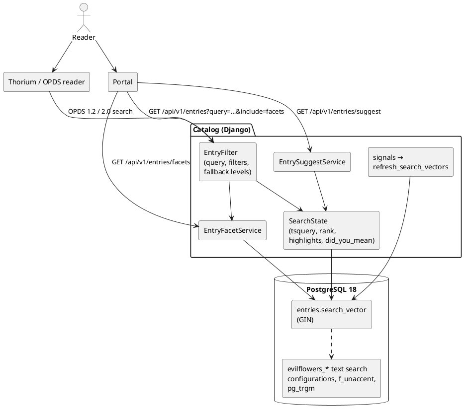

# IP-020: Catalog Search Phase 1 — In-Database Full-Text Search, Relevance, Highlights and Facets

Search moves into the catalog's PostgreSQL: a weighted `tsvector` per entry, stemmed per language and
accent-free, ranked by relevance, with highlighted results, zero-hit fallbacks, a single type-ahead
endpoint and facets shared by the REST API, OPDS 1.2 and OPDS 2.0. No Milvus, no Elasticsearch.

<!-- more -->

## Status

**Status**: Draft
**Implementation**: In Progress (code and tests complete; dev timings, Thorium check and deployment open)
**Last Updated**: 2026-11-08
**Issue**: [#101](https://github.com/EvilFlowersCatalog/EvilFlowersCatalog/issues/101) (part of #59, supersedes the search-service parts of #60)
**Depends on**: [evilflowers-postgresql#1](https://github.com/EvilFlowersCatalog/evilflowers-postgresql/issues/1) for Slovak/Czech lemmatisation (optional, see below)

## Problem Statement

Measured on dev (2026-11-08, 407 entries):

- `filter_query` was a per-word `icontains` over title, summary, publisher, authors and categories, joined
  through the many-to-many tables with `DISTINCT`. No stemming (`climates` → 0 entries, English stemming
  finds 26; `educational` → 18 instead of 54), no `unaccent`, and Slovak inflection never matched
  (`vzdelávanie` ≠ `vzdelávania`).
- The portal always sends `order_by=-created_at`, so relevance was never used.
- No highlights, no reason for a match, no did-you-mean, no zero-result fallback.
- Type-ahead cost up to five requests per keystroke; author chips were built from 50 downloaded entries.
- `/api/v1/entries/facets` loaded every full entry row (`content`, `table_of_contents`) for availability
  and had no author facet. `EntryFilter.facets` (OPDS 1.2) had no caller, OPDS 2 `facets` was never filled,
  the OpenSearch descriptor declared only `query`.
- `language` is unreliable (Slovak and Hungarian titles tagged `en`), so per-language stemming alone misses.

## Proposed Solution

### Overview



### Index

- Migration `core.0046`: `pg_trgm`; an IMMUTABLE `f_unaccent(text)` wrapper; text search configurations
  created idempotently by `apps.core.search.ddl.ensure_search_objects`:
  - `evilflowers_simple` — `unaccent` then `simple` (no stemming);
  - `evilflowers_english`, `evilflowers_german`, `evilflowers_hungarian` — `unaccent` then the snowball stemmer;
  - `evilflowers_slovak`, `evilflowers_czech` — hunspell dictionaries `slovak_hunspell` / `czech_hunspell`
    (`sk_sk`, `cs_cz` files) then `simple`. Created only when the PostgreSQL image has the files
    (evilflowers-postgresql#1); otherwise the migration logs a warning and those languages use
    `evilflowers_simple`. `manage.py reindex_search` creates them later and rebuilds every vector.
- `entries.search_config` (configuration name, from the language: en/de/hu/sk/cs) and
  `entries.search_vector` with a GIN index. Weights: title **A**; author names, category terms and labels
  in every translation **B**; publisher and summary (tags stripped) **C**. Every part is indexed as
  `to_tsvector(search_config, …) || to_tsvector('evilflowers_simple', …)`: stemmed **and** exact, so a
  wrongly tagged entry still matches its words.
- One `UPDATE … FROM (SELECT …)` recomputes any set of entries (`refresh_search_vectors`). Signals call it on
  entry save, `EntryAuthor` save/delete, `Entry.categories` / `Entry.authors` changes from either side, and
  author/category edits. The default manager defers `search_vector`, so it is never loaded and a `save()`
  never writes a stale vector back.

### Query

- `websearch_to_tsquery` in every available configuration, OR-ed, plus a prefix term per word for
  queries without operators: words of 5+ letters drop up to three trailing letters (keeping at least four),
  `vzdelávanie` → `vzdeláva:*`. The tsquery is constant across rows, so the GIN index applies.
- Rank: `ts_rank_cd(search_vector, q, 32)` + 0.5 when the title contains the query as typed (accent-free)
  + `0.01·ln(1+popularity)`; ties break on popularity, then id.
- Fallback levels, tried until one returns entries: strict (all words) → any word (`fallback: any_word`) →
  trigram word similarity on title and author names ≥ `EVILFLOWERS_SEARCH_TRIGRAM_THRESHOLD` (0.45,
  `fallback: similar`). `did_you_mean` replaces unknown words with the most similar title word or author name
  among the entries the reader may see.
- Highlights: `ts_headline` with the entry's configuration over the title and the summary (tags stripped,
  entities decoded, then HTML-escaped), `<mark>…</mark>`, two summary fragments. Accents are folded inside
  the configurations, not by wrapping text in `unaccent()`, so highlights show the original accented text.

### Endpoints

1. `GET /api/v1/entries`
   - With `query` and no `order_by` (or `order_by=relevance`): relevance order. `order_by=relevance`
     without `query` means newest first.
   - Items carry `search: {score, matched: [title|author|category|summary], highlights: {title, summary}}`.
   - `metadata.search: {query, mode: "fulltext", relaxed, fallback, did_you_mean, total}` (null without `query`).
   - `include=facets` adds `facets` (same shape as `/entries/facets`), computed at the search level of the result.
2. `GET /api/v1/entries/suggest?query=&limit=6&catalog_id=` — entries (id, catalog_id, title, authors,
   thumbnail, highlight; the last word matched as a prefix), authors, categories and feeds with readable entry
   counts, `did_you_mean` when no entry matches. All lists are limited to catalogs the reader may see.
3. `GET /api/v1/entries/facets` — adds `authors` (id, name, surname), `publishers`, `formats` (acquisition
   mime), `fulltext` (finished extraction run) with matching filters `author_id`, `publisher`, `format`,
   `fulltext`; `facet=` (subset), `facet_limit` and `facet_query`. Categories carry `term`/`label`, feeds
   `title`, languages `name`. Availability reads only LCP entries' `pk` and `config`.
4. OPDS, one `EntryFacetService` for all surfaces:
   - OPDS 2.0 search and publications feeds: `facets: [{metadata: {title}, links: [{href, type, title,
     properties: {numberOfItems}}]}]`, the active value with `rel: "self"`. The publications feed accepts the
     entry filters.
   - OPDS 1.2 search feed: `<link rel="http://opds-spec.org/facet" opds:facetGroup opds:activeFacet thr:count>`;
     authors are the top 10.
   - OpenSearch descriptor: `language_code={ef:language_code?}`, `category_id={ef:category_id?}`,
     `author_id={ef:author_id?}`, `feed_id={ef:feed_id?}`, `published_at__gte/lte={ef:…?}` with the `ef`
     namespace declared. Not the core `{language}`: readers fill it with `*` or their UI locale, which would
     silently filter the results (`language_code=*` is accepted as "any" anyway). `EntryFilter` ignores
     parameters a client sends back unfilled (`{…}`).

## Implementation Plan

### Phase 1: Index

- [X] Migration `core.0046`: `pg_trgm`, `f_unaccent`, text search configurations, `search_config`,
      `search_vector`, GIN index, backfill
- [X] `apps/core/search/ddl.py` (idempotent, hunspell optional), `index.py` (`refresh_search_vectors`)
- [X] Signals for entries, authors, categories and the through tables; `Entry.objects` defers the vector
- [X] `manage.py reindex_search`

### Phase 2: Query and results

- [X] `apps/core/search/query.py`: tsquery builder, rank, fallback levels, highlights, `did_you_mean`
- [X] `EntryFilter.filter_query` on the vector; fallback in `EntryFilter.qs`; unfilled template parameters ignored
- [X] `GET /api/v1/entries`: relevance ordering, `order_by=relevance`, `search` per item, `metadata.search`,
      `include=facets`
- [X] `GET /api/v1/entries/suggest`

### Phase 3: Facets

- [X] `apps/api/services/facets.py` (`EntryFacetService`), new dimensions and filters, facet options
- [X] Availability without full rows (also in the `lcp_state` / `over_saturated` filters)

### Phase 4: OPDS

- [X] OPDS 2.0 facets on search and publications feeds
- [X] OPDS 1.2 facet links on the search feed
- [X] OpenSearch descriptor parameters
- [ ] Validate both profiles in Thorium

### Phase 5: Verification and rollout

- [X] Golden query set (40 queries EN/SK/DE: inflected Slovak, no diacritics, typos, authors, web-search
      syntax) with recall@10 / MRR before and after — `apps/core/tests/test_search_golden.py`
- [X] API, OPDS and index-maintenance tests — `apps/core/tests/test_search_api.py`
- [ ] Measure p95 on dev: `/entries/suggest` < 50 ms, `/entries/facets` < 80 ms
- [ ] Deploy migration `core.0046` (database user must be allowed to create `pg_trgm` and text search objects)
- [ ] After evilflowers-postgresql#1 is deployed: `manage.py reindex_search`, then restart the application and
      Celery workers (each process caches the list of configurations)
- [ ] Portal: relevance sort option, highlights, `/entries/suggest` instead of five calls (elvira-portal issue)

## Technical Details

Golden set on the test corpus (20 entries, 40 queries):

| | recall@10 | MRR |
|---|---|---|
| before (`icontains`) | 0.700 | 0.700 |
| after (full text) | 1.000 | 0.988 |

Only `slovensku` does not rank its first expected entry first (both expected entries are returned).

Files:

| Area | Files |
|---|---|
| Index | `apps/core/search/{ddl,index,signals}.py`, `apps/core/migrations/0046_entry_search.py`, `apps/core/models/entry.py`, `apps/core/management/commands/reindex_search.py` |
| Query | `apps/core/search/query.py`, `apps/api/filters/entries.py` |
| REST | `apps/api/views/entries.py`, `apps/api/services/{facets,suggest}.py`, `apps/api/serializers/entries.py`, `apps/api/response.py` |
| OPDS | `apps/opds/{schema.py,views/search.py,services/entry_search.py}`, `apps/opds2/{services/feed_builder.py,views/search.py,views/publication.py}` |

Settings: `EVILFLOWERS_SEARCH_TRIGRAM_THRESHOLD` (0.45), `EVILFLOWERS_SEARCH_SUGGEST_THRESHOLD` (0.3).

## Alternatives Considered

- **Elasticsearch / Milvus (search-service)** — decided against on 2026-11-08: another service to run for a
  ~1000-title library, and catalog access control would have to be mirrored.
- **ParadeDB `pg_search` (BM25)** — phase 2; it has a Czech but no Slovak stemmer.
- **Wrapping text in `f_unaccent()` before `to_tsvector`** (as the issue sketches) — equivalent for matching,
  but `ts_headline` would then highlight the accent-free copy; folding accents inside the configuration keeps
  the original text.
- **Database triggers** for the vector — would need triggers on five tables; the single `UPDATE` called from
  signals is easier to test and to rebuild.

## Trade-offs and Risks

- The prefix fallback over-matches (`analýza` also finds `analysis`); ranking puts exact and stemmed matches
  first. Hunspell lemmatisation reduces the need once deployed.
- Writes that bypass signals (`QuerySet.update`, `bulk_create`, raw SQL) leave vectors stale until
  `reindex_search`.
- Each hunspell dictionary loads per backend connection (tens of MB, see evilflowers-postgresql#1).
- Every faceted response runs one grouped query per dimension; the OPDS 2 publications feed now computes
  facets on every page.

## Success Criteria

- [X] Golden query set committed as a test; recall@10 and MRR reported before/after
- [X] `climates`, `educational`, `vzdelavanie`, `vzdelávania` return the expected entries
- [ ] Portal default with a query is relevance-ordered; highlights render (portal work)
- [ ] `/entries/suggest` replaces the five type-ahead calls; p95 < 50 ms on dev
- [ ] Facets p95 < 80 ms on dev; availability no longer loads full rows (implemented, not measured)
- [ ] OPDS 2.0 and OPDS 1.2 search feeds carry facets, validated in Thorium (implemented and tested, not validated)
- [X] No search-service call on any path in `mode=catalog`

## Future Considerations

- Phase 2: BM25 (`pg_search`) and semantic search over the paragraph embeddings (IP-012, IP-018).
- Search inside full text (extracted paragraphs) with page-level highlights.
- `search_entries` (MCP) could return highlights and `did_you_mean`.

## References

- Issue [#101](https://github.com/EvilFlowersCatalog/EvilFlowersCatalog/issues/101), #59, #60
- [evilflowers-postgresql#1](https://github.com/EvilFlowersCatalog/evilflowers-postgresql/issues/1) — Slovak and Czech dictionaries
- evilflowers-knowledge `Proposals/Catalog-Search.md`
- PostgreSQL: [Text search controls](https://www.postgresql.org/docs/18/textsearch-controls.html),
  [pg_trgm](https://www.postgresql.org/docs/18/pgtrgm.html)
- [OPDS 1.2 §4.3 Facets](https://specs.opds.io/opds-1.2#43-facets), [OPDS 2.0 facets](https://drafts.opds.io/opds-2.0#25-facets),
  [OpenSearch 1.1](https://github.com/dewitt/opensearch/blob/master/opensearch-1-1-draft-6.md)

## Review Questions

**Status**: ⏳ Awaiting Answers
**Review Date**: 2026-11-08
**Reviewer**: Claude AI

The following questions must be answered before the proposal is accepted:

---

### Q1: Trigram indexes were not created ⚠️ Medium

**Issue**: The issue asks for trigram GIN indexes on `f_unaccent(title)` and on author full names. The fuzzy
fallback uses `word_similarity(…) >= EVILFLOWERS_SEARCH_TRIGRAM_THRESHOLD` (0.45), which no index serves;
only the `<%` operator uses a trigram index, and its threshold is the database setting
`pg_trgm.word_similarity_threshold` (default 0.6, too strict for typos such as `Hirshberger`).

**Context**: With ~1000 entries the fuzzy level (only reached when strict and any-word searches return nothing)
scans the table in a few milliseconds. An unused index only costs writes.

**Question**: Keep the function form without indexes, or switch to `<%` with indexes and set the threshold on the database?

**Options**:
- [ ] **A**: Keep as implemented; add indexes when the catalog grows past tens of thousands of entries (recommended)
- [ ] **B**: Use `<%` + GIN trigram indexes, `ALTER DATABASE … SET pg_trgm.word_similarity_threshold = 0.45`
- [ ] **C**: Create the indexes now anyway

**Answer**:
```
[User fills this in]
```

**Resolution**:
```
[AI writes this — describes how proposal will be updated based on the user's answer]
```

---

### Q2: Feed titles are not in the search vector ℹ️ Low

**Issue**: The issue lists feed changes among the vector's triggers but gives feeds no weight. Feeds are not
indexed; `/entries/suggest` returns matching feeds separately and `feed_id` facets cover browsing.

**Context**: Indexing feed titles would make `query=nové knihy` match every entry in a "Nové knihy" feed,
which is usually noise.

**Question**: Should feed titles be part of the entry vector?

**Options**:
- [ ] **A**: No, keep feeds out of the vector (recommended)
- [ ] **B**: Yes, at weight C, refreshed on feed membership and title changes

**Answer**:
```
[User fills this in]
```

**Resolution**:
```
[AI writes this — describes how proposal will be updated based on the user's answer]
```

---

### Q3: Default `facet_limit` only on authors and publishers ⚠️ Medium

**Issue**: The issue says `facet_limit` (default 10). Applying it to every dimension would cut the category
and feed lists the portal shows today, so the default applies only to the new open-ended dimensions
(`authors`, `publishers`); the others are limited only when the client sends `facet_limit`.

**Context**: Backwards compatibility of `/entries/facets` for the current portal.

**Question**: Should categories, feeds and languages also default to 10 values?

**Options**:
- [ ] **A**: Keep as implemented (recommended until the portal pages facets)
- [ ] **B**: Default 10 everywhere; portal sends a larger `facet_limit` where it needs all

**Answer**:
```
[User fills this in]
```

**Resolution**:
```
[AI writes this — describes how proposal will be updated based on the user's answer]
```

---

### Q4: Prefix-length rule for the inflection fallback ⚠️ Medium

**Issue**: The issue gives the example `vzdeláv:*` but no rule. Implemented: words of 5+ letters drop up to
three trailing letters, keeping at least four (`vzdelávanie` → `vzdeláva:*`, `knihy` → `knih:*`,
`climates` → `clima:*`). The prefix term is OR-ed into the strict query, so it can over-match
(`analýza` → `anal:*` also matches `analysis`).

**Context**: Hunspell (evilflowers-postgresql#1) gives real lemmas for Slovak/Czech, but the prefix still
serves input without diacritics and other languages.

**Question**: Keep this rule, and keep the prefix term once hunspell is deployed?

**Options**:
- [ ] **A**: Keep the rule and the prefix term (recommended; ranking puts exact matches first)
- [ ] **B**: Keep the rule; drop the prefix term for sk/cs once hunspell is live
- [ ] **C**: Use a stricter rule (e.g. drop at most two letters)

**Answer**:
```
[User fills this in]
```

**Resolution**:
```
[AI writes this — describes how proposal will be updated based on the user's answer]
```

---

### Q5: OPDS 2.0 publications feed now goes through `EntryFilter` ⚠️ Medium

**Issue**: For facets to work the publications feed must accept the facet parameters, so it now builds its
queryset with `EntryFilter` (catalog access control + filters) and computes facets on every page — about
seven extra grouped queries per request.

**Context**: Thorium pages through this feed; `EntryFilter` access control matches the catalog check the view
already performs.

**Question**: Facets on every publications page, only on the first page, or only on search feeds?

**Options**:
- [ ] **A**: Every page, as implemented (recommended: readers show facets on any page)
- [ ] **B**: Only on page 1
- [ ] **C**: Only on search feeds

**Answer**:
```
[User fills this in]
```

**Resolution**:
```
[AI writes this — describes how proposal will be updated based on the user's answer]
```

---

### Q6: The golden set uses a synthetic corpus ⚠️ Medium

**Issue**: The committed golden set runs on 20 test entries written for it (EN/SK/DE, one Slovak title
tagged `en`). The issue's "before/after" figures (`climates` 0 → 26, `educational` 18 → 54) come from dev data.

**Context**: A test cannot depend on dev data; a report script against dev could.

**Question**: Is the synthetic golden set enough, or should a dev-data evaluation (management command printing
recall@10/MRR for a query file) be added?

**Options**:
- [ ] **A**: Synthetic set in CI plus a one-off evaluation on dev after deployment (recommended)
- [ ] **B**: Synthetic set only
- [ ] **C**: Add an `evaluate_search` management command with a curated dev query file

**Answer**:
```
[User fills this in]
```

**Resolution**:
```
[AI writes this — describes how proposal will be updated based on the user's answer]
```

---

### Q7: Hunspell configurations without `unaccent` ℹ️ Low

**Issue**: Hunspell needs the accented word to find its lemma, and `unaccent` (a filtering dictionary) can only
run before it, so `evilflowers_slovak`/`_czech` do not fold accents. Input without diacritics (`vzdelavanie`)
still matches through the `evilflowers_simple` part of the vector and the prefix term, but is not lemmatised.

**Context**: The issue's README snippet maps `asciiword, word, hword, hword_part` to the hunspell dictionary, then `simple`.

**Question**: Accept that diacritics-less Slovak input is matched exactly or by prefix only?

**Options**:
- [ ] **A**: Accept (recommended)
- [ ] **B**: Also index an accent-free lemma (needs an accent-free hunspell dictionary build in the image)

**Answer**:
```
[User fills this in]
```

**Resolution**:
```
[AI writes this — describes how proposal will be updated based on the user's answer]
```

---

### Q8: `search: null` / `facets: null` in the entry list contract ℹ️ Low

**Issue**: `GET /api/v1/entries` always returns `metadata.search` and `facets` keys (null when not requested),
and list items carry `search` only when `query` is present.

**Context**: Portal type definitions (elvira-portal issue).

**Question**: Is a null key acceptable, or should the keys be omitted?

**Options**:
- [ ] **A**: Null keys, as implemented (recommended: stable schema for the OpenAPI generator)
- [ ] **B**: Omit when not requested

**Answer**:
```
[User fills this in]
```

**Resolution**:
```
[AI writes this — describes how proposal will be updated based on the user's answer]
```

---

## Changelog

| Date | Author | Changes |
|------|--------|---------|
| 2026-11-08 | jdubec | Initial draft from issue #101; implementation of phases 1–4 and tests (Claude) |
| 2026-11-08 | jdubec | Added Review Questions section |
