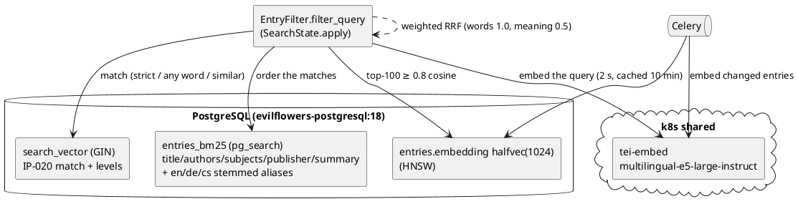

# IP-021: Catalog Search Phase 2 — BM25, Semantic Hybrid Search and One Embedding Model

The words are ranked by BM25 (ParadeDB `pg_search`), the meaning by `multilingual-e5-large-instruct`
vectors from the shared `tei-embed`, and the two are fused by weighted Reciprocal Rank Fusion — all in
the catalog's PostgreSQL. Entries, paragraphs and queries share one embedding model, and the
evilflowers-search-service is removed from the catalog.

<!-- more -->

## Status

**Status**: Draft
**Implementation**: In Progress (catalog code and tests complete; other repositories, deployment and dev measurements open)
**Last Updated**: 2026-11-09
**Issue**: [#102](https://github.com/EvilFlowersCatalog/EvilFlowersCatalog/issues/102) (part of #59, supersedes #60)
**Builds on**: [IP-020](ip-020-catalog-search-phase-1.md) (full-text index, facets, suggest)
**Supersedes**: the search-service parts of IP-008 Phase 6 F1/F2 and IP-012 Phase 1 (Milvus/Elasticsearch)

## Problem Statement

After IP-020 search finds the words well (golden set recall@10 1.0) but:

- ranks with `ts_rank_cd`, which ignores term rarity and document length (no BM25);
- cannot find a book by meaning: "teaching adults" does not find *Vzdelávanie dospelých*, "artificial
  intelligence" does not find *Strojové učenie v praxi* (lexical nDCG@10 0.00–0.43 on such queries);
- `/entries/{id}/similar` depends on the extraction pipeline (4 of 406 PDFs processed on dev);
- queries for paragraph search take a Celery round-trip to text-service (30 s timeout) with Arctic
  Embed M (768 dims), while `tei-embed` (e5, 1024 dims) already runs in k8s;
- the search-service (Elasticsearch + Milvus) is still wired in: `mode=keyword|semantic` proxies, a
  `process_pdf` send on every upload to a queue nobody consumes in production.

## Proposed Solution

### Overview



### Lexical channel

- The IP-020 tsvector decides **what** matches (languages, prefix fallback, hunspell, levels).
- When the BM25 index exists, `pdb.score` **orders** those matches: `field ||| 'words'::pdb.boost(n)` over
  title (3), authors and subjects (2), publisher and summary (1), each accent-folded and — for title,
  subjects and summary — also English/German/Czech-stemmed through pg_search aliases (no Slovak stemmer in
  pg_search; Czech matches Slovak inflection: `vzdelavania` → *Vzdelávanie*). Matches BM25 cannot see
  (prefix, hunspell lemma) follow in `ts_rank_cd` order.
- pg_search indexes one table only, so the refresh SQL denormalises `search_authors`, `search_subjects`
  (terms + labels in every language) and `search_summary` (tags stripped) onto `entries`.
- `-word` is now excluded in every configuration (fixes an IP-020 leak a different stemmer opened).
- Without `pg_search` (CI, Postgres.app) the ranking is IP-020's `ts_rank_cd`; `metadata.search.mode`
  says `bm25` or `fulltext`.

### Vector channel

- `entries.embedding halfvec(1024)` + `embedding_model` (`model@revision`), HNSW `halfvec_cosine_ops`.
  Document text: title, authors, categories (all languages), summary — plain, no instruction.
- Queries carry the e5 instruction (`Instruct: Given a library search query, retrieve relevant books\nQuery: …`);
  paragraph search and "similar passage" use their own instructions. TEI client contract from
  evilflowers-knowledge `Search-Embeddings`: batches ≤ 32, 2 s query / 60 s batch timeout, 3 retries on 429/503.
- Changed entries are embedded by one Celery task per transaction after commit; `embed_entries --missing`
  backfills. Only vectors of the current model are compared.
- TEI unconfigured or down: words only (`degraded: true` when it was asked for and failed).

### Fusion and fallbacks

- Weighted RRF, `Σ w / (60 + rank)`: words 1.0, meaning `EVILFLOWERS_SEARCH_VECTOR_WEIGHT` = 0.5. The vector
  channel contributes at most 100 entries with cosine ≥ `EVILFLOWERS_SEARCH_VECTOR_MIN_SCORE` = 0.8.
- The IP-020 fallback looks at the **words**: semantic neighbours alone do not stop the any-word / typo
  fallback. When no level matches the words, the strict result is returned — semantic neighbours, with
  `fallback: "semantic"` and `relaxed: true`.
- Items found by meaning report `matched: [..., "semantic"]`.
- Search is ranked among the entries the caller may read (access control before ranking).

### One embedding model

- `extraction_paragraph.embedding` and `extraction_run.embedding` become `halfvec(1024)` (migration
  `extraction.0004`; the 768-dim Arctic vectors cannot be converted and are dropped), and
  `EVILFLOWERS_EXTRACTION_PIPELINE_VERSION` defaults to 2 so `backfill_extraction --outdated` re-extracts.
- `ReaderExtraction.embed` (assistant highlights, similar passages) calls `tei-embed` directly.
- `/entries/{id}/similar` uses the entry vector, falling back to the run vector.

### search-service removal (catalog)

`search_service_client.py`, `SEARCH_SERVICE_*`, OPDS 2 `mode=keyword|semantic` proxying (now DB-side
channels), the `process_pdf` send in `text_publish.py`, `reindex_acquisitions`, the compose service.

## Implementation Plan

### Phase 1: Lexical BM25

- [X] Migration `core.0047`: denormalised text columns, BM25 index when `pg_search` exists (`ensure_bm25`)
- [X] BM25 ordering of the tsvector matches; `mode` `bm25`/`fulltext`
- [X] `-word` excluded across configurations; `slovak_stop`/`czech_stop` before hunspell
- [X] `reindex_search` creates the BM25 index

### Phase 2: Vectors

- [X] TEI client (`apps/core/search/embeddings.py`), settings
- [X] `entries.embedding` + HNSW, Celery task after commit, `embed_entries` command
- [X] Hybrid fusion, fallback semantics, `matched: semantic`, `degraded`
- [X] OPDS 2 `mode=keyword|semantic` as channels
- [X] `/entries/{id}/similar` by entry vector

### Phase 3: One model for paragraphs

- [X] `extraction.0004` halfvec(1024), pipeline version 2, queries through TEI
- [ ] text-service: embed paragraphs through `tei-embed` (evilflowers-text-service follow-up issue)
- [ ] `backfill_extraction --outdated` on dev and prod after text-service is deployed

### Phase 4: search-service gone

- [X] Catalog code, settings, compose
- [ ] text-service: drop `process_pdf` indexing, `delete_document`, `stats`, `clients/search.py` (follow-up)
- [ ] Cluster: remove Deployment `search`, Service `search-service`, PVC `search`; create `pg_search` from
      Ansible once roles are split; set `EVILFLOWERS_EMBEDDING_*` on the catalog (evilflowers-knowledge follow-up)
- [ ] Archive evilflowers-search-service

### Phase 5: Verification

- [X] Golden set with real TEI: nDCG@10 per language, lexical vs hybrid (`test_search_hybrid.HybridGoldenTests`)
- [X] Tests on Postgres.app (no pg_search) and on evilflowers-postgresql:18 (pg_search + hunspell)
- [ ] p95 search server time < 150 ms with hybrid on dev
- [ ] Calibrate `VECTOR_MIN_SCORE` / `VECTOR_WEIGHT` on 100–200 real queries from dev

## Technical Details

Golden set, `evilflowers-postgresql:18` (pg_search 0.26.4, hunspell), real `tei-embed`
(`intfloat/multilingual-e5-large-instruct@274baa43`), nDCG@10:

| set | lang | lexical (BM25) | hybrid |
|---|---|---|---|
| golden (40 queries, IP-020) | de | 1.000 | 1.000 |
| | en | 1.000 | 1.000 |
| | sk | 1.000 | 1.000 |
| semantic (8 queries, no shared words) | de | 0.000 | 1.000 |
| | en | 0.151 | 0.960 |
| | sk | 0.431 | 0.840 |

Calibration on the same set:

| min score | vector weight | golden sk | semantic sk | semantic en |
|---|---|---|---|---|
| 0.80 | 1.0 | 0.942 | 0.840 | 0.960 |
| 0.84 | 1.0 | 0.942 | 0.692 | 0.610 |
| 0.80 | 0.7 | 0.981 | 0.840 | 0.960 |
| **0.80** | **0.5** | **1.000** | **0.840** | **0.960** |
| 0.82 | 0.5 | 1.000 | 0.726 | 0.960 |

With equal weights an English translation that matches both channels (`algoritmy` → *Introduction to
Algorithms*) outranked the exact Slovak match; weight 0.5 keeps the words first. At 0.80 unrelated titles
still appear low in the list for single-word queries (`ekonomika` → *Knihy a knižnice* at rank 3+): see Q2.

Files: `apps/core/search/{embeddings,vectors,query,ddl,index,signals}.py`, `apps/core/tasks.py`,
`apps/core/management/commands/{embed_entries,reindex_search}.py`, migrations `core.0047`,
`extraction.0004`, `apps/api/filters/entries.py`, `apps/opds/services/entry_search.py`,
`apps/opds2/views/search.py`, `apps/extraction/{models,reader,discovery}.py`, tests
`apps/core/tests/test_search_hybrid.py`.

## Alternatives Considered

- **BM25 decides the matches** (instead of the tsvector): pg_search has no Slovak stemmer and no
  prefix/hunspell equivalent; the IP-020 match set is measured, BM25 is better at ordering.
- **Fusion in one SQL statement** (as the issue sketches): the two rankings are fused in Python and handed
  back as an annotated queryset; at catalog size (≤ thousands of matches) it is simpler, and every caller
  (REST, OPDS, MCP, facets) keeps working on a queryset.
- **pg_search aggregations (`pdb.agg`) for facets** with denormalised m2m arrays: facets already count over
  the filtered `pk__in` subquery; BM25 changes only the ranking, so facets need no change.
- **Catalog embeds paragraphs itself**: rejected (2026-11-09 decision) in favour of migrating the column now
  and moving text-service to TEI.
- **Reranker (`tei-rerank`)**: not used yet; see Future Considerations.

## Trade-offs and Risks

- `extraction.0004` drops the paragraph vectors: assistant highlights and similar passages return nothing
  until text-service embeds with e5 and the runs are re-extracted.
- `CREATE EXTENSION pg_search` needs a superuser: works while the catalog connects as `postgres`; with
  per-app roles Ansible must create it before the migration (else the migration logs and skips BM25).
- Every hybrid search makes one TEI call (cached 10 minutes per query text); TEI latency (~90 ms) adds to p95.
- pg_search is AGPL-3.0, shipped unmodified in the image.
- Faceting a search re-applies it per dimension: each dimension now runs the lexical match and the vector
  scan (BM25 is skipped when only counting), about 3× the statements of IP-020 for `include=facets`. The
  80 ms facet target (IP-020) has to be measured with hybrid on.
- A catalog in Compose (prod on gateway) reaches `tei-embed` only through the internal Envoy listener
  (`http://192.168.122.227:8081`, `EVILFLOWERS_EMBEDDING_HOST=embed.elvira.internal`), which
  evilflowers-knowledge Known-Issues #7 lists as not proven yet. Pin `EVILFLOWERS_EMBEDDING_MODEL` so TEI's
  `/info` is never on the request path (an unreachable `/info` degrades to words only).
- The golden corpus has 20 entries; the floor and weight are calibrated on it, not on real traffic.

## Success Criteria

- [X] Golden set: hybrid beats the #101 baseline on nDCG@10 for SK and EN (semantic set; equal on the lexical set)
- [ ] One embedding model across entries, paragraphs and queries; provenance records it (catalog done, text-service open)
- [ ] p95 search server time < 150 ms with hybrid on dev
- [ ] search-service gone from code (catalog done) and cluster (open)

## Future Considerations

- Rerank the fused top 50 with `tei-rerank` (`bge-reranker-v2-m3`).
- "Search inside books": paragraph hits with page numbers once paragraphs carry e5 vectors.
- Highlights for semantic-only hits (no `<mark>`: nothing literal matched).

## References

- Issue [#102](https://github.com/EvilFlowersCatalog/EvilFlowersCatalog/issues/102); IP-020; IP-018; IP-012
- evilflowers-knowledge `Proposals/Search-Embeddings`, `Cookbooks/Shared-Inference`
- [evilflowers-postgresql](https://github.com/EvilFlowersCatalog/evilflowers-postgresql) README (pg_search 0.26.4, hunspell)
- [SkMTEB](https://arxiv.org/html/2606.13647v1); [RRF](https://plg.uwaterloo.ca/~gvcormac/cormacksigir09-rrf.pdf)

## Review Questions

**Status**: ⏳ Awaiting Answers
**Review Date**: 2026-11-09
**Reviewer**: Claude AI

---

### Q1: Arctic vs e5 was not compared 🔴 Critical

**Issue**: #102 says "decide with data": run the golden set through Arctic Embed M (text-embed) and e5 (TEI).
Only e5 was measured: the dev text-embed worker is reachable only through Redis/Celery on dev, and running
Arctic locally needs an amd64 TEI image. The column migration (`extraction.0004`) already commits to e5.

**Context**: The decision is cheap to reverse now (4 runs on dev) and expensive later.

**Question**: Accept e5 on the SkMTEB evidence plus the hybrid numbers above, or run the comparison first?

**Options**:
- [ ] **A**: Accept e5 (recommended: operational win — already served by TEI — and SkMTEB STS +6)
- [ ] **B**: Run Arctic through the dev text-embed worker on the golden set before deploying `extraction.0004`

**Answer**:
```
[User fills this in]
```

**Resolution**:
```
[AI writes this — describes how proposal will be updated based on the user's answer]
```

---

### Q2: Similarity floor and vector weight ⚠️ Medium

**Issue**: 0.80 / 0.5 were calibrated on 20 entries and 48 queries. At 0.80 single-word queries collect
unrelated titles at the bottom of the list (`ekonomika` → *Knihy a knižnice*); 0.84 removes them but loses
half of the semantic gains.

**Context**: The floor decides how much noise readers see; the weight how far meaning can overtake words.

**Question**: Keep 0.80 / 0.5 until a dev calibration on real queries, or ship a stricter floor?

**Options**:
- [ ] **A**: 0.80 / 0.5, recalibrate on 100–200 logged dev queries (recommended)
- [ ] **B**: 0.84 / 0.5 (less noise, fewer semantic hits)
- [ ] **C**: Add a relative floor (drop vector hits below 90 % of the best one)

**Answer**:
```
[User fills this in]
```

**Resolution**:
```
[AI writes this — describes how proposal will be updated based on the user's answer]
```

---

### Q3: Assistant highlights are empty until text-service moves to e5 ⚠️ Medium

**Issue**: `extraction.0004` drops the 768-dim paragraph vectors (your decision: migrate now). Until
text-service embeds with e5 and runs are re-extracted, agent highlights, similar passages and the assistant's
semantic tools find nothing; text-service's current 768-dim ingestion is rejected.

**Question**: Deploy the catalog before or together with the text-service change?

**Options**:
- [ ] **A**: Together: hold `extraction.0004` in prod until the text-service image with the TEI client is out (recommended)
- [ ] **B**: Catalog first; accept the gap on dev and prod

**Answer**:
```
[User fills this in]
```

**Resolution**:
```
[AI writes this — describes how proposal will be updated based on the user's answer]
```

---

### Q4: BM25 orders, the tsvector decides what matches ℹ️ Low

**Issue**: The issue frames BM25 as the lexical engine. Here pg_search only orders the IP-020 matches;
entries BM25 cannot see (prefix, hunspell lemma) follow in `ts_rank_cd` order.

**Question**: Keep the tsvector as the match set?

**Options**:
- [ ] **A**: Yes (recommended: Slovak inflection and the fallbacks stay measured)
- [ ] **B**: Let BM25 add matches of its own (Czech-stemmed Slovak, fuzzy)

**Answer**:
```
[User fills this in]
```

**Resolution**:
```
[AI writes this — describes how proposal will be updated based on the user's answer]
```

---

### Q5: Query embedding latency and caching ℹ️ Low

**Issue**: One TEI call per new query text (2 s timeout, cached 10 min in Redis). TEI showed ~90 ms per
embed in Tempo; together with BM25 and the vector scan the 150 ms p95 target is unverified.

**Question**: Measure on dev first, or also embed asynchronously (show words-only results, then refine)?

**Options**:
- [ ] **A**: Measure on dev, act only if above target (recommended)
- [ ] **B**: Words-only first page, hybrid on the client's second request

**Answer**:
```
[User fills this in]
```

**Resolution**:
```
[AI writes this — describes how proposal will be updated based on the user's answer]
```

---

## Changelog

| Date | Author | Changes |
|------|--------|---------|
| 2026-11-09 | jdubec | Initial draft from issue #102; catalog implementation of phases 1–4 and tests (Claude) |
| 2026-11-09 | jdubec | Added Review Questions section |
