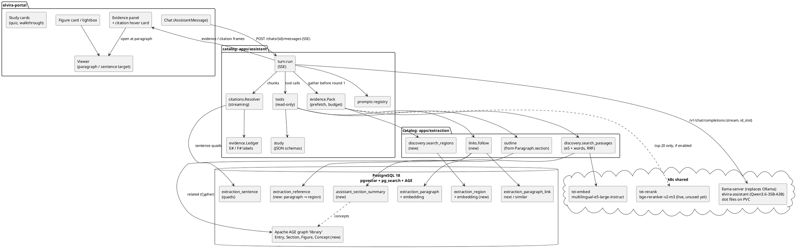
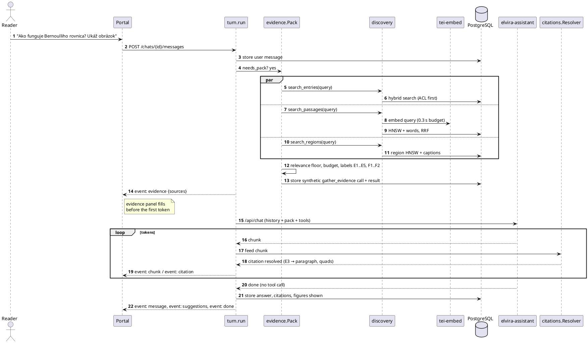
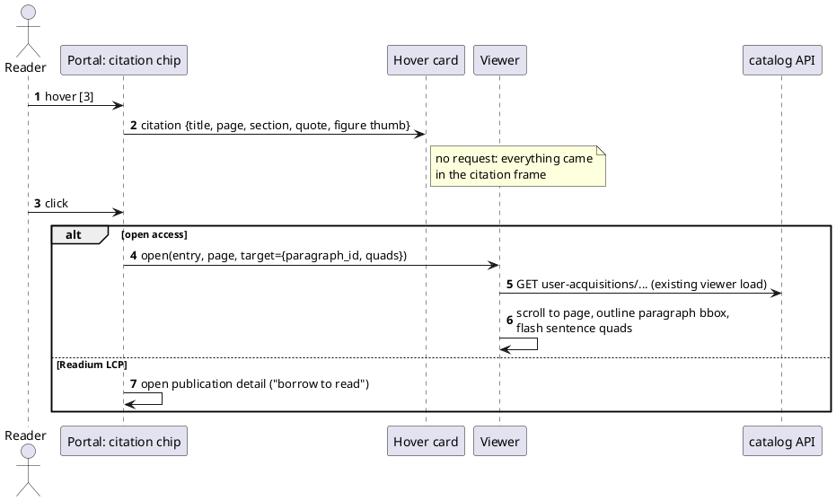
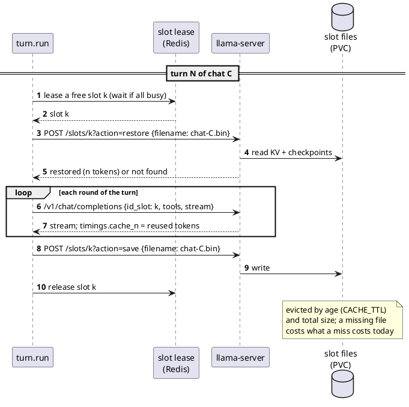
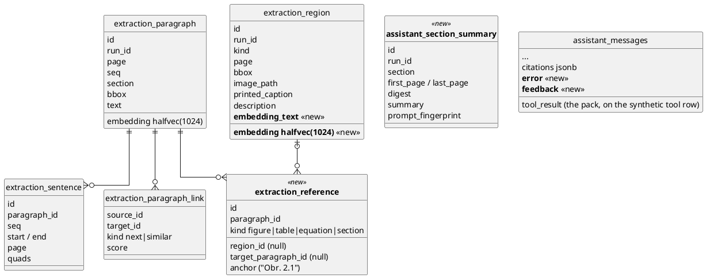

# IP-030: Assistant, Evidence First — Paragraph Citations, Figures, Links and Study Mode

The assistant can search the library and read open publications, but readers cannot see where an answer comes from. It
cannot show a picture in a plain chat, and it refuses the study help that readers keep asking for. A turn also takes
two to six minutes. This proposal replaces IP-022 and IP-024. It gathers evidence before the model's first round and cites
paragraphs and figures by short labels. The portal resolves those labels to the exact place in the viewer. The
paragraph graph already in Postgres serves "follow links", and the proposal adds a study mode and serving changes that
attack the real latency.

<!-- more -->

## Status

**Status**: Accepted (catalog implementation in progress)
**Last Updated**: 2026-11-13
**Implementation**: Catalog side of Phases 0–6 implemented on `develop` (2026-11-13, uncommitted), tested with scripted
models: 1,224 tests on plain PostgreSQL, and the assistant, extraction and graph tests (253) on evilflowers-postgresql
18.6 with AGE. Not done: everything measured on dev (baseline and A/B evaluations, cache-gap test, disconnect check,
reranker, contextual headers, speculative decoding, sampling), the llama-server deployment (knowledge#44; the
client is tested against recorded responses only), and the portal (elvira-portal#40). Deviations from the text below:
one `study` tool with modes `outline | summary | walkthrough | quiz | key_concepts`, not three tools; concept edges are
`MENTIONS {role: defines | discusses}` and no `RELATED_TO` edge (related concepts are computed at query time); AGE
needs `SET LOCAL search_path` and server-side parameter binding (verified on the image), not "no search_path".

**Supersedes**: [IP-022](ip-022-assistant-intelligence.md) (Assistant Intelligence on a Self-Hosted CPU Model) and
[IP-024](ip-024-grounded-assistant-answers.md) (Grounded Assistant Answers). Their shipped parts are listed in
[What stays](#what-stays-from-ip-022-and-ip-024), except that the capped final round changes (§5). Their open items and
unanswered review questions are carried over in [Carried over](#carried-over-from-ip-022-and-ip-024).

## Problem Statement

### Current state (measured on dev, 2026-11-13)

**Data the assistant could use**, from `evilflowers-dev`:

| What | Count | Used by the assistant today |
|---|---|---|
| Publications | 435 (17 Readium LCP) | `search_entries` |
| Active extraction runs (processed PDFs) | 133, ~263 pages on average | — |
| Paragraphs, all embedded (e5, 1024 d) | 225,225; 224,203 with a `section` heading | `search_library_text` (600-character excerpts) |
| Distinct section headings | 13,579 | no |
| Sentences with quads (positions on the page) | 985,292 | only by agent highlights (IP-018) |
| Figures / tables / equations with a crop | 9,400 / 3,584 / 4,959 | only `[[region:UUID]]` in chats bound to a reader's copy |
| … with the printed caption | 7,092 figures, 2,024 tables | same |
| … with a model description | 0 | — |
| Paragraph links `next` / `similar` | 290,125 / 1,450,272 | no |
| Paragraphs that mention "Figure/Obr./Table/Tab. N" | 16,514 | no |
| Publications with a table of contents | 2 | `get_entry` chapter summaries (30 rows) |

**Real use**: 66 user messages in 29 chats, 43 of them in the last 14 days. Read one by one, they show:

- **Pictures.** "ukáž mi to na obrázku", "find an image supporting that", "vieš mi ukázať obrázky?". The question came 4
  times. A plain chat has no path to figures: it answered "I have limited options to read publications". In the two
  chats bound to a reader's copy, the answer linked the figure as `[[region:UUID]]`, and the portal shows the crop on
  hover only. That needs the model to copy a 36-character UUID, which IP-024 itself rejected for entries.
- **Study help.** 3–4 of the 17 chats with a real question are exam preparation: "musím sa ju do rána naučiť, čítaj mi to po
  kapitolách a uč ma" (I must learn it by morning; read it to me chapter by chapter and teach me), "i need to learn for a
  test", "our teacher gave us this paper… you need to guide me", "what is one question only someone who read this could
  answer". The assistant refused to read chapter by chapter ("nemám prístup k sekvenčnému čítaniu"), against its own
  rule "never say you cannot read publications".
- **Capability discovery.** "Showcase what you can do" came 6 times. The answer is a bullet list the model writes on CPU,
  about 2,000 tokens of prompt and 200 generated, so a minute for a static fact.
- **Corpus questions.** "What are publications in the corpus mostly about? 5 interesting facts". That took 9 rounds,
  four of them narrated ("Let's extract a fact from…"), and about 6 minutes.
- **Citations barely happen.** Of the answers in those 10 days, 1 has resolved `[E#]` citations. Bound chats cite
  `[[page:N]]` more reliably, but a page citation opens the page and not the paragraph.
- **Language.** English questions in the Slovak UI get Slovak answers. The language pin ("whatever language the
  reader's message is in") contradicts the system prompt ("answer in the language the reader writes in").
- **Silent failures.** 9 user messages got no answer row. 7 of them are Ollama Cloud `402 Payment Required` from before
  the switch to `elvira-assistant`, 1 is a 300 s read timeout and 1 is a dropped connection (Loki, 10 days). `turn.run`
  stores nothing on error, so a chat read back shows a question with no reply.

**Latency** (Tempo, `chat` spans on dev, 2026-11-12):

| Round | Input tokens | Prompt evaluation | Output tokens | Generation |
|---|---|---|---|---|
| 1st round of a new chat | 1,744–2,946 | 16–40 s | 234–238 | 23–29 s |
| 1st round of a follow-up turn, previous turn ended normally, gap < 2 min | 2,041–3,470 | **3–13 s** (cache hit) | 67–202 | 9–20 s |
| 1st round of a follow-up turn, previous turn hit the 6-round cap, or gap ≥ 3 min | 6,481–8,303 | **66–109 s** (cache miss) | 78–201 | 8–22 s |
| 2nd and later round of the same turn | 2,566–9,342 | 3–15 s, one of 44 s | 59–380 | 6–47 s |

- **The prompt cache works.** #138 (append-only prompts) did its job: 8.4 K tokens re-evaluated in 3 s inside a turn, and
  a follow-up turn that came soon after a normal one hit as well. IP-022 §8 still says the cache never hits. That is
  stale.
- **Three follow-up turns missed** and re-evaluated the whole conversation, ~8 K tokens at ~75 tok/s. Two followed a
  turn that used all 6 rounds: its last request was the no-tools round ending with `ANSWER_NOW`, which the next turn's
  history does not contain. The third followed a 44-minute pause. That was within `EVILFLOWERS_ASSISTANT_CACHE_TTL`
  (3,600 s), so the history was not trimmed. Six spans cannot separate the two causes, the capped round and the slot
  being lost after a gap (§5, Phase 0).
- **Generation is the larger cost when the cache hits.** It runs at ~8 tok/s, so a 380-token answer is 47 s. Each tool
  round adds a generated tool call, often after a narrated sentence. Turns take 160–390 s.

**Portal** (`elvira-portal` branch `dev`, 45 commits ahead of `master`). It renders `[E#]` chips with a sources list
(#37), `status` and `activity` frames as a live line and a tool log (#36), `[[page:N]]`, `[[region:ID]]` with a hover
crop (`RegionCite`), agent-highlight cards and book cards. `useOpenCitation` opens the viewer **at a page**. The viewer
has no paragraph target, and no figure is ever shown inside an answer.

### Pain points

1. Readers cannot verify an answer. A citation lands on a page of 300–600 words; the paragraph and sentence positions we
   store are never used.
2. Figures, the most-asked missing feature, cannot be shown at all.
3. The paragraph graph (`next`, `similar`) and 16 K cross-references to figures and tables are unused. "Follow a link"
   is impossible.
4. The agent loop spends minutes deciding what to retrieve and narrating it, on a CPU that generates 8 tokens a second.
5. The study use case is refused, though the data (sections in reading order, sentences, highlights) is there.
6. There is no gold set (`retrieval_gold.json` is empty), so no retrieval change can be shown to be better.

## Research

What comparable open-source systems do. Claims about code come from the source files named, read on 2026-11-13; parts
of those files that were not read are marked *(not read)*. The rest comes from papers and project documentation, as
marked.

| Project | Mechanism | Source read | What we take |
|---|---|---|---|
| **PaperQA2** (Future-House/paper-qa) | Tools `paper_search → gather_evidence → gen_answer`. Each retrieved chunk (MMR over the index, `evidence_k=10`) is summarised by an LLM into JSON `{summary, relevance_score 0–10}`; score 0 is dropped; `answer_max_sources=5` is the default *(where it is applied: not read)*; citations are context keys `(pqac-…)`, "cite only keys from the context", "I cannot answer" when insufficient | `src/paperqa/prompts.py`, `agents/tools.py`, `settings.py`, `docs.py` | Evidence gathered *before* answering, a hard cap on sources, keys instead of titles. The per-chunk LLM summary is too expensive on CPU (10 summaries ≈ 10 rounds), so relevance comes from fusion scores and an optional reranker instead |
| **kotaemon** (Cinnamon) | "Highlight" mode (default): a forced tool call returns ≤ 5 verbatim quotes (≤ 15 words) per answer. "Inline" mode: the model writes start and end phrases (~6 words) per citation, fuzzy-matched (`difflib.SequenceMatcher`, accepted above 35 % length) against the retrieved chunk to get character offsets *(how highlight mode maps its quotes: not read)*; the PDF link carries page + search phrase *(the viewer JS: not read)*; relevance scores (vector, LLM, rerank) are shown per source with a low-relevance warning | `libs/kotaemon/.../qa/citation.py`, `citation_qa_inline.py`, `utils.py`, `ktem/utils/render.py` | Highlight the *evidence unit*, not the retrieval unit. We do it without asking the model for quotes: we store sentence quads, so the server picks the cited paragraph's sentence closest to the citing sentence (§2). Show a low-relevance warning |
| **Open WebUI** | Sources as `<source id="N">` tags in context; the template says cite `[id]` "only when the source tag includes an explicit id attribute"; a `source` event per source is emitted to the client during tool execution, before the answer *(verified for the tool path; the non-tool RAG path: not read)* | `backend/open_webui/config.py` (`DEFAULT_RAG_TEMPLATE`), `utils/middleware.py` | Evidence in tagged blocks with ids; send the sources to the client *before* the answer streams (§2, `evidence` frame) |
| **Onyx** | `DynamicCitationProcessor`: regex over the token stream (`[1]`, `[1, 2]`, `【1】`), holds back partial markers, skips code fences, emits `CitationInfo(number, document)` *before* the token that contains the marker | `backend/onyx/chat/citation_processor.py` | Resolve citations while streaming, so a chip is live as it appears and not only after `done` (§2) |
| **NotebookLM** (product, not open source) | Inline citations to passages; study guide, FAQ, quiz, flashcards, mind map, briefing doc — every artefact cites its sources | product pages and third-party guides (behaviour of hover not verified) | Study artefacts as first-class outputs with citations (§6) |
| **RAPTOR** (Sarthi et al. 2024) | Recursive cluster → summarise tree; retrieval over all levels | paper, via the RAG-vs-GraphRAG evaluation (arXiv 2502.11371) | "What is the library about" answered from summaries at section → book → subject level, built offline (§4) |
| **GraphRAG / LightRAG / HippoRAG 2** | LLM extracts entities and relations per chunk into a graph; global questions via community summaries (GraphRAG) or keyword-entity indexes (LightRAG) or Personalized PageRank (HippoRAG 2). LightRAG can keep graph, vectors and KV in one PostgreSQL without Apache AGE | papers and project documentation; arXiv 2506.05690 "When to use graphs in RAG" | Not the per-paragraph extraction pass (it does not fit the CPU); an Apache AGE graph fed by generated summaries instead (§4) |
| **Anthropic Contextual Retrieval** (2024); late chunking (Günther et al.) | Prepend chunk-specific context before embedding and BM25 (49 % fewer failed retrievals, 67 % with a reranker, per the original post); late chunking pools chunk vectors from a long-context embedding | original post; arXiv 2504.19754 | The cheap variant: prepend title and section heading (no LLM) when embedding paragraphs (§4). Late chunking needs a long-context embedder; e5-large takes 512 tokens |
| **ColPali / ColQwen** (page-image late interaction) | ~1,024 patch vectors per page; highest recall on visually rich pages | arXiv 2511.21121, 2505.05666 | Not here: 133 runs × ~263 pages × 1,024 vectors ≈ 36 M vectors, and multi-vector matching is the latency bottleneck even on GPU |
| **llama.cpp context checkpoints** | Hybrid (Gated DeltaNet) models such as Qwen3.5/3.6 cannot rewind their recurrent state; reuse needs a checkpoint at a prefix boundary. Reported merged: checkpoints at user-message boundaries (#24176), checkpoint fixes (#22929), checkpoints kept across slot save/restore (#26004) | llama.cpp issues #20225, #22746, #19794; secondary write-ups (merge dates not verified against `master`) | The serving experiment in §5 |

**Prompt-engineering principles** the design follows (Qwen function-calling docs, Anthropic prompting guidance, the
templates above):

- Put long documents first and the question and instructions last.
- Give every evidence block an id and allow citations of those ids only.
- Say what to do when evidence is insufficient ("say so", not "try harder").
- Keep tool descriptions disjoint and short. Qwen recommends its Hermes-style tool template, which Ollama renders.
- Give a capability inventory, so the model never denies an ability it has.
- One worked example only if the evaluation shows it helps.
- For a CPU model, also: no narration before tool calls, and an output-length budget per mode, because every generated
  token is ~125 ms.

## Proposed Solution

### Overview

Five changes.

1. **Evidence first.** Before the first model round, the turn gathers a small evidence pack in parallel: catalog hits,
   passages and figures. It hands the pack to the model as the result of a call the model "already made". Most questions
   are answered in round 1, so a turn needs one or two rounds instead of four to six.
2. **One evidence ledger** for passages, pages, figures and tables, with short labels (`E3`, `F2`). A label resolves to
   a paragraph, a sentence's position on the page, or a figure crop. Citations are resolved while streaming.
3. **Follow links** over the paragraph graph that is already in Postgres: next and previous paragraph, the figure or
   table a paragraph refers to, similar passages in other books. One read-only tool, plus related sections across
   publications from an Apache AGE graph of sections, figures and concepts in the same Postgres.
4. **Corpus and structure** from data we have: an outline derived from `Paragraph.section`, section summaries cached
   on first use, and a library overview from facets.
5. **Study mode**: section walkthrough, quiz, key concepts. Each output is structured JSON that the portal renders as an
   interactive card with citations.

Plus a prompt rewrite against the measured failures, and the serving changes that address the latency (§5).

### Architecture



### 1. Evidence first: prefetch the pack before the first round

**Today** the model picks the retrieval. A typical content question takes `search_entries → search_library_text →
get_entry → read_pdf_page → answer`: four generated tool calls (~10–30 s each) and a growing prompt.

**Proposed** (`evidence.Pack`): the turn runs the retrieval itself, in parallel, before round 1.

| Channel | What | Budget in the pack |
|---|---|---|
| Catalog | `search_entries` (hybrid, IP-021) on the message | ≤ 5 hits, ~60 tokens each (slim projection) |
| Passages | `discovery.search_passages`; scoped to the chat's publication when bound or when the message attaches one | ≤ 5 passages × ≤ 600 characters |
| Figures | `discovery.search_regions` (new, §3); plus figures referenced by the selected passages (`extraction_reference`) | ≤ 3, caption only (the image is for the reader) |

- **The pack is a synthetic tool call.** It is stored as an assistant row with `tool_calls=[{name: "gather_evidence",
  arguments: {query}}]` and a tool row with the slim pack, exactly as if the model had called it. The replayed history
  stays append-only (#138), the model sees a familiar shape, and nothing about it is per request.
- **When no pack is gathered.** A message that is a greeting, a capability question or a follow-up about cards already
  shown (heuristics in `evidence.needs_pack`, evaluated in `assistant_eval`) gets no pack. So does a message whose
  retrieval comes back below the relevance floor (§3). An empty pack is a short note ("nothing relevant found for …"),
  so the model does not pad.
- **The tools stay.** `search_entries`, `search_library_text`, `read_pdf_page` and the rest remain, so the model can
  refine. The round cap stays (`MAX_CHAT_ROUNDS`), and the final round must answer, in a way that keeps the next
  turn's prefix (§5).
- **Cost.** One embedding call (~0.3 s budget, IP-021) and three DB queries (not yet measured together; the passage
  query is the heaviest), plus ~1.2 K tokens added to round 1. It replaces at least one generated tool call and its result round.
  Whether it pays off is measured in `assistant_eval` (median rounds, time to first token) before it is switched on
  for everyone (`EVILFLOWERS_ASSISTANT_PREFETCH`).



### 2. One ledger, paragraph-precise citations, streamed

`apps/assistant/evidence.py` keeps one ledger per chat (IP-024 §1, unchanged in principle) with two label series:

| Label | Source | Resolves to |
|---|---|---|
| `E#` | a paragraph (passage search, pack, `follow`) or a page (`read_pdf_page`) | `entry_id`, `page`, `section`, `paragraph_id`, `bbox`, best sentence's `quads`, `quote` (≤ 240 characters, open access only) |
| `F#` | a figure, table or equation (`extraction_region`) | `entry_id`, `page`, `region_id`, `kind`, `caption`, `image_url` (open access only), `bbox` |

- **`[[page:N]]` and `[[region:UUID]]` are retired for new answers** (IP-024 Q4 option B). A bound chat's
  `search_paragraphs`, `read_pdf_page` and `list_regions` results carry labels too, so the model learns one
  convention. Old messages keep rendering: the portal parser stays.
- **The best sentence.** For each citation, the resolver takes the citing sentence of the answer (the text up to the
  label, split with `support.split_sentences`). It picks the cited paragraph's sentence with the highest word overlap,
  accent-folded; on a tie it takes the first. That sentence's `quads` and the paragraph `bbox` go into the citation. The
  viewer highlights the sentence and outlines the paragraph. This is kotaemon's evidence-unit idea without asking a
  CPU model to copy quotes.
- **Streaming resolution.** Onyx's pattern: `citations.Resolver` scans the chunk stream for `[E3]`, `[E3, E5]` and
  `[F2]`, and holds back a partial `[E`. On the first occurrence of a label it emits `event: citation {label, …}`. The
  existing `citations` frame after `message` stays as the authoritative list (the portal keeps it on read-back).
- **Unknown labels** are reported and left in the text (IP-024 Q2 option A). The portal shows them as plain text.
- **Access.** `quote`, `image_url` and figure captions are present only where `_may_read_text` and the `EntryFigures`
  rule allow: never for Readium LCP, never outside IP ranges. An LCP passage still resolves to a page, with the "borrow
  to read" path that `useOpenCitation` already has.



### 3. Figures: find them, cite them, show them

- **Figure documents.** A figure's searchable text is its printed caption, plus the first paragraph that refers to it
  (`extraction_reference`, below), plus the model description once one exists. It is embedded with e5 into
  `extraction_region.embedding` (new `halfvec(1024)` column, HNSW). 9,400 figures and 3,584 tables, about 6 % of the
  paragraph count, so one backfill.
- **`discovery.search_regions`** works like `search_passages`: ACL first, then meaning plus words over caption and
  context, fused by RRF and cut at a score floor. It feeds the pack and the `search_library_text` tool (`kinds:
  ["figure", "table"]`).
- **The model cites `[F2]`. It is never handed the image.** The portal renders an inline figure card with the crop,
  the printed caption, "page 47" and "ask about this figure" (elvira-portal#40). That answers "show me a picture" with no
  vision tokens.
- **Vision, when asked.** "What does this figure show?" on a cited or attached figure. The bound chat already attaches
  regions as contexts; the new piece is sending the crop to the model. Qwen3.6 accepts images, which IP-022 noted as a
  future option. Each image is roughly a thousand prompt tokens, ~15 s on control, so it is used only on an explicit
  action, never in the pack (Q4).
- **Offline descriptions** for figures without a printed caption: 2,308 figures. At ~1 K prompt + ~150 generated tokens
  that is ~30 s each, ~19 h of model time in total, run off-peak as a Celery queue that yields to chats. That needs the
  image-service caption path from IP-018 Q8 pointed at `elvira-assistant` (Q5).

### 4. Follow links, outline, corpus questions and the concept graph

**Cross-references** (`extraction_reference`, new). A deterministic pass per run finds "Figure 3.2", "Fig. 3",
"Obr. 2.1", "Table 4", "Tab. 1", "Eq. (5)" and "Section 2.3" in paragraph text. 16,514 paragraphs match the figure and
table patterns. The pass matches the number against `printed_caption` of the same run's regions and stores
`(paragraph, region | target paragraph, kind, anchor text)`. A target that does not resolve is stored with a null
target and counted, so the pattern list can be improved. The pass runs in the catalog after ingestion and needs no
service change.

**`follow` tool** (read-only, in `tools.LOCAL_TOOLS`): `follow(label, relation)` where `relation` is one of:

| Relation | From | Data |
|---|---|---|
| `next` / `previous` | `E#` | `extraction_paragraph_link` `next` (290 K) or `seq ± 1` |
| `figure` | `E#` | `extraction_reference` → region (`F#`) |
| `mentions` | `F#` | paragraphs that refer to the figure |
| `similar_elsewhere` | `E#` | `extraction_paragraph_link` `similar` (1.45 M), other publications only, the reader's ACL applied |
| `section` | `E#` | the paragraphs of the same `section`, in `seq` order, up to the page budget |

Every result is labelled into the same ledger, so a followed passage is citable. One tool with an enum costs about as
many prefix tokens as one of today's tools. The bound chat's `search_pdf` with regular expressions (rarely used) and
`list_page_regions` are dropped for it (Q6).

**Outline from sections.** Only 2 of 435 publications have a table of contents, but 99.5 % of paragraphs carry a
section heading. `outline(entry)` is the run's distinct sections in `seq` order, with first and last page and paragraph
count, computed by SQL. Chapter summaries (IP-024 §7) are re-keyed from TOC entries to sections. They become
`assistant_section_summary` (run, section, digest, summary) **and are generated on first request**. "Zhrň mi túto
kapitolu" (summarise this chapter) took 3 minutes on 2026-11-12; with this, the next reader of that section gets it at
once. The batch command stays for warming popular books.

**Corpus questions** ("what is the library about"):

- **`library_overview`**, deterministic and with no model: subject counts, languages and year range from IP-020
  facets, the most-read titles per subject, and the number of processed publications. It answers "what do you have" in
  one round, with nothing for the model to invent.
- **RAPTOR-lite, offline.** Section summaries → a book digest (`Entry` field or summary row) → a subject digest
  (per MDT term). These cover "5 interesting facts from the library": the model picks from digests that already cite
  their sections. Built by a batch command, never inside a turn.

#### Graph database: Apache AGE in the existing Postgres (Q7: deploy now)

**Do we need one?** Not for the paragraph links. `next`, `similar` and `extraction_reference` are one- or two-hop
lookups by indexed foreign key, and SQL answers them in milliseconds, so they stay relational. A graph earns its
place for **multi-hop questions across publications**:

- "Which other books explain the concept defined in this section?"
- "How is this book connected to that one?" (shared authors, subjects, concepts, citations)
- "What should I read before this chapter?"

Q7 decided to deploy it now. **Apache AGE**, not a separate graph server:

- It runs inside the same PostgreSQL 18 (AGE 1.7.0, January 2026, and 1.8.0, August 2026, support PG 18; PGDG ships
  `postgresql-18-age`).
- So: no new service, one backup (pgBackRest), one ACL boundary.
- Cypher runs through `ag_catalog.cypher('library', $$ … $$)` and can be joined to relational tables in the same query.

**What goes into the graph** (graph `library`; a *derived projection*, rebuildable from the relational tables at any
time, never the source of truth):

| Node | From | Edges |
|---|---|---|
| `Entry` | `entries` (id, title, catalog) | `WRITTEN_BY → Author`, `FILED_UNDER → Subject`, `HAS_SECTION → Section` |
| `Author`, `Subject` | `authors`, `categories` | — |
| `Section` | `outline(entry)` (distinct `Paragraph.section`, first and last page) | `NEXT → Section`, `SHOWS → Figure`, `DEFINES / DISCUSSES → Concept` |
| `Figure` | `extraction_region` (figures, tables) | `REFERRED_FROM ← Section` (from `extraction_reference`) |
| `Concept` | normalised term (lower-cased, accent-folded, lemma where available) | `RELATED_TO → Concept` (co-occurrence weight) |
| — | section-level aggregation of `similar` paragraph links (≥ 3 links between two sections) | `Section SIMILAR_TO Section` (weight) |

About 435 entries, ~13.6 K sections and 12.9 K figures and tables: a graph of tens of thousands of nodes. The 225 K
paragraphs stay out of it.

**Where concepts come from, without the 60-day pass.** GraphRAG-style extraction over every paragraph does not fit the
CPU: ~300 prompt plus ~150 generated tokens per paragraph is ~60 days of `elvira-assistant`. Instead, concepts come
from outputs the assistant already produces, as structured fields of the same call:

- **Section summaries** (§4, generated on first request): the summary schema gains
  `concepts: [{term, role: defines | discusses}]`, 3–8 per section.
- **`key_concepts`** in study mode (§6) writes its terms with `DEFINES`.
- **Offline warm-up** of popular books (`summarise_sections --limit`) fills the graph for the most-read titles first.

The graph grows with use, and every concept edge points at a section a reader can open.

**How it is used** (read-only, ACL applied by joining back to `EntryFilter`'s visible entries before anything is
returned):

- `follow(label, "related")`: other sections that `DEFINES`/`DISCUSSES` the same concepts, or are `SIMILAR_TO`,
  ranked by shared concepts and weight. Labelled into the ledger like any passage.
- `library_overview`: concepts that span the most subjects, for "what is the library about".
- Study walkthrough: "before this section" means sections that `DEFINES` the concepts this one `DISCUSSES`.

**Sync.** A Celery task `graph.project_run(run_id)` runs after an extraction run becomes active (sections, figures,
references, similar). `graph.project_concepts(section_summary_id)` runs after each summary. `graph.rebuild` drops and
reloads the graph. Deleting an entry deletes its nodes in the same task as the relational delete.

**Kept out of scope.** Full GraphRAG community summaries and entity extraction from raw paragraphs, until a GPU
exists. If that arrives, LightRAG can use the same Postgres and the same AGE graph.

### 5. Latency: what the catalog and the serving side each do

**Catalog side:**

- **Fewer rounds.** The pack (§1), the overview tool and the deterministic capability card (portal) take most turns to
  1–2 rounds.
- **Less generation.** The prompt forbids narration before a tool call ("call tools silently"). It also asks for short
  answers (§7), and `num_predict` stops a runaway answer: 600 tokens for a plain answer, 900 for study artefacts.
  Slovak takes roughly two tokens per word, so the cap must sit well above the prompt's word limit, or answers are cut
  mid-sentence. The evaluation checks the median of `gen_ai.usage.output_tokens`.
- **Store failed turns.** On `LLMUnavailable` the turn stores an assistant row with `error` set (new nullable column),
  so a chat read back shows "the assistant did not answer, try again" instead of an orphan question. The portal shows
  a retry button.
- **Stop on disconnect.** Check what happens when the reader closes the chat mid-answer: whether the gevent worker
  notices and closes the Ollama request, or Ollama keeps generating for nobody and holds a slot. Fix it if it keeps
  generating.
- **The capped round (catalog side, Phase 0).** When a turn reaches `MAX_CHAT_ROUNDS`, its last request ends with the
  `ANSWER_NOW` system message. The next turn's history does not contain it, so that request is no longer a prefix and
  the checkpoint cannot be reused. Two of the three measured misses followed such a turn. The fix: put the
  "answer now" instruction where the history keeps it. Either store it as a row, so the next turn replays it, or offer
  the final round the same tool list and refuse any tool call it makes with the same text as a tool result. The pack
  (§1) makes the cap rarer in any case.

**Serving side: llama-server replaces Ollama** (Q11: move now; knowledge#44).

- **What the Ollama logs showed** (knowledge#44):
  - The 44-minute miss: the chat's prompt was neither in one of the slots nor in Ollama's in-RAM prompt cache. That
    cache holds ~20 prompts at 130–400 MiB each, because one checkpoint of this model is 62.8 MiB.
  - A rollout of the Ollama pod emptied every cache and cut an answer in flight.
  - Ollama exposes no way to keep a chat's state longer.
- **llama-server, same GGUF**, current llama.cpp with context checkpoints and `--slot-save-path` on a PVC:
  - At the end of a turn, the catalog saves the chat's slot to disk (`POST /slots/{id}?action=save`, file
    `chat-<id>.bin`).
  - At the start of the next turn it restores the slot, so only the new tokens are evaluated. This holds after a
    pause, after another chat used the slot, and after a pod restart.
  - Write-ups report that checkpoints survive save/restore since llama.cpp PR #26004; the first deployment verifies
    this on the build used.
  - Files are evicted by age (`EVILFLOWERS_ASSISTANT_CACHE_TTL`) and total size.
- **Catalog side** (Phase 6):
  - `llm.LlamaServerClient` speaks the OpenAI-compatible `/v1/chat/completions` with tools (`--jinja`), next to
    `OllamaClient`, selected by `EVILFLOWERS_ASSISTANT_BACKEND=ollama|llama-server`.
  - **A slot lease per chat turn** (Redis lock over the server's N slots): restore, run every round of the turn on
    that slot (`id_slot`), save, release. Explain, highlight and semantic calls lease a slot too.
  - The Ollama timings that feed telemetry and the quota (Q2) map to llama-server's `timings` (`prompt_ms`,
    `predicted_ms`, `prompt_n`, `cache_n`). `cache_n` finally says how many tokens were reused.
  - `think: false` becomes the chat template's `enable_thinking: false`; `format` becomes `response_format`
    (JSON Schema).
- **Cutover:** side by side for one evaluation run (same cases, both backends), then switch dev; Ollama is removed
  from `elvira-assistant` after a week without a regression. Two copies of the weights do not fit on the node for long.
- **The catalog's diagnostics stay:** `history_sha` per message index on the `chat` span, and the capped-round fix
  (Phase 0), which breaks the prefix on any server.
- **Speculative decoding** for the 8 tok/s generation. Prompt-lookup (n-gram) drafting suits answers that reuse
  wording from the evidence; llama-server offers draft-model and n-gram speculation. The MTP variant of Qwen3.6 is the
  other option. Measured with the evaluation set, accepted only if tokens/s rises without a quality drop.
- **Sampling.** Qwen's recommended non-thinking settings (Qwen3 documented `temperature 0.7, top_p 0.8, top_k 20`; to
  be checked against the Qwen3.6 model card) against a lower temperature for grounded answers. Set per request by the
  client, measured by citation rate and unknown labels.



### 6. Study mode

There are three study modes. Each is a tool, and each has a JSON Schema enforced by the backend (`format` / `response_format`) on a no-tools
round (IP-022 §1, `structured.parse_object` with one retry).

| Mode | Input | Output schema | Portal |
|---|---|---|---|
| `walkthrough` | publication + section (or "from the start") | `{section, page_range, points: [{text, labels[]}], next_section}` | a stepper: "Next section →" sends the next request, no typing |
| `quiz` | publication + section, or the evidence in the chat | `{questions: [{question, options[4], answer_index, explanation, labels[]}]}`, 3–5 questions | an interactive card: pick, reveal, the explanation with citation chips |
| `key_concepts` | publication + section | `{concepts: [{term, definition, labels[]}]}` | a glossary card; "highlight these" calls the existing `create_highlights` (bound chats) |

- A study artefact cites like an answer: every point carries labels from the ledger, and an unknown label fails it in
  the evaluation.
- The section text comes from `outline` and `follow(section)`, within the page budget (`EVILFLOWERS_ASSISTANT_MAX_PAGES_READ`,
  raised for study mode, Q8). Readium LCP publications are refused with the existing message: their text never reaches
  the model.
- "What is one question only someone who read this could answer?" is the same generator, run offline over random
  paragraphs. It **fills `retrieval_gold.json`** with synthetic (question, paragraph) pairs, labelled synthetic. That
  unblocks the retrieval benchmark (IP-024 §5) and the reranker decision (Q3) without waiting for a librarian.

### 7. Prompt rewrite

`prompts/chat.md` is rewritten. The changes are driven by the failures above; each one gets an `assistant_eval` case
before the rewrite and must pass after.

| Section | Change | Failure it addresses |
|---|---|---|
| Role + **capabilities** | An explicit list: search the catalog; read and cite paragraphs of open publications; show figures and tables `[F#]`; follow references; walk through sections; quiz; summarise sections. "You can do each of these; never say otherwise." | "cannot read chapter by chapter", "cannot show pictures" |
| Evidence | "Evidence is given in `<evidence>` results with labels. Use it first; call tools only for what it lacks." | 4–6 rounds of retrieval |
| Tools | "Call tools without announcing them." | Narration at 8 tok/s |
| Citations | "Cite `[E#]` for text and `[F#]` for figures, right after the sentence; only labels you were given; a sentence without support gets none." The shared `_citations` segment | 1 cited answer in 10 days |
| Insufficient evidence | "If the evidence does not answer the question, say what the library has instead, in one sentence." | Padding, invented facts |
| Answer shape | "Answer first in one or two sentences, then at most 5 short points; no tables; under 250 words unless the reader asks for more." | Long answers at 125 ms per token |
| Language | One rule, in the per-message pin only: the language of the reader's message, else the UI language. The system prompt drops its own rule (Q9) | The contradiction between prompt and pin |

The prefix budget test (`PREFIX_TOKEN_BUDGET`) is re-calibrated. The prompt grows by the capability list and the tool
list by `follow`, `library_overview` and the study tools, minus the dropped `search_pdf` regex. Now that the cache hits
within a turn, the cost that matters is round 1 of a new chat: ~200 extra tokens are ~3 s.

### What stays from IP-022 and IP-024

- **The Ollama client and settings** (IP-022 §1). Thinking off, `num_ctx`, `keep_alive`, timeouts, `format` on no-tools
  rounds.
- **Tools and results.** Slim tool descriptions, slim results, `ToolError` passthrough, argument cleaning, the
  repeated-call guard, `status` and `activity` frames, `MAX_CHAT_ROUNDS` with a final no-tools round.
- **Reading open publications by id.** `pdf.open_access_document`, one page budget per turn (IP-022 §7).
- **The evidence ledger.** Unique labels per chat, rebuilt from tool rows, the `citations` column and frame, unknown
  labels reported (IP-024 §1).
- **`structured.parse_object`** and the explain retry (IP-024 §2).
- **Prompt registry and fingerprint**, and the byte-identity test (IP-024 §6).
- **`assistant_eval`.** `run`, `export`, `--verify`, `--gold`, `retrieval`, `pairs`, `calibrate`, and the
  pre-registered bars (IP-022 §6, IP-024 §3–5).
- **Append-only history and `Chat.history_start`** (#138).

## Implementation Plan

### Phase 0: Baseline and failures

- [x] Store failed turns (`ChatMessage.error`), migration; serializer field; `assistant_eval` counts them
- [x] Quota in model seconds (Q2): `ChatMessage.model_seconds` (tools' own requests included),
  `EVILFLOWERS_ASSISTANT_DAILY_LIMIT_SECONDS` — **0 (off) by default** until the baseline sets it; per-user
  `daily_token_limit` overrides are dropped by the migration (`daily_seconds_limit` replaces them)
- [x] Language pin follows the message's language (Q9)
- [ ] Check what a client disconnect does to the Ollama request; stop generation if it keeps running — code side
  done (closing the stream closes the model request, nothing is yielded after it; tested); not yet observed on dev
- [x] `history_sha` per message index on the `chat` span (cross-turn cache diagnosis)
- [x] The capped final round keeps the next turn's prefix (§5): the "answer now" instruction is stored or answered as a
  tool result, never appended only to that request
- [ ] Controlled cache test on dev: capped vs normal first turn, 30 s / 5 min / 30 min gap; record round 1 of the second
  turn
- [x] New evaluation cases from the dev chats above (anonymised): show a figure, study chapter by chapter, quiz,
  capability question, corpus question, English question in the Slovak UI, a summary of the section on the open page
- [ ] `assistant_eval run` on `elvira-assistant` as the baseline (carried over from IP-022 Phase 4/6); record rounds,
  output tokens, time to first token, citation rate

### Phase 1: Ledger and streamed, paragraph-precise citations

- [x] `F#` labels; `E#` sources carry `paragraph_id`, `bbox`, best-sentence `quads`, `quote` (access rules)
- [x] Labels on bound-chat document tools; `reading_note` cites `[E#]`/`[F#]` instead of `[[page:N]]`/`[[region:…]]`
- [x] `citations.Resolver` over the chunk stream; `citation` frame; `citations` frame kept
- [x] Tests: resolution, sentence choice, LCP and IP-block redaction, partial-label hold-back, old markers untouched

### Phase 2: Evidence first

- [x] `evidence.Pack` (`apps/assistant/pack.py`; the channels run one after another on one DB connection): catalog, passage and region retrieval; relevance floor; token budget; synthetic
  `gather_evidence` rows; `evidence` frame
- [x] `needs_pack` heuristics; `EVILFLOWERS_ASSISTANT_PREFETCH` (off by default until the evaluation passes)
- [ ] Prompt rewrite (§7); prompt hash and prefix budget updated together with the evaluation result — rewrite
  done, hash and budget (2,100 estimated tokens, +~210) updated; the evaluation result is still to come
- [ ] Evaluation: median rounds and time to first token against Phase 0; switch the flag on in dev only if both drop
  with no fall in passing cases

### Phase 3: Figures and references

- [x] `extraction_region.embedding` + HNSW; figure document text; backfill command (`link_extraction`)
- [x] `extraction_reference` + the cross-reference pass (after ingestion and as a backfill); unresolved counts in the
  admin extraction panel
- [x] `search_regions` (in `apps/extraction/regions.py`); `figures: true` on `search_library_text`; figures in the pack
- [x] `follow` tool (relations in §4); ACL on `similar_elsewhere`
- [ ] Vision on request for one figure (Q4) — `follow(F#, "look")` behind `EVILFLOWERS_ASSISTANT_VISION` (off);
  not run against a model that accepts images

### Phase 3b: Apache AGE graph (Q7)

- [x] evilflowers-postgresql image (EvilFlowersCatalog/evilflowers-postgresql#3; release r202611131151): `age` in `versions.json` extensions (PGDG `postgresql-18-age`), per-major opt-out
  like `pg_search` for 19 until a package exists; image test creates the extension next to `vector` and `pg_search`
- [x] knowledge: roll the image to gateway, enable on dev, then prod (EvilFlowersCatalog/knowledge#45); `CREATE EXTENSION age` needs a superuser, like the
  other extensions in the release notes
- [x] Catalog migration (`apps/graph/migrations/0001`): `CREATE EXTENSION IF NOT EXISTS age`,
  `create_graph('library')`; it passes with a warning where AGE is not installable. Verified on the image: every
  query runs `LOAD 'age'` and `SET LOCAL search_path = ag_catalog, "$user", public` in its own transaction
  (`create_graph` fails without the path), so a pooled connection is returned unchanged; `cypher()`'s parameters
  must be bound server-side (`psycopg.Cursor`), which also keeps headings and concept terms out of the query text
- [x] `apps/graph`: projection tasks (`project_run`, `project_concepts`, `rebuild`), Cypher helpers returning entry
  ids that are then filtered by `EntryFilter`
- [x] Section summary schema gains `concepts`; `key_concepts` writes `DEFINES` (as `MENTIONS {role: defines}`)
- [x] `follow(label, "related")`, concepts in `library_overview`, "before this section" in walkthrough
- [x] Tests: projection idempotence, ACL (a hidden entry never surfaces through the graph), rebuild equals incremental

### Phase 4: Structure, corpus, study

- [x] `outline(entry)` from sections (migration of chapter summaries checked on data: matched by heading, others dropped); `assistant_section_summary` (replaces `ChapterSummary`, migration of the 30
  rows) generated on first request
- [x] `library_overview` (facets, no model)
- [x] Study tools `walkthrough`, `quiz`, `key_concepts` with schemas (one `study` tool with modes); study page budget (Q8)
- [ ] Synthetic gold questions — generator built (`assistant_eval gold --synthetic N`); not yet run, no retrieval run → `retrieval_gold.json` (marked synthetic); first `assistant_eval retrieval` run against the
  pre-registered bars

### Phase 5: Retrieval quality (each step only if the benchmark improves)

- [ ] Contextual headers: re-embed paragraphs as "title — section — text" under a new `embedding_model` revision; compare
  with the benchmark
- [ ] Reranker: `bge-reranker-v2-m3` on TEI CPU over the top 20 fused candidates; measure p95 on control first (Q3)
- [ ] Offline figure descriptions for the 2,308 figures without a printed caption (Q5) — Celery task
  `describe_figures` built (yields to chats, needs `EVILFLOWERS_ASSISTANT_VISION`); not run
- [ ] Book and subject digests (RAPTOR-lite) for corpus questions

### Phase 6: llama-server (catalog + EvilFlowersCatalog/knowledge#44)

- [ ] knowledge#44: llama-server Deployment (same GGUF, checkpoints, `--slot-save-path` PVC, mmproj for Q4 vision)
- [x] `llm.LlamaServerClient` (tested against recorded responses only, not a running server; OpenAI-compatible, tools, `response_format`, `enable_thinking: false`, timings →
  telemetry and model seconds); `EVILFLOWERS_ASSISTANT_BACKEND`
- [x] Slot lease per turn (Redis), save/restore per chat; explain/highlight/semantic and tools' own requests lease
  too. Eviction of slot files by age and size happens on the server's volume (knowledge#44): the API cannot list or
  delete them. With 2 slots, a study call during a turn takes the second; if none is free it fails as a tool error
- [ ] Side-by-side evaluation run on both backends; switch dev; remove Ollama's `elvira-assistant` after a week
- [ ] Speculative decoding (n-gram, draft model, MTP) measured on the evaluation set
- [ ] Sampling settings measured by citation rate

### Phase 7: Portal (EvilFlowersCatalog/elvira-portal#40)

- [ ] Covered by elvira-portal#40, filed with this proposal: evidence panel, hover cards, paragraph-target viewer links,
  figure cards, capability card and starter prompts, suggestion chips, study cards, failed-turn retry, feedback

### Prerequisites

- IP-018 extraction running on dev (it is: 133 runs); IP-021 TEI (`tei-embed`) on the shared namespace.
- A dedicated evaluation account with a raised `AssistantUserPolicy` (IP-022 Phase 4).

## Technical Details

### Data model changes



- `extraction_reference` and `extraction_region.embedding` belong to the extraction run. A new run replaces them
  together with its paragraphs, so they are never stale.
- `assistant_section_summary` keys on `(run, section)` plus the digest of the section text and the prompt, so a new
  run or a prompt change re-generates on demand.
- `ChatMessage.feedback`: `{"rating": 1 | -1, "reason": "...", "at": "..."}` from the portal, exported by `assistant_eval
  export --feedback` as evaluation material.

### API and SSE contract

New and changed SSE frames on `POST /api/v1/assistant/chats/{id}/messages`:

| Event | When | Data |
|---|---|---|
| `evidence` (new) | after the pack, before round 1 | `{"sources": [{"label": "E1", "kind": "passage", "entry_id", "title", "page", "section", "quote", "score"}, {"label": "F1", "kind": "figure", "entry_id", "title", "page", "region_id", "caption", "image_url"}], "low_relevance": false}` |
| `citation` (new) | on the first streamed occurrence of a label | one citation, the shape below |
| `citations` (kept) | after `message` | `{"citations": [...], "unknown": [...]}`; each citation now also carries `kind`, `paragraph_id`, `bbox`, `quads`, `quote`, `region_id`, `image_url` where they apply |
| `study` (new) | a study tool's result | `{"mode": "quiz" \| "walkthrough" \| "key_concepts", "data": {...schema...}}` |
| `suggestions` (new) | before `done` | `{"suggestions": [{"label": "Ukáž obrázok 3.2", "message": "…", "kind": "figure"}]}`, built from the ledger, not by the model: next section, a cited figure, similar passages elsewhere, "quiz me on this section" |
| `error` (changed) | turn failed | `{"error": "...", "message_id": "…", "retryable": true}` |

Citation object (in `citation` and `citations`):

```json
{"label": "E3", "kind": "passage", "entry_id": "…", "title": "Fluid Mechanics", "page": 47,
 "section": "2.4 Bernoulli", "paragraph_id": "…", "bbox": {"x0": 0.12, "y0": 0.31, "x1": 0.88, "y1": 0.44},
 "quads": [{"x0": 0.12, "y0": 0.31, "x1": 0.88, "y1": 0.33}], "quote": "Along a streamline …",
 "readable": true}
```

```json
{"label": "F2", "kind": "figure", "entry_id": "…", "title": "Fluid Mechanics", "page": 48,
 "region_id": "…", "caption": "Figure 2.7: Venturi tube", "image_url": "https://…/entries/…/regions/…/image",
 "bbox": {"x0": 0.1, "y0": 0.2, "x1": 0.9, "y1": 0.6}, "readable": true}
```

REST:

- `POST /api/v1/assistant/chats/{id}/messages/{message_id}/feedback` `{"rating": 1|-1, "reason"?}`, owner only.
- `GET /api/v1/assistant/capabilities?entry_id=&bound=`: the static capability card and starter prompts in the
  reader's language. No model involved; it lists what the session can do, for example no shelf tools when signed out.
- Chat read-back: messages carry `citations` (extended), `study`, `error`, `feedback`.

### Configuration

```bash
EVILFLOWERS_ASSISTANT_PREFETCH=0              # evidence pack before round 1 (Phase 2)
EVILFLOWERS_ASSISTANT_PACK_ENTRIES=5
EVILFLOWERS_ASSISTANT_PACK_PASSAGES=5
EVILFLOWERS_ASSISTANT_PACK_FIGURES=3
EVILFLOWERS_ASSISTANT_PACK_MIN_SCORE=0.80     # relevance floor (cosine), tuned on the gold set
EVILFLOWERS_SEARCH_REGION_MIN_SCORE=0.78      # figures found by meaning
EVILFLOWERS_ASSISTANT_NUM_PREDICT=600         # hard stop for a runaway answer
EVILFLOWERS_ASSISTANT_STUDY_NUM_PREDICT=900   # the same for study artefacts
EVILFLOWERS_ASSISTANT_STUDY_MAX_PAGES=6
EVILFLOWERS_ASSISTANT_DAILY_LIMIT_SECONDS=0   # model seconds per reader and day; 0 = off until the baseline (Q2)
EVILFLOWERS_ASSISTANT_VISION=0                # send a figure's crop to the model on request (Q4)
EVILFLOWERS_ASSISTANT_BACKEND=ollama          # or llama-server (Phase 6)
EVILFLOWERS_ASSISTANT_LLAMA_ENDPOINT=         # e.g. http://llm.elvira.internal (without /v1)
EVILFLOWERS_ASSISTANT_LLAMA_MODEL=elvira-assistant
EVILFLOWERS_ASSISTANT_LLAMA_HOST=             # Host header through the internal Gateway
EVILFLOWERS_ASSISTANT_LLAMA_SLOTS=2           # = llama-server --parallel
EVILFLOWERS_ASSISTANT_LLAMA_SLOT_FILES=1      # save/restore a chat's slot between turns
EVILFLOWERS_ASSISTANT_LLAMA_SLOT_WAIT=120     # seconds to wait for a free slot
EVILFLOWERS_ASSISTANT_LLAMA_TOP_P=            # sampling; empty = server default
EVILFLOWERS_ASSISTANT_LLAMA_TOP_K=
EVILFLOWERS_RERANK_ENDPOINT=                  # empty: no reranker (Phase 5; not built)
```

### Files

| File | Change |
|---|---|
| `apps/assistant/evidence.py` | `F#` series, resolution with paragraph, quads, quote; `Pack` |
| `apps/assistant/citations.py` | new: streaming resolver |
| `apps/assistant/turn.py` | pack before round 1, `evidence`/`citation`/`suggestions`/`study` frames, failed-turn rows, disconnect |
| `apps/assistant/tools.py` | `follow`, `library_overview`, study tools, `kinds` on `search_library_text` |
| `apps/assistant/study.py` | new: schemas, prompts, section text |
| `apps/assistant/prompts/chat.md`, `_citations.md`, `study_*.md` | §7 |
| `apps/assistant/explain.py`, `services.py` | bound-chat tools labelled; `reading_note` |
| `apps/assistant/models/` | `error`, `feedback`; `SectionSummary` replaces `ChapterSummary` |
| `apps/extraction/models.py` | `Region.embedding`, `Region.embedding_text`, `Reference` |
| `apps/extraction/references.py` | new: cross-reference pass |
| `apps/extraction/discovery.py` | `search_regions`, `outline` |
| `apps/assistant/evaluation.py`, `evaluation_cases.json`, `retrieval_gold.json` | cases, rounds/output-token metrics, synthetic gold |

## Alternatives Considered

### A. Keep the agent loop, improve the prompt only

**Pros**: smallest change. **Cons**: retrieval stays at 4–6 generated rounds on an 8 tok/s CPU; no figures or paragraph
targets. **Why not**: it does not touch the costs and the gaps the measurements show.

### B. A fixed RAG pipeline with no tools

Retrieve, stuff, answer in one round. **Pros**: fastest, simplest. **Cons**: loses loans, shelf, availability filters,
reading a named book, follow-ups. **Why not**: the pack (§1) gets most of B's speed and keeps the tools for what the
pack misses.

### C. Full graph RAG (GraphRAG, LightRAG, HippoRAG 2), or a separate graph server

**Pros**: strong on global and multi-hop questions (arXiv 2506.05690). **Cons**: entity extraction over every paragraph
is ~60 days of CPU model time, again after each model change; a separate server (Neo4j) adds a service, a backup and a
second ACL boundary. **Why not**: AGE in the same Postgres with concepts from generated summaries gives the
cross-publication hops at no extra model cost (§4, Q7).

### D. Adopt an existing application (RAGFlow, kotaemon, Open WebUI, Onyx)

**Pros**: mature UIs, citations out of the box. **Cons**: a second auth and ACL model, and the Readium LCP and IP-block
rules (`_may_read_text`) re-implemented elsewhere. Our extraction (paragraphs, sentences, regions, links) and portal
integration would be duplicated, plus another stack to deploy. **Why not**: we take their mechanisms (table in
[Research](#research)), not their runtime.

### E. Visual retrieval (ColPali, ColQwen) for figures

**Pros**: no parsing; best recall on figure-heavy pages. **Cons**: ~36 M patch vectors for 35 K pages; latency even on
GPU. **Why not**: captions and the paragraphs that reference a figure already describe most figures; descriptions fill
the rest offline.

### F. Per-chunk LLM summaries or contexts (PaperQA2 RCS, Anthropic Contextual Retrieval)

**Pros**: the best published retrieval quality. **Cons**: one LLM call per chunk, either at query time (10 per
question) or at index time (225 K). **Why not**: the no-LLM variants (title and section headers, reranker) come first,
measured on the gold set.

## Trade-offs and Risks

### Trade-offs

- **The pack spends tokens the model may not need.** ~1.2 K tokens on round 1 when the question needed none. Mitigated by
  `needs_pack` and the relevance floor; the flag stays off until the evaluation shows fewer rounds and a shorter time to
  first token.
- **Labels for bound chats change a working convention.** `[[page:N]]` works in the viewer today. The gain is one
  convention and paragraph targets; the portal keeps rendering old messages.
- **Best-sentence choice is lexical.** It can pick the wrong sentence when the answer paraphrases. The paragraph outline
  is still right, and the support check (IP-024 §4) can later score the pair.

### Risks

| Risk | Impact | Mitigation |
|---|---|---|
| The model ignores labels with thinking off | High | Evaluation measures citation rate; the evidence panel still shows sources; one worked example if it measurably helps |
| Cache misses after a pause cannot be fixed in Ollama | High | llama-server experiment with slot save/restore (Phase 6); the pack lowers rounds regardless |
| Cross-reference patterns miss formats (roman numerals, "Obrázok", Czech, German) | Medium | Unresolved references stored and counted; the pattern list grows from the counts |
| Figure embeddings dominated by short captions ("Figure 3") | Medium | Embedding text includes the referring paragraph; captions under 4 words get context only |
| Study artefacts invent questions not supported by the text | Medium | Each item must carry labels; unknown or missing labels fail it; the support check runs on study items in evaluation |
| Synthetic gold questions favour the retriever that generated them | Medium | Marked synthetic, never used to certify absolute recall; librarian questions replace them when they exist |
| AGE next to pg_search and pgvector in one PG 18 (no known report of the three together) | Medium | Image test creates all three and runs a Cypher, a BM25 and an HNSW query; AGE is loaded per session, not preloaded |
| The graph drifts from the relational data | Medium | Projection is idempotent per run; nightly `graph.rebuild` on dev compares counts; the graph never decides access |
| Slot files fill the PVC (several hundred MiB per chat with checkpoints) | Medium | Eviction by age and total size; measure file size in knowledge#44 first |
| LCP text leaking through quotes, captions or summaries | High | Every new path uses `_may_read_text` / `open_access_document`; tests per path (as `test_open_access.py`) |

## Success Criteria

- [ ] Median model rounds per content question ≤ 2 (today 4–6) in `assistant_eval`
- [ ] Median time to first token of a plain chat ≤ 30 s; of a follow-up turn ≤ 30 s, including after a capped turn
  (Phase 0) and after a pause (Phase 6); today a miss is ~100 s
- [ ] ≥ 80 % of content answers carry ≥ 1 resolved citation; 0 unknown labels across the set
- [ ] Every "show me a figure" case answers with an `[F#]` that renders an image (open-access publications)
- [ ] A citation click lands on the paragraph with its sentence highlighted (portal)
- [ ] Study cases (walkthrough, quiz, key concepts) return valid schemas with labels in every run
- [ ] Retrieval benchmark run against the pre-registered bars, with synthetic and (later) librarian questions
- [ ] 0 failed turns without a stored error row

## Future Considerations

- **Research mode** (IP-024): a background job that plans several searches and writes a cited brief, delivered by
  notification.
- **Bibliography links**: resolve references in a publication's bibliography to catalog entries ("this book cites X,
  which the library has").
- **PDF hyperlinks and outline destinations** from text-service, as `extraction_reference` rows of kind `link`.
- **Support-check gating** of citations once calibrated (IP-024 §4).
- **GraphRAG/LightRAG extraction over raw paragraphs** into the same AGE graph, when a GPU node exists (§4).

## References

- IP-012, IP-013, IP-015, IP-018 (extraction, regions, sentences, links), IP-020 (facets), IP-021 (hybrid search, TEI),
  IP-022 and IP-024 (superseded), IP-029 (tracing)
- EvilFlowersCatalog#104, #105, #113–#119, #127, #130, #138; elvira-portal#14, #16, #36, #37
- PaperQA2: `Future-House/paper-qa` `src/paperqa/prompts.py`, `agents/tools.py`, `settings.py`, `docs.py`
- kotaemon: `Cinnamon/kotaemon` `libs/kotaemon/kotaemon/indices/qa/citation.py`, `citation_qa_inline.py`, `utils.py`,
  `libs/ktem/ktem/utils/render.py`
- Open WebUI: `backend/open_webui/config.py` (`DEFAULT_RAG_TEMPLATE`), `utils/middleware.py`
- Onyx: `backend/onyx/chat/citation_processor.py`
- Sarthi et al., *RAPTOR* (2024); Han et al., *RAG vs. GraphRAG: A Systematic Evaluation* (arXiv 2502.11371);
  *When to use Graphs in RAG* (arXiv 2506.05690); *Reconstructing Context: Evaluating Advanced Chunking Strategies*
  (arXiv 2504.19754); VisionRAG (arXiv 2511.21121); *Lost in OCR Translation?* (arXiv 2505.05666)
- Anthropic, *Introducing Contextual Retrieval* (2024)
- llama.cpp issues #20225, #22746, #19794, #22384, #22450; QwenLM/qwen-code#14203 (hybrid checkpoints in Ollama 0.40.3)
- Qwen function-calling documentation (Hermes-style tool template)

## Discussion

None yet.

## Carried over from IP-022 and IP-024

Open work items:

| From | Item | Where it lives now |
|---|---|---|
| IP-022 Phase 4 | Catalog env for `elvira-assistant` on dev (knowledge#11) | Done in practice: dev has run on `elvira-assistant` since 2026-11-11 |
| IP-022 Phase 4/6 | `assistant_eval run` on `elvira-assistant`, explain/highlight JSON contracts, Q1 cache check | Phase 0 baseline; the cache check is answered by Tempo (§ Current state) |
| IP-022 Phase 5 | Prompt iteration; prod HTTPRoute `llm.elvira.internal` | §7; prod after the evaluation passes (unchanged) |
| IP-022 Phase 6 | Portal: attach a publication to a plain chat by hand | Portal issue |
| IP-024 Phase 3 | ~200 labelled support pairs, threshold | Unchanged, still needs a person; study items join the pairs |
| IP-024 Phase 4 | ~50 gold questions | Synthetic gold now (§6), librarian questions later |
| IP-024 Phase 5 | First batch of chapter summaries | Replaced by section summaries on first request (§4) |
| IP-024 #114 | Measure first-round tokens in Tempo | Done: § Current state |

Unanswered review questions:

| Question | Disposition |
|---|---|
| IP-022 Q1 (daily token quota) | **Q2 below**: Tempo shows cached tokens are counted |
| IP-022 Q2 (tool set) | Superseded by §4 and §6 (`follow`, `library_overview`, study tools) |
| IP-022 Q3 (library-wide passage text) | Kept as implemented (option A); every new path follows the same rule |
| IP-022 Q4 (read timeout) | **Q12 below** |
| IP-022 Q5 (`num_ctx`), Q6 (seed cases) | Kept as implemented (option A) |
| IP-022 Q10 (prefix budget) | Method kept (characters ÷ 3.4, calibrated); the number is re-calibrated with the §7 prompt and tools |
| IP-022 Q7 (status frames) | Resolved: elvira-portal#36 closed, the live line and tool log are on portal `dev` |
| IP-022 Q8 (reading tools) | Superseded by **Q6 below** |
| IP-022 Q9 (round cap) | Kept at 6; re-measured after the pack (Phase 2). §5 changes how the last round is asked, so it keeps the next turn's prefix |
| IP-022 Q11 (prompt cache) | Sharpened into §5 and **Q11 below** |
| IP-024 Q1 (citation look) | Resolved by implementation: chip with number, title + page on hover, sources list (portal `dev`) |
| IP-024 Q2 (unknown labels) | Kept as implemented (option A) |
| IP-024 Q3 (explain retry) | Kept as implemented (option A) |
| IP-024 Q4 (labels in bound chats) | **Q1 below** (this proposal chooses B) |
| IP-024 Q5 (support check placement) | Kept: evaluation only until calibrated |
| IP-024 Q6 (retrieval bars) | **Q10 below** (synthetic gold changes the context) |
| IP-024 Q7 (summaries on `get_entry`) | Superseded by section summaries and `outline` (§4) |
## Review Questions

**Status**: ✅ Resolved (answered by jdubec, 2026-11-13)
**Review Date**: 2026-11-13
**Reviewer**: Claude AI

All questions are answered. Q7 and Q11 were decided against the recommendation: Apache AGE and llama-server now.

---

### Q1: One citation convention for bound chats too? ⚠️ Medium

**Issue**: §2 retires `[[page:N]]` and `[[region:UUID]]` for new answers and labels the bound chat's document tools
with `E#`/`F#` (IP-024 Q4 option B). Bound chats cite pages reliably today; plain chats almost never cite.

**Context**: One convention is easier for a 3B-active model and gives bound chats paragraph targets. The cost is
changing what already works, and the prompt-hash test changes.

**Question**: Unify on labels?

**Options**:
- [x] **A**: Unify; the portal keeps rendering old markers (recommended)
- [ ] **B**: Keep both: `[[page:N]]` in bound chats, labels in plain chats
- [ ] **C**: Unify, but keep `[[page:N]]` as an accepted fallback the resolver also understands

**Answer**:
```
A — unify on labels.
```

**Resolution**:
```
§2 as written: E#/F# everywhere, bound-chat document tools labelled, reading_note cites labels.
[[page:N]] / [[region:…]] are no longer requested; the portal keeps rendering them in old messages.
```

---

### Q2: What should the daily quota count? 🔴 Critical

**Issue**: `gen_ai.usage.input_tokens` (Ollama's `prompt_eval_count`) is ~8.4 K on a round whose prompt evaluation
took 3 s, so cached tokens are counted (answers IP-022 Q1). A follow-up turn of 3 rounds books ~25 K tokens against
`EVILFLOWERS_ASSISTANT_DAILY_LIMIT_TOKENS` (200 K), so a reader in a long chat runs out after about 8 questions,
although the CPU did a fraction of that work.

**Context**: The scarce resource is model time, not tokens.

**Question**: What should the quota measure?

**Options**:
- [x] **A**: Model seconds (`prompt_eval_duration + eval_duration` from Ollama), with a daily budget per reader; keep
  the message limit (recommended)
- [ ] **B**: Output tokens only
- [ ] **C**: Keep input + output tokens, raise the limit to 1 M

**Answer**:
```
A — model seconds.
```

**Resolution**:
```
New ChatMessage.model_seconds (prompt_eval_duration + eval_duration of each round, from Ollama's or
llama-server's timings). Quota: EVILFLOWERS_ASSISTANT_DAILY_LIMIT_SECONDS replaces the token limit
(default to be set from the Phase 0 baseline: the p90 of a reader's daily use), the 100 messages/day
limit stays. tokens_used is kept for telemetry. Added to Phase 0.
```

---

### Q3: Reranker on CPU ⚠️ Medium

**Issue**: Phase 5 adds `bge-reranker-v2-m3` over the top 20 fused candidates. Published CPU numbers range from
~0.3 s for 3 documents to ~20 s for 30 × 256 tokens. Nothing has been measured on control, and the gold set is
empty today.

**Question**: Under what conditions does the reranker go in?

**Options**:
- [x] **A**: Only if p95 ≤ 1.5 s for 20 candidates on the shared nodes **and** page nDCG@10 improves on the gold set
  (recommended)
- [ ] **B**: Not at all while there is no GPU
- [ ] **C**: Always for the pack, never for interactive search

**Answer**:
```
A — only if fast and better.
```

**Resolution**:
```
tei-rerank (bge-reranker-v2-m3, 2 CPU) is already live in `shared` (Cookbooks/Shared-Inference), so
Phase 5 needs no deployment: measure p95 for 20 candidates × ≤ 512 tokens from the dev catalog pod,
then the A/B on the gold set (Q10). Adopted behind EVILFLOWERS_RERANK_ENDPOINT only if both pass.
```

---

### Q4: Vision on demand ℹ️ Low

**Issue**: §3 sends a figure's crop to `elvira-assistant` only when the reader asks about that figure (~1 K prompt
tokens, ~15 s on control). It is not verified that the deployed GGUF and Ollama build accept images for Qwen3.6.

**Question**: Include vision in this proposal?

**Options**:
- [x] **A**: Yes, behind a check that the model accepts images; otherwise answer from caption and context
  (recommended)
- [ ] **B**: No; answer about figures from captions, descriptions and referring paragraphs only

**Answer**:
```
A — yes, on request.
```

**Resolution**:
```
Phase 3 as written. With llama-server (Q11) the vision projector (mmproj) has to be loaded next to the
GGUF; checking that is a step of knowledge#44.
```

---

### Q5: Offline figure descriptions ⚠️ Medium

**Issue**: 2,308 figures have no printed caption and none has a description. Describing them takes ~19 h of model
time on control, and the descriptions compete with chats unless they run off-peak.

**Question**: How should descriptions be produced?

**Options**:
- [x] **A**: Off-peak Celery queue on `elvira-assistant` that pauses while a chat is active; uncaptioned figures first
  (recommended)
- [ ] **B**: Image-service with a separate small vision model (IP-018 Q8), more memory on the node
- [ ] **C**: Skip; rely on the referring paragraph for retrieval

**Answer**:
```
A — off-peak queue.
```

**Resolution**:
```
Phase 5 as written: a Celery queue `assistant.describe` that checks for an active chat turn before
each figure and backs off; the 2,308 figures without a printed caption first.
```

---

### Q6: Bound chat tool set ℹ️ Low

**Issue**: §4 adds `follow` and drops `search_pdf` with regular expressions and `list_page_regions` from bound
chats. `list_regions`, `get_region`, `search_paragraphs` and `read_pdf_page` stay. The prefix budget stays roughly
flat.

**Question**: Accept the swap?

**Options**:
- [x] **A**: Yes; restore `search_pdf` only if an evaluation case fails for lack of it (recommended)
- [ ] **B**: Keep everything and add `follow` (+ ~120 prefix tokens)

**Answer**:
```
A — swap.
```

**Resolution**:
```
§4 as written.
```

---

### Q7: Graph database 🔴 Critical (scope)

**Issue**: §4 concludes that no graph database is needed. The links fit in Postgres, and entity extraction for
GraphRAG/LightRAG would take ~60 days of CPU model time.

**Question**: Do you agree to defer graph RAG?

**Options**:
- [ ] **A**: Defer; revisit when a GPU exists or `assistant_eval` shows multi-hop failures that `follow` cannot fix
  (recommended)
- [ ] **B**: Pilot LightRAG on the existing Postgres for one subject (~a few hundred paragraphs) to measure quality
  now
- [x] **C**: Deploy Apache AGE now for the paragraph/reference graph

**Answer**:
```
C — deploy Apache AGE now.
```

**Resolution**:
```
§4 "Graph database: Apache AGE" replaces "not now". AGE ≥ 1.7.0 supports PostgreSQL 18; PGDG
ships postgresql-18-age, so the image adds "age" to versions.json extensions. The graph is a derived
projection (relational tables stay the source of truth), loaded per extraction run and rebuildable.
Concepts enter it from what the assistant already generates (section summaries, key_concepts),
not from a separate extraction pass over 225K paragraphs. New Phase 3b. Read-only Cypher behind
the `follow` tool (`related` relation) and `library_overview`.
```

---

### Q8: Page budget in study mode ⚠️ Medium

**Issue**: `EVILFLOWERS_ASSISTANT_MAX_PAGES_READ` limits reading to protect the CPU and the publisher (IP-018 Q5).
A walkthrough of a section needs its text, often 4–10 pages; §6 proposes `EVILFLOWERS_ASSISTANT_STUDY_MAX_PAGES=6`.

**Question**: How much may a study tool read per turn?

**Options**:
- [x] **A**: 6 pages per turn, open access only; a longer section is split across "Next" steps (recommended)
- [ ] **B**: The section's whole text, open access only
- [ ] **C**: Same budget as chat

**Answer**:
```
A — 6 pages per turn.
```

**Resolution**:
```
EVILFLOWERS_ASSISTANT_STUDY_MAX_PAGES=6; walkthrough steps split longer sections.
```

---

### Q9: Answer language ⚠️ Medium

**Issue**: The system prompt says "answer in the language the reader writes in". The per-message pin says "write in
{UI language} whatever language the reader's message is in". Dev chats show English questions in the Slovak UI
answered in Slovak.

**Question**: Which wins?

**Options**:
- [x] **A**: The language of the reader's message; the UI language only for messages too short to tell (recommended)
- [ ] **B**: Always the UI language (today's effective behaviour); fix the system prompt to say so
- [ ] **C**: The UI language, with a one-line offer to switch

**Answer**:
```
A — the message's language.
```

**Resolution**:
```
services.language_instruction becomes "answer in the language of the reader's last message; if it is
too short to tell, in {UI language}; Slovak never Czech". The system prompt drops its own rule.
New evaluation cases: English question in the Slovak UI → English; "ok" in the Slovak UI → Slovak.
```

---

### Q10: Synthetic gold questions and the pre-registered bars ⚠️ Medium

**Issue**: §6 fills `retrieval_gold.json` with model-generated questions from random paragraphs. IP-024's bars
(publication Recall@5 ≥ 0.70, page nDCG@10 ≥ 0.30, …) were set for librarian questions. Synthetic questions are easier
for the retriever, because they reuse the paragraph's words.

**Question**: How are synthetic questions used?

**Options**:
- [x] **A**: For comparing changes only (A/B between runs); the bars apply to librarian questions when they exist
  (recommended)
- [ ] **B**: Apply the bars to synthetic questions as well
- [ ] **C**: Do not generate synthetic questions; wait for the librarian

**Answer**:
```
A — A/B only.
```

**Resolution**:
```
Synthetic cases carry "synthetic": true in retrieval_gold.json; `assistant_eval retrieval` reports
them separately and applies PREREGISTERED bars only to non-synthetic cases.
```

---

### Q11: Serving experiment 🔴 Critical (latency)

**Issue**: §5. A follow-up turn after a pause (44 min, within `CACHE_TTL`) re-evaluated ~8 K tokens (~100 s). The
misses after capped turns are a catalog fix (Phase 0). Ollama does not expose slot save/restore. llama-server does,
and reportedly keeps hybrid-model checkpoints across it.

**Question**: What should the knowledge repository try first?

**Options**:
- [ ] **A**: Run the Phase 0 gap test first. If misses follow pauses or concurrent chats, run the llama-server + slot
  save/restore experiment on the same GGUF (recommended)
- [x] **B**: Move to llama-server directly
- [ ] **C**: Stay on Ollama and accept the cost; rely on the pack to cut rounds

**Answer**:
```
B — llama-server now.
```

**Resolution**:
```
§5 rewritten: llama-server (same GGUF) replaces Ollama for `elvira-assistant` after a short side-by-
side comparison; slot save/restore to disk per chat. Catalog: an OpenAI-compatible client next to
OllamaClient (`llm.LlamaServerClient`), selected by EVILFLOWERS_ASSISTANT_BACKEND, plus a slot lease
per chat (Redis) so save/restore never races another chat. knowledge#44 re-ordered: llama-server is
the main path, the Ollama tuning steps only record the baseline. The capped-round catalog fix stays
in Phase 0 (it breaks the prefix on any server).
```

---

### Q12: Read timeout and failed turns ℹ️ Low

**Issue**: One dev turn hit the 300 s read timeout (IP-022 Q4). With failed turns stored and a retry button (§5),
the timeout decides how long a reader waits before being able to retry.

**Question**: Change the timeout?

**Options**:
- [x] **A**: Keep 300 s until Phase 6 is measured; failed turns become visible and retryable (recommended)
- [ ] **B**: Lower to 180 s

**Answer**:
```
A — keep 300 s (default kept when asked together with Q13).
```

**Resolution**:
```
No change; revisit after the llama-server measurement.
```

---

### Q13: Reader feedback ℹ️ Low

**Issue**: §API adds thumbs up/down with an optional reason on answers, exported for evaluation.

**Context**: The reason is free text from a reader and may contain personal data, like the chats themselves (IP-022
Q6).

**Question**: Collect it, and how is it used?

**Options**:
- [x] **A**: Collect; export only to stdout for a person to anonymise before it becomes an evaluation case, as with
  `assistant_eval export` (recommended)
- [ ] **B**: Collect the rating only, no reason
- [ ] **C**: Do not collect

**Answer**:
```
A — rating and reason.
```

**Resolution**:
```
As in § API: ChatMessage.feedback; `assistant_eval export --feedback` prints to stdout only.
```

---

## Changelog

| Date | Author | Changes |
|------|--------|---------|
| 2026-11-13 | jdubec | Initial draft: dev state audit (data, chats, Tempo, Loki, portal `dev`), research of PaperQA2, kotaemon, Open WebUI, Onyx and the RAG literature; evidence-first design; supersedes IP-022 and IP-024 |
| 2026-11-13 | jdubec | Read-back fixes: `num_predict` as a runaway cap above the word limit (Slovak ~2 tokens/word), disconnect behaviour to be checked rather than assumed, ER diagram without a separate pack column; added Carried-over section (open items and the 18 unanswered IP-022/IP-024 questions) |
| 2026-11-13 | jdubec | Added Review Questions section |
| 2026-11-13 | jdubec | Portal issue filed: EvilFlowersCatalog/elvira-portal#40 |
| 2026-11-13 | jdubec | AGE issues filed: EvilFlowersCatalog/evilflowers-postgresql#3 (image), EvilFlowersCatalog/knowledge#45 (rollout) |
| 2026-11-13 | jdubec | Resolved review questions Q1–Q13 (Q7: Apache AGE now, Q11: llama-server now, the rest as recommended) and updated the proposal: §4 AGE graph design, §5 llama-server with slot save/restore and slot lease, Phases 0/3b/6, risks; serving issue EvilFlowersCatalog/knowledge#44 (reordered for llama-server); `tei-rerank` noted as already deployed |
| 2026-11-13 | jdubec | Implemented the catalog side of Phases 0–6 (see Status): failed-turn rows, quota in model seconds, language pin, prefix-keeping final round, disconnect handling, history hashes; E#/F# ledger with paragraph boxes, best-sentence quads and streamed `citation` frames; cross-references, figure vectors, `search_regions`, `follow`; evidence pack behind `EVILFLOWERS_ASSISTANT_PREFETCH`; prompt rewrite (prefix budget re-calibrated to 2,100 estimated tokens); sections, section summaries on demand (replacing chapter summaries), `library_overview`, `study`; synthetic gold questions; Apache AGE graph app (`apps/graph`); `LlamaServerClient` with Redis slot lease and save/restore; feedback and capabilities endpoints; offline figure descriptions task |
| 2026-11-14 | jdubec | Review fixes: seconds quota off by default (a turn is 160–390 s today) and tools' own model requests booked; bound-chat tests with offset viewer pages; IP-block check on section headings in `get_entry`; a busy model during study is a tool error; slot saved only while the lease is still ours; softer empty-pack note; chapter-summary migration checked on data; phase checkboxes, Phase 3b AGE wording and the Configuration block brought in line with the code; status Accepted |
| 2026-11-13 | jdubec | Second read-back: cache misses tied to capped turns or pauses, not to every follow-up turn (span-to-chat mapping); capped-round prefix fix moved to Phase 0; provenance markers on the research table; exam-prep share and the bound-chat figure behaviour stated exactly; unverified numbers marked |
