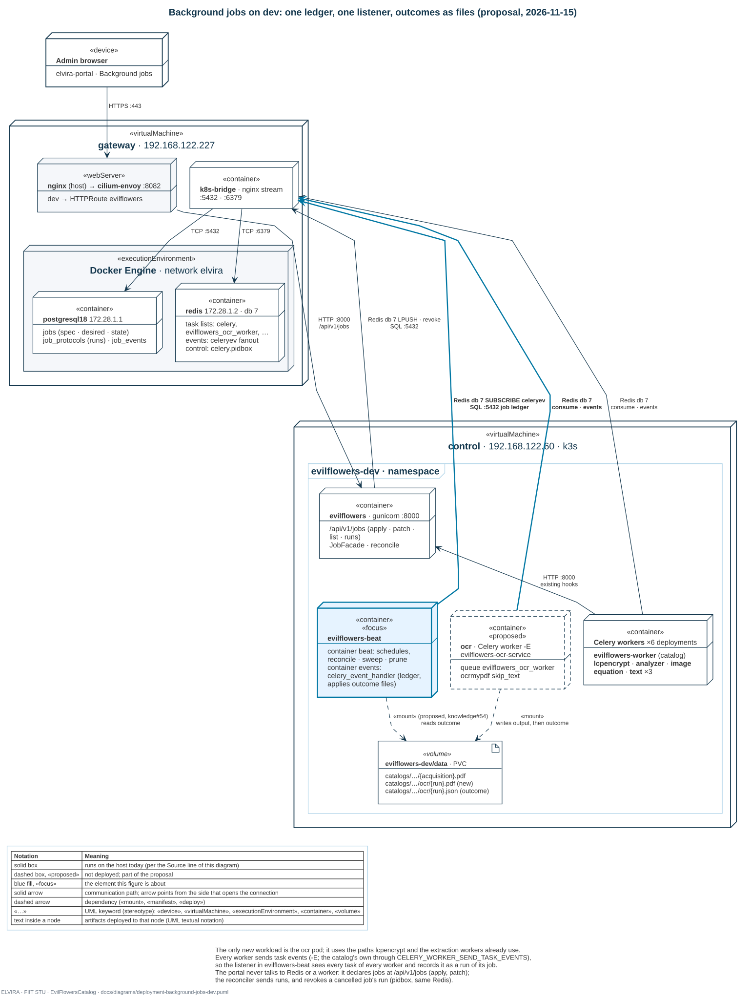

# IP-031: Background Jobs — One Ledger, One Registry, One API

Every background task the catalog runs or sends to a service worker becomes a **job**: one row in one
ledger, started, retried and revoked through one service, and read through one REST and MCP API. A
small **job kind** class says what a kind of work needs (its subject, task, arguments, permission
and how its report changes the subject). OCR (#146) is the first kind built on it; LCP encryption
(#148) and extraction register as kinds that keep their own models.

<!-- more -->

## Status

**Status**: Draft (implemented with the recommended answers; awaiting confirmation of the review answers)
**Last Updated**: 2026-11-14
**Implementation**: Catalog complete and tested locally (uncommitted); OCR service tracked in
evilflowers-ocr-service#1–#4; dev deployment open

### Implementation notes (2026-11-14)

What was built, and where it differs from the text below:

- **Every task is recorded at publish time.** `apps/tasks/apps.py` connects Celery's
  `before_task_publish`, so any task the catalog sends (JobService, a `.delay()` in a signal, beat)
  gets its ledger row, queued, with its exact arguments, before a worker can take it. Existing
  dispatch sites did not have to change; each kind reads its subject back from the call
  (`JobKind.subject_from_call`). A service's follow-up task inherits its parent's subject.
- **All jobs are kinds (23).** `maintenance.*` (the `apps.tasks` beat tasks plus `sweep_jobs` and
  `prune_jobs`), `readium.encrypt` + the four readium sweeps, `extraction.run`,
  `extraction.post_process`, `core.table_of_contents`, `core.embed_entries`,
  `assistant.highlight_annotation` / `summarise_sections` / `describe_figures`,
  `notifications.send` (not startable; a failed one can be re-sent), `dataverse.resume_workflow`
  (not re-sendable: its token is redacted) and `files.ocr`. A test fails when a catalog task has no kind.
- **Status values were renamed in the database** (`created`→`queued`, `in-progress`→`started`,
  `success`→`succeeded`) by migration `tasks.0002_jobs_ledger`, which also backfills kind and
  subject for LCP and extraction rows and the beat tasks and redacts stored `dataverse_token`s.
- **Secrets are redacted** from arguments and results (`token`, `password`, `secret`, `api_key`, …
  keys); a redacted call is never re-sent.
- **The MCP encryption tools** (`list_encryption_jobs`, `requeue_encryption`,
  `reencrypt_publication`) still call `ContentEncryptionService` directly; their dispatches are
  recorded by the publish hook with kind and subject, without `requested_by`. The job response's
  `detail.encryption` is the same `ENCRYPTION_JOB_SCHEMA` (`apps/readium/services/encryption_jobs.py`).
- **`EntryEncryptionView` (#148)** now covers every PDF/EPUB of the entry (`acquisitions`,
  optional `acquisition_id`), returns the full job shape, starts through JobService, and answers
  `force` on a registered package with a re-encryption in place or 409 with the active-loan count;
  it never deletes `EncryptedContent` rows.
- **OCR (#146)** starts after the upload's content is saved (`apps.files.jobs.queue_ocr`), only with
  `EVILFLOWERS_OCR_ENABLED` and the entry's `evilflowers_ocr_enabled`; the dead `background_tasks`
  signal is gone.
- **Added during review:** queued jobs with no event at all become `lost` after
  `EVILFLOWERS_JOBS_QUEUED_LOST_HOURS` (48 h); beat runs keep `job_events` only on trouble (Q6);
  `POST /readium/v1/entries/{id}/encryption` answers 409 for a job still on its way and re-sends only
  a stale or failed one; jobs of `stable_task_id` kinds cannot be revoked (workers remember revoked
  ids, a re-run would be discarded).

**Plan status.** Phases 1–3 and 6 are done in the catalog, plus the catalog parts of Phases 4–5.
Open:
- the OCR worker (evilflowers-ocr-service#1–#4);
- the dev deployment (knowledge#50);
- hand-off comments for the portal on #146 and #148;
- moving the MCP encryption tools onto JobService;
- an end-to-end run against a real broker (every test mocks the broker).

## Problem Statement

The admin portal (elvira-portal) has a "Background jobs" section with three tabs: LCP encryption,
AI processing (IP-018) and OCR. The catalog cannot serve it consistently, and it cannot show its
own Celery tasks reliably either.

### What the catalog records today

`manage.py celery_event_handler` (`apps/tasks/management/commands/celery_event_handler.py`) listens
to Celery events and writes `JobProtocol` rows (`job_protocols`). Measured on dev on 2026-11-14
(317 770 rows since 2026-03-15) and in 7 days of Loki logs:

| # | Gap | Evidence |
|---|-----|----------|
| 1 | Only `task-received`, `-started`, `-succeeded`, `-failed` are handled. `task-revoked`, `-retried`, `-rejected` change nothing; `JobStatus.REVOKED` is never set. | `celery_event_handler.py:96-110` |
| 2 | The result is copied only when the row is created, which is always `task-received`. | 11 of 317 051 `success` rows have a result |
| 3 | `task-failed` drops `exception` and `traceback`. | 133 `failed` rows, no reason recorded |
| 4 | Times are `timezone.now()` at processing, not the event timestamp; `runtime` is ignored. | `celery_event_handler.py:103-110` |
| 5 | No precedence: a later event of an earlier state overwrites; a redelivery overwrites `started_at` with no history. | two `evilflowers_equation.equations` rows, created 11-11 and 11-12, show `started_at` on 11-14 and are still `in-progress`: their earlier starts are gone |
| 6 | The name comes only from `task-received`; a missed received leaves `unknown`. | 326 rows `unknown` |
| 7 | Rows that never finish stay forever: no sweeper, `worker-offline` ignored. | 9 `in-progress` (one `backup` since March), 577 `created` |
| 8 | An event that cannot be stored is dropped. Celery events are pub/sub, so it is lost. A child whose parent row is missing fails the deferred FK check and is dropped too. | 857 `Skipping Celery event` in 7 days: prod PgBouncer `server_login_retry` outages, dev Ellipsis (#122); 4 of them match foreign-key / `IntegrityError` text |
| 9 | Event emission is not configured in the repository. The catalog worker runs without `-E` and no setting enables events; that its events arrive anyway is most likely Flower (running in prod and dev) enabling them remotely, which stops when Flower does. `task_send_sent_event` is off, so a task the catalog queued is invisible until a worker takes it. | `conf/supervisor.conf`, `settings/base.py`, knowledge `evilflowers.yaml.j2` |
| 10 | `worker` is `max_length=50`; k8s node names (`equation@dev.equation-77868cf6dd-49w24`) are already 38. | `apps/tasks/models.py` |
| 11 | No retention. 78 % of rows are the every-minute `sweep_unclaimed_reservations`. | 247 627 of 317 770 |
| 12 | Nothing can act on a task: no revoke anywhere, no generic retry, no API or admin for `JobProtocol`. A result backend is configured only by the deployment (`CELERY_RESULT_BACKEND` = Redis db 7 in the k8s template), and no catalog code reads it. | `grep` for `control.revoke`, `AsyncResult`, `result_backend` in `apps/`: none |

### What the portal needs and cannot get

- **OCR (#146)**: the dispatch is fire-and-forget to a worker that is not deployed. No model
  records the job, nothing can re-run it, the config flags are ignored (nothing reads
  `evilflowers_ocr_enabled` / `evilflowers_ocr_rewrite`), every MIME type would be sent and the
  original file would be overwritten in place. In practice the dispatch never fires for uploads:
  `attach_acquisition` (`apps/api/services/entry.py:260-262`) saves the row before its content,
  so the `created=True` save in `background_tasks` (`apps/core/models/acquisition.py:148-176`)
  sees no file and returns, and the later content save arrives with `created=False`.
- **LCP (#148)**: `GET/POST /readium/v1/entries/{id}/encryption` covers one file per entry. The
  list, requeue and re-encrypt the portal needs exist only as MCP tools, which the portal cannot
  call (`/mcp/v1` answers 403 to browser origins). `force=true` deletes `EncryptedContent` rows
  that licenses reference (`on_delete=RESTRICT`).
- **AI processing**: covered by `GET/POST /api/v1/entries/{id}/extraction`, but in a third shape.

Each feature that needs background work has grown its own tracker: `EncryptedContent` (task id,
attempts, webhook), `ExtractionRun` (states, worker reports), and #146 proposes `OcrJob`. Each
adds its own status vocabulary, endpoints and portal tab logic. Without a shared layer, the next
feature adds a fourth.

## Proposed Solution

### Overview

Three pieces in `apps/tasks`, plus a listener that tells the truth:

1. **Ledger**: `JobProtocol` grows into the record of every task. It gains a kind, a subject,
   timestamps from the events, attempts, error and traceback, the worker's report and the
   revoke request. An append-only `JobEvent` keeps every event, so a redelivery or retry is
   history instead of an overwrite.
2. **Registry**: a `JobKind` class per kind of work: subject model, Celery task name, queue,
   arguments, permission, eligibility, report handler and optional kind-specific actions.
3. **JobService**: the only way to start, retry, revoke or report a job. It writes the ledger row
   **before** sending, using the row id as the Celery task id, so a job is visible as queued
   before any worker sees it.

The REST API (`/api/v1/jobs`), the MCP tools, domain signals and beat all call JobService. The
listener only updates rows; it never starts work.

### Diagrams

The proposal is drawn on three layers, in the ELVIRA PlantUML theme (`docs/diagrams/`).

**Deployment (dev, k8s).** The only new workload is the OCR worker pod. Every worker sends events
to Redis db 7; the listener in `evilflowers-beat` writes the ledger; services report to one
endpoint; the portal uses only the catalog API.



**Components (inside the catalog).** Interface adapters (REST, MCP, signals, report view) → job
core (JobService, registry, ledger, listener, sweeper) → kinds → Celery.


**Sequence (one OCR job).** Celery events drive the status; the worker's report drives the change
to the acquisition and starts the follow-up jobs. Failure, retry and revoke use the same ledger.


Prod runs the same processes in one Compose container (`conf/supervisor.conf`: gunicorn, worker,
beat, listener). No OCR worker runs in prod until a deployment decision (Q2).

### Key Components

1. **Ledger** (`JobProtocol`, `JobEvent`): one row per Celery task id, whatever started it, plus
   every event. Tasks the catalog did not start through JobService (beat, plain `.delay()`, the
   services' internal follow-ups) are recorded too, with `kind = NULL`.
2. **JobKind registry** (`apps/tasks/kinds.py`): kinds register at app start
   (`AppConfig.ready`). The registry is a dict by name; `GET /api/v1/jobs/kinds` serves it to the
   portal.
3. **JobService** (`apps/tasks/services.py`): `start`, `retry`, `revoke`, `run_action`, `report`.
   It checks permission and eligibility, refuses a second active job for the same kind and
   subject unless `force`, writes the row and sends on commit.
4. **Event listener** (rewritten `celery_event_handler`): handles every `task-*` event, applies
   only events newer than the row's last event, stores what the events carry, buffers through
   database outages and never loses a child for a missing parent.
5. **Sweeper and retention** (beat): marks jobs `lost` when no event arrived past the task's time
   limit; prunes old rows by status and keeps the latest job per kind and subject.
6. **REST API and MCP tools**: list (filters, `latest`, `stale`), detail with events, kinds,
   summary counts, start, retry, revoke, kind actions, worker report.
7. **First kinds**: `files.ocr` (#146, new), `readium.encrypt` (#148, adapter over
   `EncryptedContent`), `extraction.run` (adapter over `ExtractionRun`).

## Implementation Plan

### Phase 1: The listener tells the truth

These are bugs; they ship before and independently of the rest.

- [ ] Settings: `CELERY_WORKER_SEND_TASK_EVENTS = True`, `CELERY_TASK_SEND_SENT_EVENT = True`
- [ ] Handle `task-sent`, `-received`, `-started`, `-succeeded`, `-failed`, `-retried`,
      `-revoked`, `-rejected`; ignore other types
- [ ] Precedence (one rule, see Status): apply an event only if its timestamp is not older than
      the row's `last_event_at`; a `revoked` row takes no further status change; another
      terminal row reopens only on a newer `task-received` / `task-started` (redelivery, Celery
      retry, stable-id re-queue). Celery timestamps; hosts are NTP-synced through chrony
- [ ] Store `result`, `exception`, `traceback`, `runtime`, `retries`, `queue`/`routing_key`,
      `hostname` from whichever event carries them; take the name from any event that has it
- [ ] Event timestamps for `sent_at`, `received_at`, `started_at`, `finished_at`
- [ ] Append every applied event to `JobEvent`
- [ ] `parent` and `retry_of` with `db_constraint=False`: a child is never lost for its parent
- [ ] `worker` → `max_length=255`
- [ ] Database outage: keep events in a bounded in-memory queue, retry with backoff, log
      once per outage; drop (and log) only events that fail with a data error
- [ ] Tests for every event type, out-of-order events, outage replay, missing parent

### Phase 2: Ledger, registry and JobService

- [ ] Migration: new `JobProtocol` fields (see Data Model Changes), `JobEvent`, status values
      `retrying`, `rejected`, `lost`
- [ ] `JobKind` base class and registry; `apps.tasks` loads kinds from each app's `jobs.py`
- [ ] `JobService.start/retry/revoke/run_action/report` with permission, eligibility and
      single-active-job checks; row before send; send in `transaction.on_commit`
- [ ] Revoke: `app.control.revoke(task_id, terminate=…)`; a queued job is also marked
      `revoked` at once (a worker that has not seen it discards it on receipt)
- [ ] Sweeper beat task: `lost` for started jobs with no event past their time limit + grace;
      the limit is the kind's `time_limit`, else `CELERY_TASK_TIME_LIMIT` for tasks of the
      catalog's own Celery app, else `EVILFLOWERS_JOBS_SERVICE_TIME_LIMIT_HOURS` (service tasks
      run for hours, #120); `stale` flag for queued jobs older than `EVILFLOWERS_JOBS_STALE_MINUTES`
- [ ] Retention beat task (see Configuration)
- [ ] Backfill: set `kind`/subject on existing rows whose id matches `EncryptedContent.task_id`
      or an extraction task id

### Phase 3: REST API and MCP tools

- [ ] `apps/api` views, filters, forms and serializers for the endpoints under API Changes
- [ ] OpenAPI schemas (no bare `{"type": "object"}`)
- [ ] MCP tools: `list_jobs`, `get_job`, `start_job`, `retry_job`, `revoke_job`, `run_job_action`;
      existing encryption tools stay and call JobService
- [ ] Worker report endpoint with service credentials (`tasks.report_job` permission)
- [ ] API and MCP tests

### Phase 4: OCR (#146), the first kind

- [ ] `files.ocr` kind: subject `Acquisition`; eligible when the MIME type is
      `application/pdf`, the entry has a language and `EVILFLOWERS_OCR_ENABLED` is on
- [ ] Upload signal: start OCR only when the entry config has `evilflowers_ocr_enabled`;
      remove the old `event_broker.execute("evilflowers_ocr_worker.ocr", …)` branch, the unused
      `dependent_tasks` variable and the stale docstring
- [ ] Task kwargs: `source`, `destination` (`…/ocr/{job_id}.pdf`), `language`, `job_id`,
      `report_url`; the original file is never written
- [ ] Start OCR after the content is saved (on commit of `attach_acquisition`), not from the
      `created=True` save that has no file yet
- [ ] Report handler: verify the output, then apply it per Q3 (replace the content and clear
      `checksum_cached`, which nothing clears today, or add a derived acquisition); start `readium.encrypt` (re-encrypt, keeps the
      content id, guards loans) and `extraction.run` as child jobs; `skipped` changes nothing
- [ ] evilflowers-ocr-worker: kwargs task signature, `ocrmypdf.ocr(skip_text=True)`, write
      `destination`, report to `report_url` with `Authorization: Bearer`, `-E`, OTel SDK and JSON
      logs per Deploy-a-Service (separate repository and PR)
- [ ] Deployment: issue in EvilFlowersCatalog/knowledge with the Ansible steps for an `ocr`
      Deployment in `evilflowers-dev` (image, queue, data PVC, API key Secret, OTLP)

### Phase 5: LCP (#148) and extraction as kinds

- [ ] `readium.encrypt` kind over `ContentEncryptionService`: `start` → encrypt, actions
      `requeue` (same content id, new task) and `reencrypt` (`dry_run`, `force`, active-loan
      guard); `detail` returns the MCP `ENCRYPTION_JOB_SCHEMA` fields (`content_id`, `attempts`,
      `last_dispatched_at`, `reported_at`, `report`, `stale`, `trace_id`)
- [ ] `EntryEncryptionView`: every PDF/EPUB acquisition, job shape in the response; `force`
      goes through `reencrypt` or answers 409 with the active-loan count
- [ ] `extraction.run` kind over the extraction service; `/api/v1/entries/{id}/extraction` stays
- [ ] Portal hand-off: comment on #146 and #148 with the endpoints and filters

### Phase 6: Documentation

- [ ] `docs/catalog-wiki/Asynchronous-Tasks.md`: jobs, kinds, API, listener guarantees
- [ ] `docs/catalog-wiki/Management-commands.md`: listener behaviour and settings
- [ ] Diagrams: re-render on change; offer the deployment diagram to the knowledge vault

### Prerequisites

- #122 Ellipsis fix (uncommitted on develop) is kept by Phase 1
- A catalog API key for the OCR worker (user with `tasks.report_job`)

## Technical Details

### Technology Stack

- Celery events (`celery.events.EventReceiver`) over the existing Redis broker: already the
  transport every worker uses; no new infrastructure.
- Celery remote control (`app.control.revoke`, pidbox on the same Redis) for revoke.
- Django ORM, `ContentType` for the generic subject.
- The result backend is not used: the deployment sets `CELERY_RESULT_BACKEND` (Redis db 7) but
  no catalog code reads it, and the ledger becomes the result store. Nothing here depends on the
  backend; removing it from the deployment is a separate decision.

### Data Model Changes

`job_protocols` (model `JobProtocol`, kept name; existing columns stay):

| Column | Type | Notes |
|---|---|---|
| `kind` | varchar(100) null, indexed | registry name; NULL for tasks not started through JobService |
| `subject_type_id` | FK `django_content_type` null | generic subject |
| `subject_id` | uuid null | all catalog models use UUID keys |
| `catalog_id` | FK `catalogs` null, `SET_NULL` | from `kind.scope(subject)`; filter and ACL |
| `entry_id` | FK `entries` null, `SET_NULL` | from `kind.scope(subject)`; filter |
| `requested_by_id` | FK `users` null, `SET_NULL` | who started it; NULL for signals and beat |
| `options` | jsonb default `{}` | the kind options as requested; a retry reuses them |
| `retry_of_id` | FK self null, `db_constraint=False` | manual retry chain |
| `parent_id` | existing, now `db_constraint=False` | Celery parent / follow-up parent |
| `queue` | varchar(100) null | routing key from `task-sent`/`received` |
| `worker` | varchar(255) null | was 50 |
| `status` | queued, received, started, retrying, succeeded, failed, revoked, rejected, lost | old values renamed by the migration |
| `attempts` | int default 0 | `task-started` count |
| `sent_at`, `received_at` | timestamptz null | event timestamps |
| `started_at`, `finished_at` | existing, now from events | |
| `last_event_at` | timestamptz null | precedence guard |
| `runtime` | double null | from `task-succeeded` |
| `error` | text null | exception repr |
| `traceback` | text null | |
| `report` | jsonb null | worker report as accepted by the kind |
| `reported_at` | timestamptz null | |
| `revoke_requested_at` | timestamptz null | |
| `trace_id` | varchar(32) null | trace of the start, for Tempo links |

Indexes: `(kind, subject_type_id, subject_id, created_at DESC)` for "latest per subject",
`(status, created_at)`, `(catalog_id, kind, status)`.

`job_events` (new, model `JobEvent`):

| Column | Type |
|---|---|
| `id` | uuid |
| `job_id` | FK `job_protocols`, `CASCADE`, `db_constraint=False` |
| `type` | varchar(30) |
| `timestamp` | timestamptz (the event's) |
| `hostname` | varchar(255) null |
| `data` | jsonb (the event minus args/kwargs, trimmed) |

No `OcrJob` table: the ledger row, its `report` and the acquisition are the OCR state (Q4).

### The JobKind contract

```python
class JobKind:
    name: str                      # "files.ocr"
    title: str                     # portal label
    task: str                      # Celery task name
    queue: str | None = None       # None: CELERY_TASK_ROUTES decides
    subject_model: type[Model]
    permission: str = "core.change_entry"
    exclusive: bool = True         # one active job per subject
    stable_task_id: bool = False   # True: the kind owns a deterministic task id (extraction)
    time_limit: timedelta | None = None  # sweeper limit; None: see Phase 2
    terminate_safe: bool = False   # revoke(terminate=True) allowed (Q7)
    options_schema: dict = {}      # JSON Schema of start options

    def scope(self, subject) -> tuple[UUID | None, UUID | None]: ...   # (catalog_id, entry_id)
    def eligible(self, subject, options) -> str | None: ...            # None or the reason
    def dispatch(self, job, subject, options) -> None: ...              # default: send_task(task, kwargs=self.kwargs(...), task_id=job.id)
    def kwargs(self, job, subject, options) -> dict: ...
    def on_report(self, job, subject, payload) -> None: ...
    def detail(self, job, subject) -> dict: ...                         # kind fields in the job response
    actions: dict[str, JobAction] = {}                                  # e.g. readium.encrypt: requeue, reencrypt
```

Adapter kinds override `dispatch` to call their existing service with `task_id=job.id`, so their
own model and the ledger share the id:

- `readium.encrypt`: `ContentEncryptionService._record_dispatch` (`content_encryption_service.py:298`)
  mints a `uuid4` today; it takes the job id instead. `EncryptedContent` keeps `task_id`,
  `trace_id`, `attempts`, `last_dispatched_at`, `report` and `reported_at`, and the result webhook
  (`EncryptionResultWebhook`) keeps ignoring reports for an older task.
- `extraction.run`: the task id is deterministic (`uuid5` of acquisition and pipeline version,
  `apps/extraction/services.py:107`), so every re-queue of a run reuses one Celery task id.
  The kind declares `stable_task_id = True`: a retry resets the existing row to queued instead of
  inserting a new one, and the attempts stay in `JobEvent` (Q9).

### Status

| Status | Set by |
|---|---|
| queued (was `created`) | JobService before send; the publish hook for any other task the catalog sends; `task-sent` for a service's tasks |
| received | `task-received` |
| started (was `in-progress`) | `task-started` (`attempts += 1`) |
| retrying | `task-retried` (Celery `self.retry`, autoretry) |
| succeeded (was `success`) | `task-succeeded` |
| failed | `task-failed` |
| revoked | `task-revoked`, or JobService for a still-queued job |
| rejected | `task-rejected` |
| lost | sweeper: started, and no event past the time limit + grace (Phase 2) |

Precedence: an event applies only if its timestamp is not older than `last_event_at`. `revoked`
is final. Any other terminal status (`succeeded`, `failed`, `rejected`, `lost`) reopens only on a
newer `task-received` or `task-started`: a broker redelivery, a Celery retry, or a re-queue of a
`stable_task_id` kind (Q9). JobService's own writes (queued, revoked) follow the same rule.

The stored values are these names; migration `tasks.0002_jobs_ledger` rewrote the old ones. `stale` is a computed flag (queued past
`EVILFLOWERS_JOBS_STALE_MINUTES`), not a status.

The worker's `report` is separate from the status: a job can be `succeeded` without a report
(the portal shows "no report") or reported before its `task-succeeded` arrives.

### API Changes

All under the administrator gate of the kind (`core.change_entry` by default), per Q1.

| Method | Path | Body / params | Result |
|---|---|---|---|
| GET | `/api/v1/jobs` | `kind`, `status` (csv), `stale`, `latest` (one per kind + subject), `catalog_id`, `entry_id`, `subject_type`, `subject_id`, `name`, `created_after`, `created_before`, `query` (entry title), `page`, `limit`, `order_by` | paginated jobs |
| GET | `/api/v1/jobs/{id}` | – | job + events + children + retries + kind `detail` |
| GET | `/api/v1/jobs/kinds` | – | name, title, subject type, options schema, actions |
| GET | `/api/v1/jobs/summary` | `kind`, `catalog_id` | counts by kind × status, plus stale; the dashboard's attention badges |
| POST | `/api/v1/jobs` | `{kind, subject_id, options?, force?}` | 201 job; 409 active job exists; 422 not eligible (reason) |
| POST | `/api/v1/jobs/{id}/retry` | `{options?}` | 201 new job (`retry_of`); 409 for jobs without a kind |
| POST | `/api/v1/jobs/{id}/revoke` | `{terminate?}` | 202 job |
| POST | `/api/v1/jobs/{id}/actions/{action}` | action options (`dry_run`, `force`, …) | action result |
| POST | `/api/v1/jobs/{id}/report` | kind payload | 200; idempotent; service credentials only |

How #148's table maps: `GET /readium/v1/encryption-jobs` → `GET /api/v1/jobs?kind=readium.encrypt&latest=true&status=queued,failed`;
`/requeue` → `POST /api/v1/jobs/{id}/actions/requeue`; `/reencrypt` →
`POST /api/v1/jobs/{id}/actions/reencrypt` (Q5 asks whether the portal also wants the
`/readium/v1/encryption-jobs` paths).

How #146's table maps: `GET /api/v1/entries/{id}/ocr` → `GET /api/v1/jobs?kind=files.ocr&entry_id=…&latest=true`;
`POST …/ocr` → `POST /api/v1/jobs {kind: files.ocr, subject_id: <acquisition>}`;
`GET /api/v1/ocr-jobs?status=` → `GET /api/v1/jobs?kind=files.ocr&status=`.

### Configuration

```ini
# Celery (settings, not env)
CELERY_WORKER_SEND_TASK_EVENTS=True
CELERY_TASK_SEND_SENT_EVENT=True

# Jobs
EVILFLOWERS_JOBS_STALE_MINUTES=60          # queued longer → stale
EVILFLOWERS_JOBS_LOST_GRACE_MINUTES=15     # started longer than time limit + this → lost
EVILFLOWERS_JOBS_SERVICE_TIME_LIMIT_HOURS=12  # limit for service tasks without a kind (= visibility timeout)
EVILFLOWERS_JOBS_RETENTION_DAYS=30         # succeeded / revoked
EVILFLOWERS_JOBS_RETENTION_FAILED_DAYS=90  # failed / lost / rejected
EVILFLOWERS_JOBS_IGNORE_TASKS=             # csv of task names not recorded (Q6)

# OCR
EVILFLOWERS_OCR_ENABLED=false              # no worker deployed → no dispatch
```

The latest job per kind and subject is never pruned.

## Alternatives Considered

### Alternative 1: One tracker per feature (`OcrJob`, as #146 proposes)

**Description**: copy `EncryptedContent` for OCR; add REST endpoints per feature (#148's
`/readium/v1/encryption-jobs`, `/api/v1/ocr-jobs`).
**Pros**: no shared abstraction to design; each feature stays self-contained.
**Cons**: a fourth status vocabulary and endpoint family; the portal writes one tab per backend;
Celery-level facts (events, revoke, lost tasks) stay in a log nobody reads.
**Why not chosen**: the shared part (dispatch, status, retry, revoke, list) is most of each
tracker; only the report handling differs, and that is what a kind is.

### Alternative 2: Celery result backend + Flower API

**Description**: read state from the result backend the deployment already configures (Redis
db 7) with `AsyncResult`, use Flower's REST API for revoke and inspection.
**Pros**: off the shelf.
**Cons**: no subject (which acquisition?), no permissions, results expire, Flower is VPN-only and
not a product API; the portal would talk to two systems.
**Why not chosen**: it answers "what is task X doing", not "what happened to this book".

### Alternative 3: Record from signals inside the workers

**Description**: `task_prerun`/`task_postrun`/`task_failure` signals in the catalog worker write
the ledger directly.
**Pros**: no event listener; transactional with the task.
**Cons**: covers only the catalog's own worker; the service workers (lcpencrypt, extraction,
OCR) do not run catalog code and have no database access.
**Why not chosen**: events are the one thing every Celery worker emits.

### Alternative 4: Let the portal speak MCP

**Description**: allow-list the portal origin in `EVILFLOWERS_MCP_ALLOWED_ORIGINS`.
**Why not chosen**: couples the admin UI to tool descriptions written for models (#148 already
prefers REST). The MCP tools remain, on top of the same service.

## Trade-offs and Risks

### Trade-offs

- **One row per Celery task, not per subject**: history and retries are honest; "current state
  of this book" needs `latest=true`. The index makes that one query.
- **Events are best effort**: Celery does not queue events for an absent listener. The ledger row
  written before send, the buffer and the sweeper make a gap visible (`stale`, `lost`) instead of
  silent; they do not make events durable.
- **Generic subject (`ContentType`)**: no FK integrity to the subject; `catalog_id`/`entry_id` are
  real FKs for filtering and ACL.

### Risks

| Risk | Impact | Mitigation |
|---|---|---|
| Event volume grows with `task-sent` and every worker on `-E` | Medium | `JobEvent` trimmed, retention; `EVILFLOWERS_JOBS_IGNORE_TASKS` for the every-minute beat tasks |
| Listener falls behind under a backfill (thousands of events) | Medium | one transaction per event today; batch per second if the lag metric shows it |
| Clock skew between hosts breaks precedence | Low | chrony on every node; precedence also uses the state order for equal timestamps |
| Revoke of a queued task is lost when workers restart (revokes live in worker memory) | Medium | the row is `revoked` at once; if the task still runs, its report gets 409 and changes nothing, and the listener keeps `revoked` over later events (Q7) |
| OCR replaces a file that LCP or extraction is reading | High | the original is never written; the swap happens in the report handler and re-queues both as child jobs |

## Success Criteria

- [ ] Every task of every worker (catalog, lcpencrypt, extraction, OCR) appears in the ledger with
      its name, queue, worker, event times, attempts, and on failure its error and traceback
- [ ] A database outage of a few minutes loses no events
- [ ] No row stays `queued` or `started` forever: it becomes `stale` or `lost`
- [ ] The portal's three tabs (LCP, AI processing, OCR) use `/api/v1/jobs` with server-side
      filtering and paging
- [ ] An admin can start, retry and revoke OCR for one acquisition, and re-queue or re-encrypt an
      LCP job, from REST and MCP
- [ ] OCR never overwrites the original upload; a successful OCR re-queues LCP and extraction

## Future Considerations

- Batch start (`POST /api/v1/jobs/batch`) for "OCR every PDF of this catalog"
- Server-sent events for live job status in the portal
- Prometheus metrics from the ledger (queued age, failure rate per kind) for KEDA and alerts
- S3 storage for service workers (signed URLs instead of the shared volume)

## References

- EvilFlowersCatalog#146 — OCR is not functional
- EvilFlowersCatalog#148 — REST API for background jobs (LCP)
- EvilFlowersCatalog#99 — LCP encryption result webhook
- EvilFlowersCatalog#108, #122 — listener survives bad events
- IP-018 (extraction runs), IP-019 (telemetry), IP-029 (semantic tracing)
- Celery: [Monitoring and Management — Events](https://docs.celeryq.dev/en/stable/userguide/monitoring.html#events)
- Diagrams: `docs/diagrams/deployment-background-jobs-dev.puml`,
  `component-background-jobs.puml`, `sequence-ocr-job-lifecycle.puml`

## Discussion

- 2026-11-14: started from an audit of the Celery integration ("do we see the whole task
  lifecycle and can we control it?"); #146 (OCR) and #148 (LCP jobs REST) were filed the same day
  from the portal's "Background jobs" section and are the first consumers.

## Review Questions

**Status**: ⏳ Awaiting Answers
**Review Date**: 2026-11-14
**Reviewer**: Claude AI

> **Implemented with option A of every question** (the recommended one), on request (2026-11-14:
> "execute implementation - migrate all jobs"). The answers below are still open: confirm A or
> pick another option, and the implementation follows. Q2-A means the OCR worker is built in
> evilflowers-ocr-service and deployed on dev first; `EVILFLOWERS_OCR_ENABLED` stays off until then.

The following questions must be answered before implementation:

---

### Q1: Who may see and control jobs? ⚠️ Medium

**Issue**: API Changes puts every endpoint behind the kind's permission, default `core.change_entry`
(#148's administrator gate). `Entry` has `default_permissions=()`, so that check is in effect
superuser-only. Catalog managers already re-run extraction on their entries:
`/api/v1/entries/{id}/extraction` checks `check_entry_manage` (`apps/extraction/admin_views.py:307`).

**Context**: `catalog_id` on the row makes a per-catalog filter cheap, but it widens who can revoke
or re-run paid-for work (CPU on control).

**Question**: Are jobs administrator-only, or may catalog managers see and start jobs for subjects
in their catalogs?

**Options**:
- [ ] **A**: Administrators only, per kind permission (recommended for the first version)
- [ ] **B**: Catalog managers see and start jobs in their catalogs; revoke stays administrator-only
- [ ] **C**: Catalog managers get everything within their catalogs

**Answer**:
```
```

**Resolution**:
```
```

---

### Q2: Does OCR stay a feature, and where does the worker run? 🔴 Critical

**Issue**: #146 asks this first. No OCR worker runs anywhere; the extraction pipeline (IP-018)
already extracts text from born-digital PDFs. OCR only adds value for scanned PDFs.

**Context**: Phase 4 includes changing and deploying `evilflowers-ocr-worker`. Without a
worker, the kind would only queue tasks that wait forever (today's bug).

**Question**: Keep OCR, and deploy it where?

**Options**:
- [ ] **A**: Keep; build the kind and worker changes, deploy on dev only, prod after a dev trial (recommended)
- [ ] **B**: Keep; deploy on dev and prod together
- [ ] **C**: Drop OCR: remove the signal branch and the two config flags, archive the worker; IP-031 ships with LCP and extraction as first kinds

**Answer**:
```
```

**Resolution**:
```
```

---

### Q3: What happens to the original PDF after OCR? 🔴 Critical

**Issue**: `evilflowers_ocr_rewrite` exists in `EntryConfig` but nothing reads it. Replacing the
file changes the checksum, invalidates the LCP-encrypted copy and the extraction run, and
destroys the original unless it is kept.

**Context**: LCP re-encryption keeps the content id but must not run under active loans
(`reencrypt` guards them). A derived acquisition keeps everything intact but shows two files.

**Question**: On a successful OCR report, what does the catalog do?

**Options**:
- [ ] **A**: `evilflowers_ocr_rewrite` decides: true → replace the acquisition's file (old file kept under `…/ocr/original/` until the next successful run), re-encrypt and re-extract; false → add a derived acquisition (recommended)
- [ ] **B**: Always replace the file
- [ ] **C**: Always add a derived acquisition

**Answer**:
```
```

**Resolution**:
```
```

---

### Q4: Separate `OcrJob` table or the ledger only? ℹ️ Low

**Issue**: #146 proposes `OcrJob` mirroring `EncryptedContent`. Data Model Changes proposes no
OCR table: the ledger row (status, attempts, error, `report`) and the acquisition carry the state.

**Question**: Is the ledger enough for OCR?

**Options**:
- [ ] **A**: Ledger only; the kind's `detail` reads `report` (recommended)
- [ ] **B**: Add `OcrJob` as #146 proposes, linked by task id

**Answer**:
```
```

**Resolution**:
```
```

---

### Q5: Generic API only, or also #148's LCP paths? ⚠️ Medium

**Issue**: #148 proposes `/readium/v1/encryption-jobs` with requeue and re-encrypt. This proposal
serves the same through `/api/v1/jobs?kind=readium.encrypt` and kind actions.

**Context**: The portal team wrote #148 against the MCP schema. Two paths for one thing double
the tests and the OpenAPI surface.

**Question**: Which paths ship?

**Options**:
- [ ] **A**: Generic only; the job response embeds `ENCRYPTION_JOB_SCHEMA` fields in `detail`; fix `EntryEncryptionView` gaps 3–6 (recommended)
- [ ] **B**: Generic plus `/readium/v1/encryption-jobs` as thin aliases
- [ ] **C**: #148 as written, generic API later

**Answer**:
```
```

**Resolution**:
```
```

---

### Q6: Record every-minute beat tasks? ℹ️ Low

**Issue**: `sweep_unclaimed_reservations` (every minute) and `expire_lapsed_licenses` (every 5
minutes) are 93 % of today's rows. With `JobEvent` each costs ~4 more rows.

**Question**: How are high-frequency beat tasks recorded?

**Options**:
- [ ] **A**: Record them; retention removes successes after `EVILFLOWERS_JOBS_RETENTION_DAYS`, `JobEvent` kept only for failed jobs of kind NULL (recommended)
- [ ] **B**: Skip them by name (`EVILFLOWERS_JOBS_IGNORE_TASKS`), record only failures
- [ ] **C**: Record everything, full events

**Answer**:
```
```

**Resolution**:
```
```

---

### Q7: How does a revoked-but-already-running job stop? ⚠️ Medium

**Issue**: `control.revoke(terminate=True)` sends SIGTERM to the pool process. The OCR, lcpencrypt
and extraction workers run their own code; a killed lcpencrypt may leave a half-written file, and
revokes of queued tasks live only in worker memory (lost on restart without `--statedb`).

**Question**: What does revoke promise?

**Options**:
- [ ] **A**: Revoke = "do not start"; `terminate` allowed only for kinds that declare it safe; a report for a revoked job answers 409 and changes nothing (recommended)
- [ ] **B**: Always terminate
- [ ] **C**: No terminate at all

**Answer**:
```
```

**Resolution**:
```
```

---

### Q8: Report authentication for service workers ⚠️ Medium

**Issue**: lcpencrypt reports to `/readium/v1/hooks/encryption/result` with Basic credentials
embedded in `EVILFLOWERS_READIUM_LCPENCRYPT_REPORT_URL` (the endpoint is open when that URL has
none, `apps/readium/views/hooks.py:41`); extraction workers call `/extraction/v1/runs/…` with a
Bearer API key holding `extraction.ingest_extraction`. The generic report endpoint needs one rule;
the existing two stay as they are.

**Question**: How does a worker authenticate a report?

**Options**:
- [ ] **A**: Bearer API key of a service user with `tasks.report_job`; the report must name the job's kind (recommended)
- [ ] **B**: A per-job signed token in `report_url` (no shared key; the job id alone grants the report)
- [ ] **C**: Both: API key required, token binds the report to the job

**Answer**:
```
```

**Resolution**:
```
```

---

### Q9: Kinds whose task id never changes ⚠️ Medium

**Issue**: The ledger is one row per Celery task id, and a retry inserts a new row (`retry_of`).
Extraction derives its task id from acquisition and pipeline version, so every re-queue reuses the
id (by design: the worker's late reports are matched by `?attempt=`). The listener would see a
second `task-received` for a row that is already `success` or `failed`.

**Context**: The precedence rule applies an event only if it is newer than `last_event_at`; a
re-queue is newer, so the row would move back to received with its old `report` and `error`.

**Question**: How does the ledger treat a reused task id?

**Options**:
- [ ] **A**: `stable_task_id` kinds: JobService resets the row (status queued, error/report cleared, `attempts` kept) before re-sending; the old attempt survives in `JobEvent` (recommended)
- [ ] **B**: Change extraction to a fresh task id per attempt (worker contract unchanged: it reports by `run_id` and `attempt`)
- [ ] **C**: Leave extraction out of the ledger's kinds; list it from `ExtractionRun` only

**Answer**:
```
```

**Resolution**:
```
```

---

### Q10: Notification jobs keep a per-reader record ⚠️ Medium

**Issue**: `notifications.send` jobs store the exact call: notification type, recipient id and the
template context (loan, title, dates). The subject is the reader, and retention keeps the newest
job per kind and subject forever, so every reader keeps one notification record indefinitely, next
to IP-016's activity history (with its own retention) and IP-029 Q1 (no reading log in traces).

**Question**: How much of a notification job is kept?

**Options**:
- [ ] **A**: Keep the call (needed to re-send a failed e-mail), but leave `notifications.send` out of the "newest per subject is kept" rule, so it expires with normal retention (recommended)
- [ ] **B**: Store only the type and recipient; a failed e-mail cannot be re-sent from the ledger
- [ ] **C**: Keep as implemented

**Answer**:
```
```

**Resolution**:
```
```

---

**Instructions for completing Review Questions**:

1. For each question, check the box next to your chosen option
2. Fill in the "Answer" section with your reasoning
3. Fill in the "Resolution" section with specific changes to make
4. Update the proposal based on all resolutions.
5. Change Status to "✅ Resolved" when all questions answered.  Remove the "Review Questions" after the document is accepted.
6. Add changelog entry: "Resolved review questions and updated proposal accordingly"

---

## Changelog

| Date | Author | Changes |
|------|--------|---------|
| 2026-11-14 | jdubec | Initial draft from the Celery integration audit, #146 (OCR) and #148 (LCP jobs REST); deployment, component and sequence diagrams |
| 2026-11-14 | jdubec | Added Review Questions section |
| 2026-11-14 | jdubec | Code survey: OCR signal never fires on upload (content saved after the row), extraction reuses one task id (`stable_task_id`, Q9), `core.change_entry` is superuser-only in effect, report auth of the existing hooks |
| 2026-11-14 | jdubec | Review pass: one precedence rule, per-kind sweeper limit (service tasks run for hours), result backend is configured by the deployment, evidence rows 5/8/9 reworded to what was measured, Discussion section |
| 2026-11-14 | jdubec | Implemented in the catalog with option A of every review question: ledger + JobEvent (migration with backfill and status rename), publish hook, 23 kinds, JobService, listener with outage buffer, sweeper/prune, `/api/v1/jobs`, MCP job tools, OCR kind, #148 fixes; Implementation notes added; OCR service issues evilflowers-ocr-service#1–#4 |
| 2026-11-14 | jdubec | Review fixes (queued→lost, beat event history, entry trigger 409, no revoke for stable ids, OpenAPI generation); deployment knowledge#50; Q10 (notification records) added |
