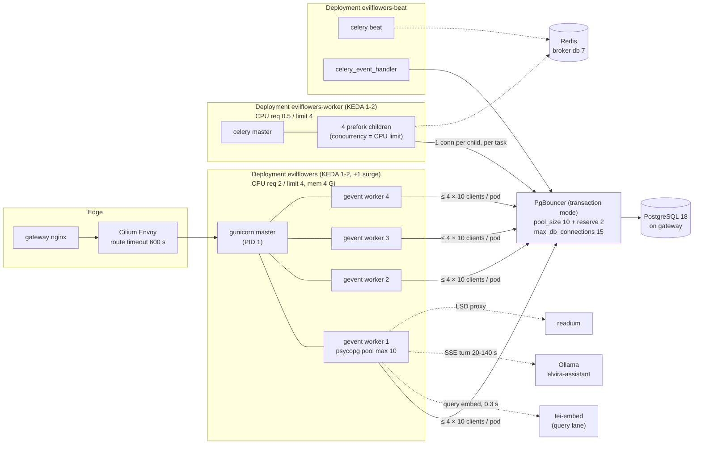
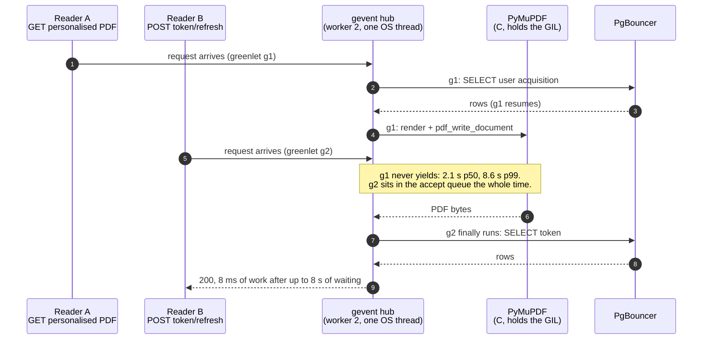
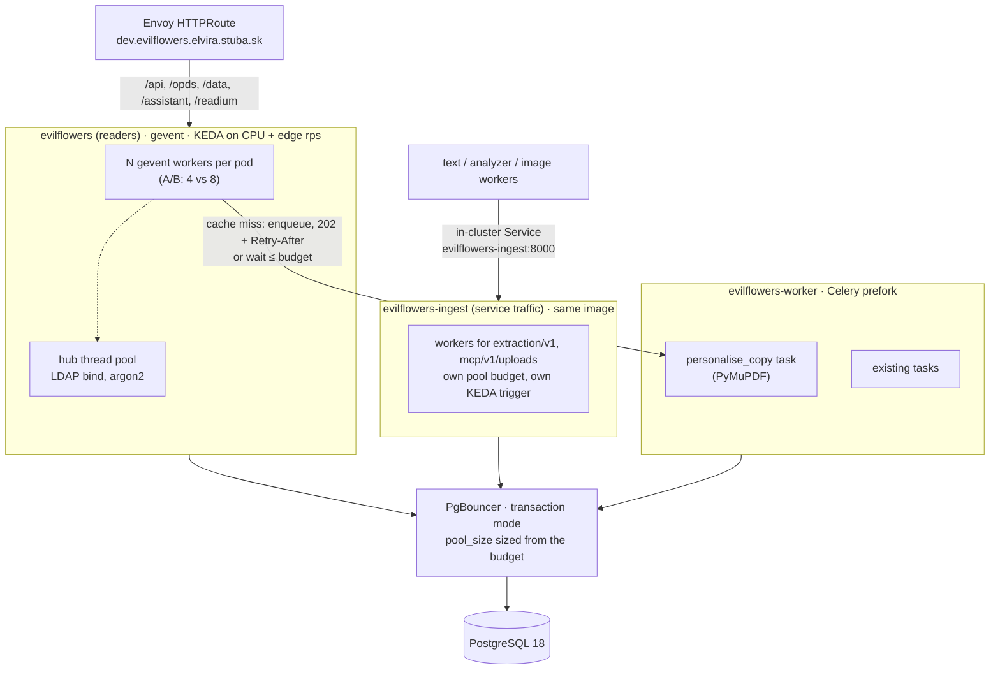
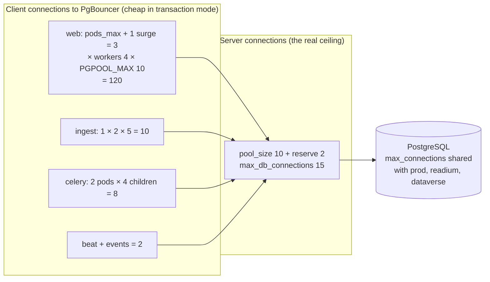
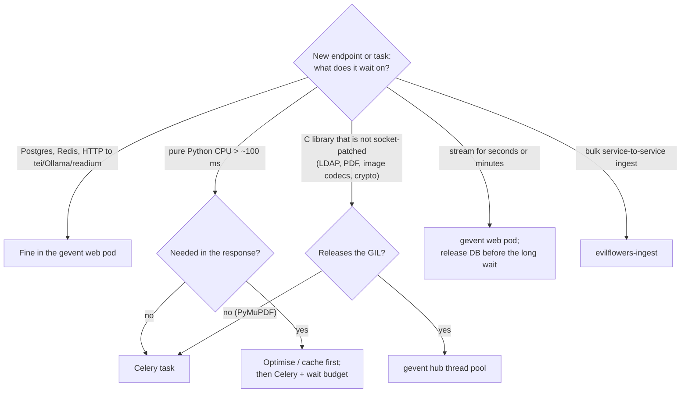

# IP-032: The Web Worker Model — gevent, Kept Off the CPU

Which gunicorn worker class the catalog should run on k8s, and how to size it together with the database
pool, Celery and the embedding traffic. The short answer: **stay on gevent**, but take CPU-heavy and
C-blocking work off the gevent hub, split bulk ingest away from readers, and size workers and pools from a
connection budget instead of from the CPU count. ASGI is not an option while every view is synchronous:
Django buffers a synchronous streaming body in full under ASGI, which would break the assistant's SSE and
file range downloads.

<!-- more -->

## Status

**Status**: Rejected (2026-11-15)

**Rationale**: The catalog will migrate to ASGI instead of investing further in the gevent model. Until
then the current gunicorn gevent setup stays unchanged; none of the phases below will be implemented and the
Review Questions are closed unanswered. The analysis is kept as input for the ASGI migration, in particular
option E (Django buffers synchronous streaming bodies under ASGI, so the assistant SSE and Range downloads
need async iterators; no async DB backend in Django 6.0) and the list of gevent-coupled code.

**Former status**: Draft (analysis only; nothing implemented; awaiting review answers)

Every claim below carries one of three tags:

- **[measured]**: read from Mimir, Tempo, Pyroscope, Loki or the installed source on 2026-11-14/15.
- **[inferred]**: follows from the code or the docs, not observed under load.
- **[verify]**: open; the A/B plan in Phase 1 measures it.

Dev is mostly idle. The only load evidence is the k6 run of 2026-11-11, taken during the extraction backfill
and before the #133 pool and #135 facet fixes. **No option is crowned from live telemetry alone.**

## Problem Statement

The catalog web process does four very different kinds of work, and one worker class has to serve all of
them:

| Request class | Examples (route, requests on 2026-11-14) | Duration [measured, Tempo 2026-11-14] | What it waits on |
|---|---|---|---|
| Cheap | `token/refresh` (412), `data/v1/thumbnails` (2,317), `mcp/v1` (569) | p50 8–27 ms, p99 ≤ 0.1 s | Postgres, Redis |
| Query-heavy | `api/v1/entries` (173), `sections/<key>/related` (18) | p50 0.11 / 0.40 s, p99 1.0 / 2.1 s | Postgres, tei-embed (0.3 s budget), Python CPU |
| Long stream | assistant `POST chats/<id>/messages` (11) | span `chat elvira-assistant` p50 **21.6 s**, p99 **137 s** | Ollama tokens (8 tok/s CPU model) |
| CPU or C-blocking | `data/v1/user-acquisitions/<id>` (3), `extraction/v1/runs/<id>/paragraphs` (63), `api/v1/token` (9) | p50 2.1 s / p99 8.6 s; p99 17 s; p50 0.22 s | PyMuPDF (`apps/core/modifiers/pdf`), JSON + halfvec parsing, LDAP bind (`BasicBackend`) + Argon2 |

The samples are a dev day: the percentiles of the small rows (3, 9, 11 requests) show the shape, not a
reliable p99.

The open questions from the November perf rounds:

1. Under k6 (~73 rps), 4 gevent workers let one CPU-heavy `/entries` request hold back every other request
   of its worker: `token/refresh` p95 rose to 1 s [measured, 2026-11-11].
2. The k8s web pod is already split from Celery (`catalog_split: true`, knowledge#37) and autoscaled by KEDA
   (1–2 pods), but the worker count (4) and pool size (`PGPOOL_MAX` 10) were never derived from anything.
3. PgBouncer has **10 server connections (+2 reserve, max 15)** for `evilflowers-dev` in transaction mode,
   while up to **81 clients** were connected at once [measured]. Nobody has checked whether that ceiling or
   the per-worker psycopg pool bites first.

## What Runs Where Today

### Processes and connections (k8s dev)



Facts behind the picture:

- `GUNICORN_CMD_ARGS="-w 4 …"` on k8s overrides `GUNICORN_WORKERS` in `conf/gunicorn.conf.py`; the class is
  hard-coded `gevent` [measured, knowledge `evilflowers.yaml.j2`, `group_vars/all/evilflowers.yml`].
- Prod still runs Compose: gunicorn + Celery + beat + events in one container under supervisord, PgBouncer
  in **session** mode, pool off. `conf/gunicorn.conf.py` serves both runtimes.
- The image ships gunicorn **25.3.0**, gevent 26.5.0, psycopg 3.3.4 (C), psycopg-pool 3.3.1, Django 6.0.7
  [measured, `requirements.txt`]. The current gunicorn release is 27.0.1 (2026-11-12).
- Peak CPU of `container="evilflowers"` pods over 7 days: up to 2.0–3.3 cores of the 4-core limit; CFS
  throttling ≤ 8 % of periods, mostly < 1 % [measured]. That series mixes pre-split all-in-one pods, the
  k6 run of 2026-11-11 and post-split web pods, so it bounds the web pod from above; it is not a web-only peak.
- 24 h CPU profile of the web role (`role="gunicorn"`): 50 % `Hub.run` (idle wait), ~21 % cumulative in
  module execution at worker boot (~90 rollouts in the week), the rest spread thin [measured, Pyroscope]. An
  idle service with frequent rollouts inflates the boot share.

### Background jobs and embedding creation

The web worker class does not touch Celery, but the two share the CPU of `control` and the PgBouncer budget.
What the catalog's own worker runs [measured, Tempo `run/*` spans, 2026-11-14]:

| Task | p50 | p99 | Character |
|---|---|---|---|
| `apps.extraction.tasks.post_process_run` | 22 s | 550 s | CPU + DB, long |
| `apps.tasks.tasks.backup` | ~1,100 s | — | `pg_dump` subprocess + S3 upload |
| `apps.core.tasks.embed_entries` | 0.19 s | 0.27 s | HTTP to tei-embed (bulk lane) |
| beat sweeps (`reconcile_jobs`, `expire_lapsed_licenses`, `sweep_*`, …) | 0.02–0.3 s | ≤ 2.1 s | DB |

Paragraph embeddings are not computed in the catalog at all: the `text` workers embed through tei-embed's
bulk lane (`x-embed-lane: bulk`, `text_tei_concurrency` 4 × 2 replicas) and post the vectors to
`/extraction/v1/runs/<id>/paragraphs`. The catalog embeds only reader queries (query lane, 0.3 s budget,
in a greenlet beside the SQL, #141). The parallelism of embedding creation is therefore a tei-embed and
text-worker question; for the catalog it shows up as **bursts of ingest POSTs** in the web pods, which is
what the ingest split below addresses.

Celery stays on **prefork**: its long tasks are CPU-bound or run subprocesses, so a gevent pool would gain
nothing, and prefork already isolates a crashing PyMuPDF or `pg_dump`. Its knobs (concurrency = CPU limit,
prefetch 1, late ack, KEDA on queue length) were set in #129 and #142 and are out of scope here, except as
connection consumers in the budget.

### Code that assumes gevent today

| Place | Assumption |
|---|---|
| `conf/gunicorn.conf.py` | `worker_class = "gevent"`; pool turned on for the web process only |
| `settings/base.py` (#133 comment) | pool per worker, shared by greenlets; `CONN_MAX_AGE` rejected because gevent keeps a connection per greenlet |
| `apps/core/search/query.py` `_submit` / `_gevent_patched` | query embedding runs in a greenlet beside the SQL; thread pool otherwise |
| `apps/assistant/llm.py` | streaming is "a plain blocking read" that yields the greenlet |
| `apps/assistant/pack.py` | retrieval runs serially to keep one connection per turn "under gevent" |
| `apps/api/middleware/db_release.py` | returns the pooled connection before a streaming body starts |

psycopg detects gevent itself: with `select` patched it picks `wait_poll` instead of the C `wait_c`
[measured, `psycopg/waiting.py:405–459`]. The profile's `poll.poll` frames confirm the cooperative path.

## Why one CPU-heavy request hurts under gevent

A gevent worker is one OS thread. Greenlets switch only when one of them blocks on a patched socket. Anything
that computes, or blocks inside C code that gevent did not patch, stops every greenlet of that worker.



The same pattern applies, with different durations, to:

- `api/v1/token`: `BasicBackend._ldap_initialize` binds through `python-ldap` (libldap's own socket, which
  gevent does not patch), and `Argon2PasswordHasher` is the first entry of `PASSWORD_HASHERS` [measured,
  code]. That both stall the hub is [inferred].
- `extraction/v1/runs/<id>/paragraphs`: `ParagraphForm.clean_embedding` and `HalfVector` text conversion of
  1024-dim vectors, p99 17 s [measured duration; CPU share inferred from the profile's `JSONDecoder`,
  `HalfVector.to_text` frames].
- `api/v1/entries` with facets: pure Python CPU, the k6 hotspot [measured, 2026-11-11].

Under **gthread** the picture changes only for C code that releases the GIL (python-ldap, argon2-cffi,
`cryptography`): another thread runs meanwhile. PyMuPDF and pure Python hold the GIL, so threads block each
other there too [inferred from the libraries' documented threading behaviour; not measured here]. **Only more processes, or moving the work out of the web process, help for
those.**

## Options Considered

| | Cheap requests | Query-heavy | Long SSE stream | CPU / C-blocking | DB pool fit | Cost of change |
|---|---|---|---|---|---|---|
| **A. sync** | fine | fine | ❌ one process per stream for 20–140 s | isolates per process | 1 conn per process | config only |
| **B. gthread** (`--threads N`) | fine | GIL-bound | ⚠️ one thread per stream; N caps concurrency | ✅ GIL-releasing C; ❌ PyMuPDF, Python | pool ≥ N per process | config + undo gevent-specific code paths (they fall back already) |
| **C. gevent as is** | fine until a CPU request lands | blocks the worker | ✅ greenlet per stream, cheap | ❌ stalls the whole worker | pool shared by all greenlets | none |
| **D. gevent, more processes** (e.g. 8 per pod) | ✅ kernel interleaves workers | same per request, less collateral | ✅ | collateral halves, still stalls one worker | 8 × `PGPOOL_MAX` clients per pod | config; memory ~+4 × worker RSS [verify] |
| **E. ASGI** (gunicorn `asgi`, uvicorn, granian) | sync views via `sync_to_async` threads + context switches | no gain: no async ORM backend in Django 6.0 | ❌ **today**: Django drains a sync `StreamingHttpResponse` into a list first | thread per request | pool across threads | rewrite SSE and file streams as async iterators; audit middleware |
| **F. Route split + C/D** (recommended) | ✅ readers alone in the web pods | ✅ | ✅ gevent | ✅ moved to Celery / ingest pods / hub thread pool | budgeted per Deployment | moderate: one Deployment, two code changes |

Notes on the rows:

- **E, the decisive fact.** `StreamingHttpResponse.__aiter__` in the installed Django 6.0.7 falls back to
  `await sync_to_async(list)(self.streaming_content)` for a synchronous iterator
  [measured, `django/http/response.py:532–546`]. The assistant turn (`turn.run`) and the Range responses
  (`apps/files/ranges.py`) are synchronous generators, so an ASGI server would send the whole answer at the
  end and hold a whole PDF in memory. Django's async ORM still wraps synchronous calls in threads; async
  cursors (ticket #35629) have not shipped. Gunicorn ships its own ASGI worker (`--worker-class asgi`); the
  version that introduced it and its maturity label were read only from a summary of the changelog [verify].
  The 26.0.0 entry lists its compatibility suite as Starlette, FastAPI, Litestar, Quart, Sanic and
  BlackSheep, not Django [measured, gunicorn.org/news].
- **Granian** in WSGI mode runs synchronous apps on blocking threads, as far as its docs summarise it
  [verify]. That would make it a faster-parsing variant of B, with the same GIL limits and a younger process
  manager. Not worth a migration on its own.
- **Gunicorn "dirty arbiters"** (settings documented as "Added in 25.0.0") run blocking work in a separate
  process pool next to the workers. They could host PyMuPDF rendering without Celery. Their maturity was read
  only from a changelog summary, and the guide was not read [verify].
- **Benchmarks.** Two searches found no published benchmark that compares gevent, gthread and ASGI on
  database-bound Django views with mixed CPU and I/O. Hello-world numbers (Granian's suite, uvicorn vs
  gunicorn) measure HTTP parsing, which is not where our time goes: the catalog spends it in the ORM, in JSON
  and in PyMuPDF. A Django Forum reply advises benchmarking realistic views because server overhead is then
  negligible, and one vendor guide (DeployHQ, 2026) puts the WSGI/ASGI gap for blocking CRUD within about
  10 %. A single small blog test (Flask, simulated CPU + I/O) put gthread and gevent level with each other
  (~23 req/s each, sync ~10). Hence the A/B plan in Phase 1 instead of a borrowed number.

## Proposed Solution

Keep gevent as the reader-facing worker class, and remove the reasons it hurts.

### Target layout



### 1. Take CPU and C-blocking work off the hub

- **Personalised PDFs.** `apps/files/personalised.py` renders the copy inside the request. Move rendering into
  a Celery task; the request waits on the result for a short budget (the copy is cached, so repeat downloads
  never render) and otherwise answers `202` with `Retry-After`; whether the portal and the viewer handle a
  `202` today is not checked [verify]. Alternative: a gunicorn dirty-arbiter app, once out of beta (Q1).
- **LDAP bind and password hashing.** Run `python-ldap` calls and Argon2 through
  `gevent.get_hub().threadpool.spawn(...)` when gevent is patched (the same switch as `_gevent_patched()` in
  `search/query.py`). Both should release the GIL, so the hub would keep serving other greenlets [inferred].
  Only nine `/token` requests a day on dev: do this only if the Phase 1 A/B shows `/token` stalling others.
- **RSA private key import per Bearer request** (`RSABinding.import_private_key`, 0.75 % of web CPU,
  Known-Issues 43) is cached once per process; that is a plain CPU fix independent of the worker class.

### 2. Split bulk ingest from readers

The extraction services post paragraphs and regions to `/extraction/v1/…` (601 run updates and 63 paragraph
batches on 2026-11-14, p99 17 s). They are service traffic, they come in bursts during backfills, and they
should not share workers with readers. Add a third catalog Deployment, `evilflowers-ingest`, from the same
image, behind its own in-cluster Service, and point the workers' `CATALOG_URL` at it. The public HTTPRoute
keeps routing everything to `evilflowers`, so nothing breaks while workers still use the old URL. MCP uploads
(`/mcp/v1/uploads/<token>`) can follow later (Q2).

### 3. Size workers and pools from a budget



- In transaction mode a client holds a server connection only for one transaction, so the client side may
  exceed the server side by a lot. What must hold:
    - **server side**: `pool_size + reserve` covers the peak number of *concurrent transactions*, measured as
      `pgbouncer_pools_server_active_connections` (peak 10 of 10 [measured]) with
      `pgbouncer_pools_client_waiting_connections` at 0;
    - **client side, per worker**: `PGPOOL_MAX` covers the greenlets that hold a Django connection at once. A
      request holds its pooled connection from its first query to `request_finished`, which includes view and
      serialisation CPU time.
- All 6 `couldn't get a connection after 5.00 sec` events on dev in 7 days fall in the hour
  2026-11-14 19:00–20:00 UTC. In the same hour the web pods logged 27 `server login has been failing`
  lines and PgBouncer's client max wait reached 22 s: the PostgreSQL image restart, not load
  [measured, Loki + Mimir]. The server pool reached 10 of 10 three times (2026-11-09 05:00 and 07:00,
  2026-11-12 21:00 UTC) without any client waiting longer than 1 s.
- With 8 workers per pod, lower `PGPOOL_MAX` to 5 (`min_size` 1), so the client count stays at the same 120
  and a pod does not open 16 idle connections at boot.
- Raise PgBouncer's `pool_size` for `evilflowers-dev` only if the A/B shows `client_waiting > 0` under load;
  PostgreSQL's `max_connections` is shared with prod, readium and dataverse, so this is a knowledge change
  with its own budget (Q4).

### 4. Make the worker class a deployment knob

On k8s the A/B needs no catalog change: `GUNICORN_CMD_ARGS` overrides the config file, so
`-k gthread --threads 8` in `ef.gunicorn_*` (knowledge) is enough. For Compose and local runs,
`conf/gunicorn.conf.py` also reads `GUNICORN_WORKER_CLASS` (default `gevent`) and `GUNICORN_THREADS` (used only
by `gthread`); prod keeps its behaviour. The code paths in the table above already fall back to threads when
`threading` is not patched.

### Decision guide for later changes



## Implementation Plan

### Phase 1 — Measure before changing anything

- [ ] Variants through `GUNICORN_CMD_ARGS` in knowledge (`-k`, `--threads`, `-w`); optional
      `GUNICORN_WORKER_CLASS` / `GUNICORN_THREADS` env in `conf/gunicorn.conf.py` for Compose (default unchanged).
- [ ] k6 scenario `mixed`: 70 % cheap (`token/refresh`, `thumbnails`), 20 % `entries`+facets, 5 % personalised
      PDF, 5 % assistant SSE (scripted model or a stub endpoint, so Ollama is not the bottleneck). Extraction
      backfill paused (open item of the 2026-11-11 run).
- [ ] Run four variants on dev with the same pod CPU limit: gevent ×4 (baseline), gevent ×8 with
      `PGPOOL_MAX` 5, gthread 4 × 8 threads with `PGPOOL_MAX` 8, gthread 8 × 4.
- [ ] Record per variant: `token/refresh` p95 and p99, `entries` p50/p95, SSE time-to-first-event, `PoolTimeout`
      count (Loki), `pgbouncer_pools_client_waiting_connections` and `…_server_active_connections` peaks, pod CPU
      against the KEDA 65 % target, pod RSS.
- [ ] Verify whether an assistant turn holds its pooled connection during the model wait (Q6).

**Pass criteria for keeping gevent** (the recommendation): with Phase 2 applied, gevent ×N meets
`token/refresh` p95 < 150 ms and zero `PoolTimeout` at the k6 peak, and no gthread variant beats it by more
than 20 % on `entries` p95 at equal CPU.

### Phase 2 — Off the hub

- [ ] Personalised PDF rendering as a Celery task with a wait budget and `202 Retry-After` (Q1); portal
      handles the `202`.
- [ ] LDAP bind and Argon2 through the gevent hub thread pool when patched, only if Phase 1 shows `/token`
      stalling other requests.
- [ ] Cache the imported RSA private key per process (Known-Issues 43).
- [ ] Re-run the Phase 1 baseline.

### Phase 3 — Ingest Deployment (knowledge)

- [ ] `evilflowers-ingest` Deployment + Service in `roles/evilflowers_k8s` (same image, gunicorn, own
      `GUNICORN_CMD_ARGS`, own `PGPOOL_MAX`), behind `ef.catalog_ingest`.
- [ ] Extraction workers' catalog URL → `http://evilflowers-ingest.<ns>:8000`.
- [ ] KEDA trigger on the extraction queues' length or the ingest pod's CPU.

### Phase 4 — Sizing as config (knowledge)

- [ ] `ef.gunicorn_workers`, `ef.gunicorn_worker_class`, `ef.db_pool_max`, `ef.db_pool_min` from the Phase 1
      winner; budget written next to them in `group_vars/all/evilflowers.yml`.
- [ ] PgBouncer `pool_size` for `evilflowers-dev` adjusted only if `client_waiting` > 0 under load (Q4).
- [ ] Optional: gunicorn 25.3 → 27.x after a changelog review of the gevent worker (Q5).

## Technical Details

**Knobs (env → effect):**

| Knob | Today (dev) | Where |
|---|---|---|
| `GUNICORN_CMD_ARGS -w` | 4 | knowledge `ef.gunicorn_workers` |
| `GUNICORN_WORKER_CLASS` (new) | gevent | `conf/gunicorn.conf.py` |
| `GUNICORN_THREADS` (new, gthread only) | — | `conf/gunicorn.conf.py` |
| `PGPOOL_MAX` / `PGPOOL_MIN` | 10 / 2 | knowledge `ef.db_pool_max` |
| `PGPOOL_TIMEOUT` | 5 s | settings default |
| `worker_connections` (gevent) | 1000 | gunicorn default; caps greenlets per worker |
| PgBouncer `pool_size` / `reserve_pool` / `max_db_connections` | 10 / 2 / 15 | knowledge `roles/postgresql` |
| `CELERY_WORKER_CONCURRENCY` | CPU limit | knowledge |

**Not changed:** Celery pools (prefork stays), the embedding lanes (`x-embed-lane` bulk vs query, already
isolated in tei-embed), `preload_app` (stays off: with gevent the app would be imported before the workers
monkey-patch).

**Worker boot cost.** ~21 % of the web role's 24 h CPU profile sits under module execution at boot, but
most of that is running imports (regex compilation, class creation), not compiling source. Compiling from
source sits inside the 8.3 % flat of `_call_with_frames_removed`, shared with extension loading.
`PYTHONDONTWRITEBYTECODE=1` stops `.pyc` files of the app's own modules from being written (site-packages
already ship them from `pip install`), so `python -m compileall` in the Dockerfile saves **at most about
8 %, app modules only**, on an idle service with ~90 rollouts [measured profile; split inferred].

## Alternatives Considered

- **ASGI now** (rejected for now): blocked by synchronous streaming bodies (see option E) and no async ORM.
  Revisit if the assistant moves to an async generator with an async LLM client; then only `/assistant/v1`
  could run on an ASGI Deployment behind the same HTTPRoute.
- **gthread everywhere**: wins on GIL-releasing C calls, loses cheap concurrency for 20–140 s streams; Phase 1
  measures it rather than dismissing it.
- **More pods instead of more workers**: KEDA already does this; a pod costs a full Django import and a 2-CPU
  request on `control`, which is the scarce resource (Known-Issues 45).
- **Granian / uvicorn**: no gain for synchronous Django views; process management less proven.

## Trade-offs and Risks

- More workers per pod raise memory and client connections; the budget table keeps the latter flat.
- A `202` path for personalised PDFs needs a portal change; until then the wait budget must cover most renders.
- The ingest split adds a Deployment and a URL the extraction workers must know; the fallback (public route)
  keeps working.
- gevent stays fragile against new C libraries; the decision guide makes that a review question for every new
  dependency.

## Success Criteria

- Under the `mixed` k6 scenario at the 2026-11-11 peak (~73 rps): `token/refresh` p95 < 150 ms, zero
  `PoolTimeout`, `pgbouncer_pools_client_waiting_connections` = 0.
- Personalised PDF downloads no longer appear in the web role's CPU profile.
- No reader request shares a worker with an extraction ingest request.

## Future Considerations

- An async assistant endpoint on its own ASGI Deployment, if SSE concurrency outgrows greenlets.
- Free-threaded CPython (3.14t) changes the gthread column once Django, psycopg and PyMuPDF support it.
- Prod (Compose, session-mode PgBouncer, pool off) follows only after the k8s move; this proposal changes
  nothing there.

## References

- Gunicorn design ("How Many Workers?", worker types): <https://gunicorn.org/design/>
- Gunicorn changelog (24.0.0 ASGI worker, 25.0.0 dirty arbiters and HTTP/2, 26.0.0 eventlet removed, 27.0.1):
  <https://gunicorn.org/news/>; settings: <https://gunicorn.org/reference/settings/>
- Django 6.0 async support: <https://docs.djangoproject.com/en/6.0/topics/async/>; database pooling:
  <https://docs.djangoproject.com/en/6.0/ref/databases/>; async cursors ticket
  <https://code.djangoproject.com/ticket/35629>
- psycopg 3 concurrency and gevent: <https://psycopg.org/psycopg3/docs/advanced/async.html>
- Benchmark caveats: <https://forum.djangoproject.com/t/huge-performance-difference-when-using-asgi-and-wsgi/30344>,
  <https://blog.miguelgrinberg.com/post/ignore-all-web-performance-benchmarks-including-this-one>,
  <https://www.deployhq.com/blog/python-application-servers-wsgi-vs-asgi-guide>,
  <https://github.com/emmett-framework/granian/blob/master/benchmarks/vs.md>
- Related: #133 (DB pool), #135 (facets), #137 (split deploy), #141 (embed overlap), knowledge#37, #38, #39;
  vault `Proposals/Catalog-Autoscaling`, `Cookbooks/PgBouncer`.

## Discussion

Open; see Review Questions.

## Review Questions

**Status**: ❌ Closed unanswered (proposal rejected 2026-11-15)
**Review Date**: 2026-11-15
**Reviewer**: Claude AI

The following questions must be answered before implementation:

---

### Q1: Where should personalised PDFs be rendered? 🔴 Critical

**Issue**: `data/v1/user-acquisitions/<id>` renders with PyMuPDF inside the request (p50 2.1 s, p99 8.6 s),
stalling every other request of the gevent worker (section "Why one CPU-heavy request hurts").

**Context**: PyMuPDF holds the GIL, so neither gthread nor the hub thread pool helps.

**Question**: Where does rendering move?

**Options**:
- [ ] **A**: Celery task; the request waits up to a budget, then `202 Retry-After` (recommended)
- [ ] **B**: Gunicorn dirty arbiter (beta; needs a gunicorn upgrade and its guide reviewed)
- [ ] **C**: Keep it in the request; rely on more workers per pod

**Answer**:
```
```

**Resolution**:
```
```

---

### Q2: Split ingest traffic into its own Deployment? ⚠️ Medium

**Issue**: `/extraction/v1/…` bulk posts (p99 17 s, CPU-heavy parsing) share workers with readers.

**Context**: Adds a Deployment, a Service and a worker-side URL change in three service repositories.

**Question**: Do we add `evilflowers-ingest`, and does `/mcp/v1/uploads/<token>` go with it?

**Options**:
- [ ] **A**: Yes, extraction only; MCP uploads later (recommended)
- [ ] **B**: Yes, extraction and MCP uploads
- [ ] **C**: No; route by priority inside one Deployment instead

**Answer**:
```
```

**Resolution**:
```
```

---

### Q3: Worker count per pod ⚠️ Medium

**Issue**: 4 workers equals the CPU limit; gunicorn's own guidance is `2 × cores + 1`, and gevent's collateral
damage halves with twice the processes.

**Context**: Memory per worker is not measured yet; `PGPOOL_MAX` must shrink to keep the client budget.

**Question**: Do we let the Phase 1 A/B decide, or fix a value now?

**Options**:
- [ ] **A**: A/B decides between 4 and 8 (recommended)
- [ ] **B**: 8 now, `PGPOOL_MAX` 5
- [ ] **C**: Keep 4

**Answer**:
```
```

**Resolution**:
```
```

---

### Q4: PgBouncer server pool for evilflowers-dev ℹ️ Low

**Issue**: `pool_size` 10 + reserve 2, `max_db_connections` 15; peak `server_active` reached 10 of 10.

**Context**: PostgreSQL `max_connections` is shared with prod, readium and dataverse.

**Question**: Raise it now, or only when the A/B shows waiting clients?

**Options**:
- [ ] **A**: Only if `client_waiting > 0` under the k6 peak (recommended)
- [ ] **B**: Raise to 20 now

**Answer**:
```
```

**Resolution**:
```
```

---

### Q5: Gunicorn upgrade 25.3 → 27.x ℹ️ Low

**Issue**: The image pins 25.3.0; 26.0.0 removed eventlet (unused), 27.0.x changed keep-alive handling for
gthread and made the ASGI worker faster.

**Context**: Nothing in this proposal needs 27.x unless Q1 picks B.

**Question**: Upgrade as part of this work?

**Options**:
- [ ] **A**: Separately, after a changelog review of the gevent worker (recommended)
- [ ] **B**: Together with Phase 1

**Answer**:
```
```

**Resolution**:
```
```

---

### Q6: Does an assistant turn pin a pooled connection for the whole model wait? 🔴 Critical

**Issue**: `ReleaseConnectionBeforeStreamingMiddleware` returns the connection before the body starts, but
`turn.run` queries (evidence pack) inside the body and nothing closes the connection again before the
Ollama wait (20–140 s). If so, 10 concurrent turns on one worker exhaust its `PGPOOL_MAX` 10 and the
worker's other requests hit `PoolTimeout` after 5 s. Not verified.

**Context**: Matters for every option, most for gevent (many streams per worker).

**Question**: If Phase 1 confirms it, how do we fix it?

**Options**:
- [ ] **A**: Close the Django connection in `turn.run` after the pack and after each tool round, before the
      model call (recommended)
- [ ] **B**: Cap concurrent turns per worker below `PGPOOL_MAX`
- [ ] **C**: Accept it; raise `PGPOOL_MAX`

**Answer**:
```
```

**Resolution**:
```
```

---

### Q7: Bytecode at build time ℹ️ Low

**Issue**: Worker boot shows up as ~21 % of the web role's CPU profile, of which compiling the app's own
modules (`PYTHONDONTWRITEBYTECODE=1` prevents their `.pyc` reuse) is at most about 8 %.

**Context**: Affects KEDA scale-up latency and rollouts, not steady-state requests; a small, cheap change.

**Question**: Add `python -m compileall` to the Dockerfile?

**Options**:
- [ ] **A**: Yes (recommended)
- [ ] **B**: No

**Answer**:
```
```

**Resolution**:
```
```

---

## Changelog

| Date | Author | Changes |
|------|--------|---------|
| 2026-11-15 | jdubec | Initial draft: worker-class analysis from Mimir, Tempo, Pyroscope, Loki and the installed Django/psycopg source; options matrix, target layout, Mermaid diagrams, A/B plan |
| 2026-11-15 | jdubec | Added Review Questions section |
| 2026-11-15 | jdubec | Self-review corrections: PoolTimeout timing re-measured per hour, render and `/token` paths traced, sample counts added, unverified gunicorn/Granian claims retagged, boot-cost estimate narrowed to ≤ 8 %, A/B through `GUNICORN_CMD_ARGS`, background jobs and embedding section added |
| 2026-11-15 | jdubec | Rejected: the catalog will migrate to ASGI instead; gevent setup stays unchanged until then; analysis kept as input for that migration |
